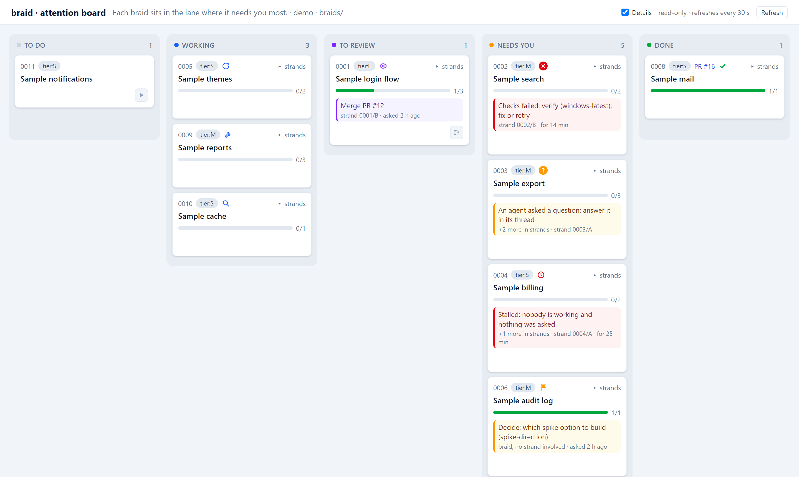
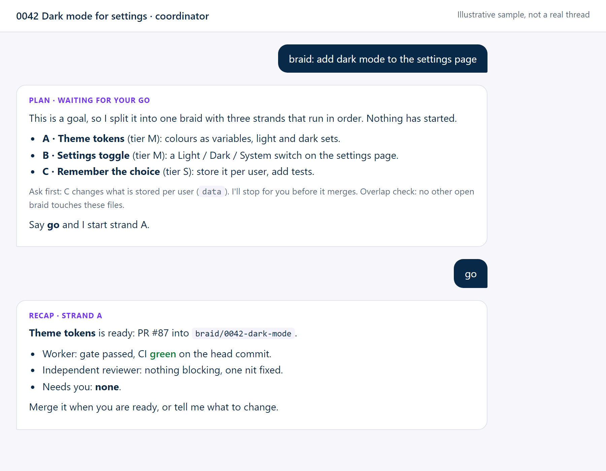
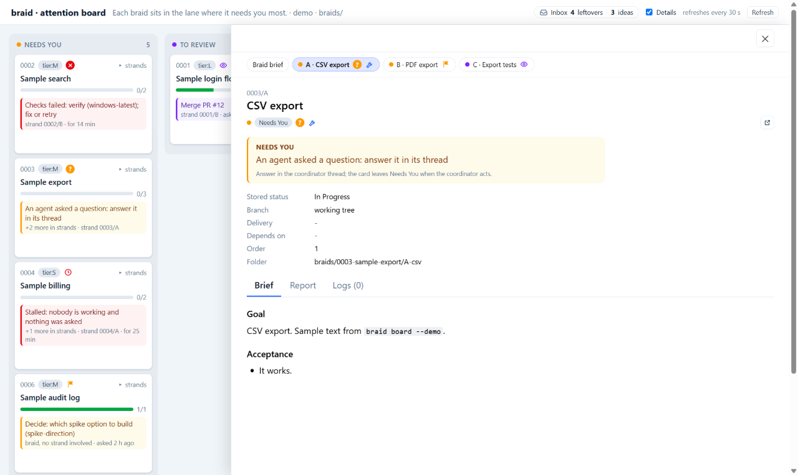
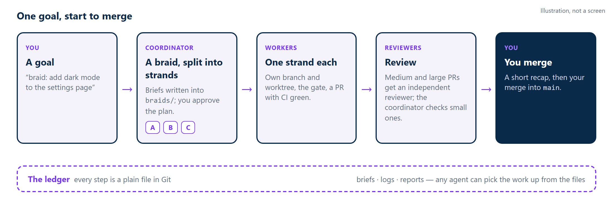
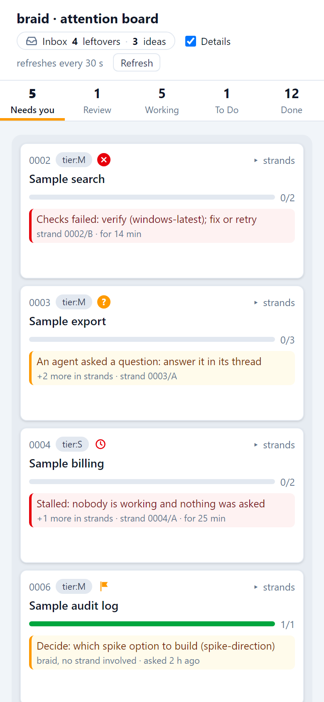
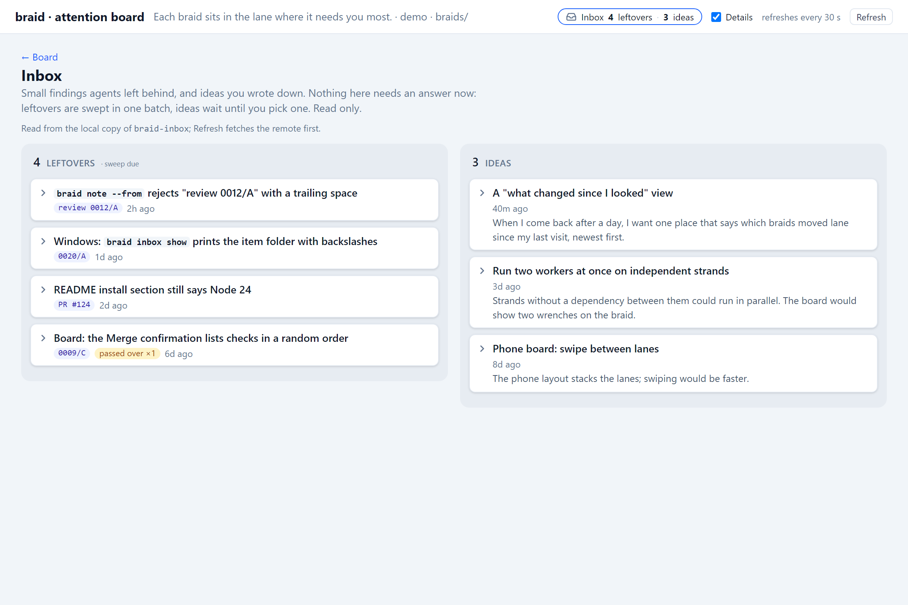

<p align="center">
  <picture>
    <source media="(prefers-color-scheme: dark)" srcset="design/logo/svg/braid-logo-primary-reversed.svg">
    
  </picture>
</p>

<p align="center"><strong>Orchestrates agents. Keeps the ledger. Braids the work.</strong></p>

<p align="center">
  <a href="https://github.com/exones/braid/actions/workflows/ci.yml"></a>
  <a href="LICENSE"></a>
</p>

Tell braid a goal. It splits the goal into small work items, has a coding agent build each one on its own branch, has the work reviewed, and hands you pull requests that are ready to merge. Everything is written down as plain files in your repository, so nothing depends on one chat staying alive.

<p align="center">
  
</p>
<p align="center"><em>The board on sample data: what needs you comes first, the rest stays out of your way.</em></p>

## What it can do

- **Plan a goal into reviewed pull requests.** Say "braid: add dark mode"; you get a plan to approve, then one PR per part.
- **Review before it reaches you.** Medium and large changes get an independent reviewer (you can set it to a different model than the worker's); the coordinator checks small ones itself, and in auto mode every strand gets a reviewer.
- **Resume from the files.** Briefs, logs and reports live in `braids/`; after a crash or in a new session any agent continues from them.
- **See what needs you.** `braid board` shows what waits on you, and can Start a braid, ask the coordinator to merge, and open an agent's thread.
- **Check in from your phone.** The board has a phone layout, and `braid board --host tailscale` serves it on your Tailscale network, to your own login only.
- **Stops and asks when a decision is yours.** Security, a new dependency, stored data, an effect outside the repository, a change of scope: it waits for you.
- **Auto mode for a goal.** Its strand PRs merge into the goal's branch once seven conditions hold; the final PR into `main` is always yours.
- **Capture ideas without breaking flow.** `$braid-idea` and `braid note` park an idea or a leftover in an inbox the board shows.
- **Works with Claude, Codex and Cursor.** braid is a set of agent skills plus a CLI that does the bookkeeping; agents run as threads in [T3 Code](https://github.com/pingdotgg/t3code).

## Why braid

| The problem | What braid does |
| --- | --- |
| Agents lose context between sessions. | Plan, decisions and progress are files in Git (brief, per-thread logs, report), so a fresh agent reads them instead of guessing. |
| Agent code goes in unreviewed. | One writer per branch, an independent reviewer on medium and large changes (the coordinator checks small ones), and a merge that is yours. |
| You can't tell what needs you. | The board puts what waits on you in its own lane, with the reason on each card; red only where something went wrong. |
| The work is stuck in one chat. | Items, not conversations, are the unit: any thread can pick one up from its folder in `braids/`. |

The reasons behind these choices are in [decisions](docs/decisions.md).

## A walk-through

You ask for dark mode. Here is what happens next.

1. **You state the goal** in a coordinator thread. braid plans it as one braid with three strands that run in order, and asks about anything risky (here, a change to what is stored per user) before it starts. You say go.

   

   *Illustrative mock-up, not a real thread: the plan, and later the recap.*

2. **A worker builds strand A** on its own branch and worktree, runs the project's gate and opens a PR with CI green.
3. **A reviewer checks the PR** against the brief (for a small strand, the coordinator reads the diff); findings go back to the worker.
4. **You get a recap** and merge or ask for changes. Until then the board shows the item where you can act on it:

   

   *An item's details open as a side panel over the board (sample data), here a strand with a question waiting for you.*

5. **Strands B and C follow.** In auto mode the strand PRs merge into the goal's branch for you; the final PR into `main` is yours either way.

   

   *Illustration of the flow, not a screen.*

Away from your desk, the same board fits a phone, and the inbox keeps ideas and leftovers from getting lost:

<p align="center">
  
  &nbsp;&nbsp;
  
</p>
<p align="center"><em>The phone layout (one lane at a time) and the inbox of leftovers, on sample data.</em></p>

## The parts

- **A coordinator** is the agent you talk to. It plans with you, launches the other agents and reports back.
- **Workers** each do one item on their own branch and worktree, run the gate and open a PR.
- **Reviewers** check medium and large PRs independently before they reach you.
- **Braids and strands:** a braid is a story or a goal; a goal is split into strands, its parts, which run in order.
- **The ledger** is the `braids/` folder: one folder per braid and strand with its brief, logs and report, plain Markdown in Git, managed with the `braid` CLI.

## Quick start

You need Node.js 26 (`>=26.13.0`), PowerShell 7.6+ and Git. The current CLI isn't on npm yet (the `@exones/braid@0.1.0` there is an older CLI, see [npm distribution](docs/npm-distribution.md)), so install it from a checkout:

```powershell
git clone https://github.com/exones/braid.git
cd braid
pwsh -NoProfile -File .\scripts\Install-Skills.ps1   # the skills for Claude, Codex and Cursor, plus the braid CLI
```

Then, in the repository you want braid to work on:

1. Add a `BRAID.md` from the [template](.agents/skills/braid/assets/braid-md.md): the gate command, the CI checks and the models per role.
2. Add `braids/**/temp/` to `.gitignore`, commit and push.
3. Open the repository as a T3 project and start a thread with `braid`: "braid: add dark mode to the settings page".

The details, including Backlog.md import and auto mode, are in [getting started](docs/getting-started.md).

## The CLI

```powershell
braid list               # braids and their strands, with status and run order
braid view 0002          # one braid: fields, report, logs, strands and its brief
braid new 'Search page'  # a new braid with the next free number
braid status 0008        # each strand: lane, branch, PR, CI checks, agent thread
braid board              # the board in your browser
```

The full list is in [the CLI reference](docs/cli.md).

## Documentation

| Page | What's in it |
| --- | --- |
| [Getting started](docs/getting-started.md) | Installing the skills and CLI, `BRAID.md`, setting up a repository, auto mode. |
| [CLI reference](docs/cli.md) | Every command, with examples and exit codes. |
| [The attention board](docs/board.md) | What `braid board` shows, how it decides, and its actions (Start, Merge, Open thread). |
| [The braids/ format](docs/braids-format.md) | The files in `braids/`, branches and each command's behaviour. |
| [Autonomy presets](docs/autonomy.md) | The preset file a braid runs on, the three shipped presets and `braid autonomy`. |
| [Workflow](.agents/skills/braid/references/workflow.md) | Items, tiers, branches, merges and checks. |
| [Skills](.agents/skills/braid/SKILL.md) | How agents plan ([braid](.agents/skills/braid/SKILL.md)), do ([worker](.agents/skills/braid-worker/SKILL.md)) and review ([reviewer](.agents/skills/braid-reviewer/SKILL.md)) items, and note your ideas for later ([idea](.agents/skills/braid-idea/SKILL.md)). |
| [Decisions](docs/decisions.md) | Current requirements and their reasons. |
| [Roadmap](docs/roadmap.md) | What comes next. |
| [npm distribution](docs/npm-distribution.md) | The release path and the steps before publication. |
| [Development](docs/development.md) | Building, testing, the gates and CI. |
| [Brand](design/README.md) | The logo, colours and their use. |

This repository is planned and built with braid: its own items are in [`braids/`](braids/), past epics in [`epics/`](epics/README.md). [`inspiration/`](inspiration/README.md) is reference material only; its permissions, hosts and credentials don't apply here.

## Contributing

Issues and pull requests are welcome. Building, testing and the pre-PR gate (`npm run verify`) are in [development](docs/development.md); agents also read [AGENTS.md](AGENTS.md).

## Licence

[MIT](LICENSE)
