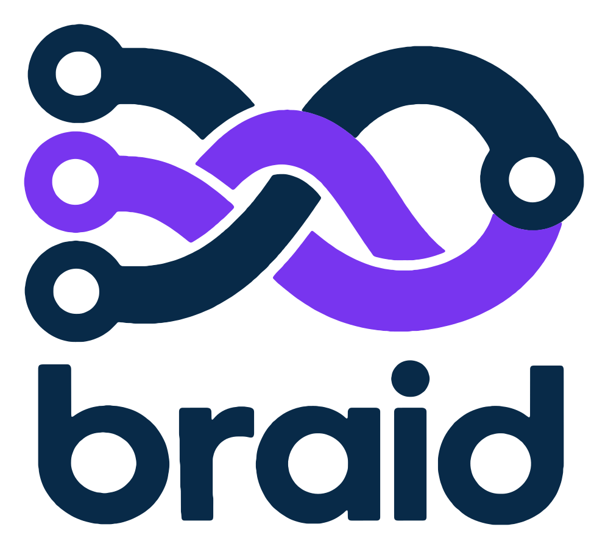

<p align="center">
  <picture>
    <source media="(prefers-color-scheme: dark)" srcset="design/logo/svg/braid-logo-primary-reversed.svg">
    
  </picture>
</p>

<p align="center"><strong>Orchestrates agents. Keeps the ledger. Braids the work.</strong></p>

<p align="center">
  <a href="https://github.com/exones/braid/actions/workflows/ci.yml"></a>
  <a href="LICENSE"></a>
</p>

braid runs a software project with coding agents: you state a goal, braid splits it into work items, gives each one to an agent, has another agent review it, and hands you the finished pull requests to merge. Every step is written down in your repository, so the work can be picked up from the files alone.

## What is braid

- **A coordinator** is the agent you talk to. It plans the work with you, launches the other agents and reports back.
- **Workers** each do one item on their own branch and worktree, run the project's gate and open a PR.
- **Reviewers** check each PR independently against its brief before it reaches you.
- **Braids and strands** are the work items: a braid is a story or a goal, and a goal's braid is split into strands, its parts, which run in order.
- **The ledger** is the `braids/` folder: one folder per braid and strand with its brief, logs and report, plain Markdown kept in Git and managed with the `braid` CLI.
- **You merge.** braid never merges into `main` unless you tell it to, and it stops and asks when a decision is yours.

braid ships as agent skills (`braid`, `braid-worker`, `braid-reviewer`) for Claude, Codex and Cursor, plus the `braid` CLI they use. Agents run as threads in [T3 Code](https://github.com/pingdotgg/t3code).

## How it works

1. **Plan.** Tell the coordinator a goal in a thread. It writes the braids and strands into `braids/` and waits for your go.
2. **Work.** It starts each strand on its own branch and launches a worker, which implements it, runs the gate and opens a PR with CI green.
3. **Review.** A reviewer agent checks the PR against the brief; findings go back to the worker.
4. **Merge.** You get a short recap and merge. For a goal, auto mode can merge strands into the goal's branch for you; the final PR into `main` is always yours.
5. **Watch.** `braid board` shows where the work needs you.

<p align="center">
  
</p>

## Quick start

You need Node.js 26 (`>=26.13.0`), PowerShell 7.6+ and Git. braid isn't published on npm yet, so install it from a checkout:

```powershell
git clone https://github.com/exones/braid.git
cd braid
pwsh -NoProfile -File .\scripts\Install-Skills.ps1   # the skills for Claude, Codex and Cursor, plus the braid CLI
```

Then, in the repository you want braid to work on:

1. Add a `BRAID.md` from the [template](.agents/skills/braid/assets/braid-md.md): the gate command, the CI checks and the models per role.
2. Add `braids/**/temp/` to `.gitignore`, commit and push.
3. Open the repository as a T3 project and start a thread with `braid`: "braid: add dark mode to the settings page".

The details, including Backlog.md import and auto mode, are in [getting started](docs/getting-started.md).

## The CLI

```powershell
braid list               # braids and their strands, with status and run order
braid view 0002          # one braid: fields, report, logs, strands and its brief
braid new 'Search page'  # a new braid with the next free number
braid status 0008        # each strand: lane, branch, PR, CI checks, agent thread
braid board              # the read-only board in your browser
```

The full list is in [the CLI reference](docs/cli.md).

## Documentation

| Page | What's in it |
| --- | --- |
| [Getting started](docs/getting-started.md) | Installing the skills and CLI, `BRAID.md`, setting up a repository, auto mode. |
| [CLI reference](docs/cli.md) | Every command, with examples and exit codes. |
| [The attention board](docs/board.md) | What `braid board` shows and how it decides. |
| [The braids/ format](docs/braids-format.md) | The files in `braids/`, branches and each command's behaviour. |
| [Workflow](.agents/skills/braid/references/workflow.md) | Items, tiers, branches, merges and checks. |
| [Skills](.agents/skills/braid/SKILL.md) | How agents plan ([braid](.agents/skills/braid/SKILL.md)), do ([worker](.agents/skills/braid-worker/SKILL.md)) and review ([reviewer](.agents/skills/braid-reviewer/SKILL.md)) items. |
| [Decisions](docs/decisions.md) | Current requirements and their reasons. |
| [Roadmap](docs/roadmap.md) | What comes next. |
| [npm distribution](docs/npm-distribution.md) | The release path and the steps before publication. |
| [Development](docs/development.md) | Building, testing, the gates and CI. |
| [Brand](design/README.md) | The logo, colours and their use. |

This repository is planned and built with braid: its own items are in [`braids/`](braids/), past epics in [`epics/`](epics/README.md). [`inspiration/`](inspiration/README.md) is reference material only; its permissions, hosts and credentials don't apply here.

## Contributing

Issues and pull requests are welcome. Building, testing and the pre-PR gate (`npm run verify`) are in [development](docs/development.md); agents also read [AGENTS.md](AGENTS.md).

## Licence

[MIT](LICENSE)
