## What changed

`docs/design/board-mockups/actions.html`: static mockups (demo data, no server or React code) of the three board actions, light and dark (`actions.html#<view>&light` or `&dark`). PNGs of each view are `actions-<view>-<theme>.png` beside it.

1. **start**: Start on To Do cards (card and row buttons are icon-only: name and disabled reason in the tooltip, plus an aria-label; dialog buttons keep their words); no open button without a thread.
2. **confirm**: Start confirmation: new coordinator thread, T3's project default model vs BRAID.md, base branch.
3. **warn**: same dialog when T3's model differs from BRAID.md (warning; "Start anyway").
4. **running**: Start waiting, started (card in Working), and a failed launch with its reason.
5. **merge**: Merge on a To Review strand; dialog with PR, head commit, target branch, checks.
6. **merging**: merging (button off) and merged.
7. **refuse**: head moved; checks not green.
8. **thread**: open-thread icon on cards and strand rows with a thread, none elsewhere.
9. **disabled**: Start without T3, Merge with failing or running checks; reason in a tooltip.

## Why

The user reviews the design before anything is built (D40).

## Validation

Rendered every view in both themes with headless Chrome and looked at the screenshots. `npm run verify` passes.

## Screenshots

**start**

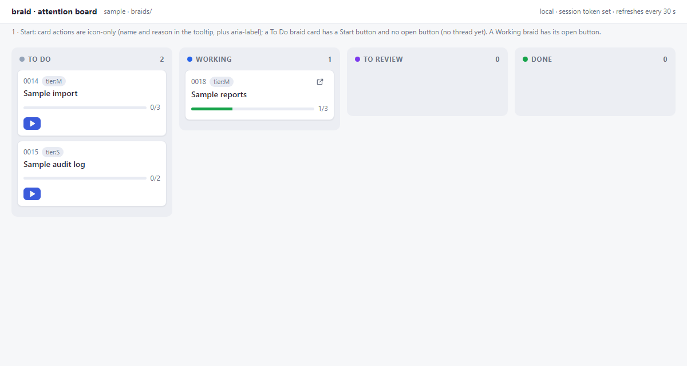 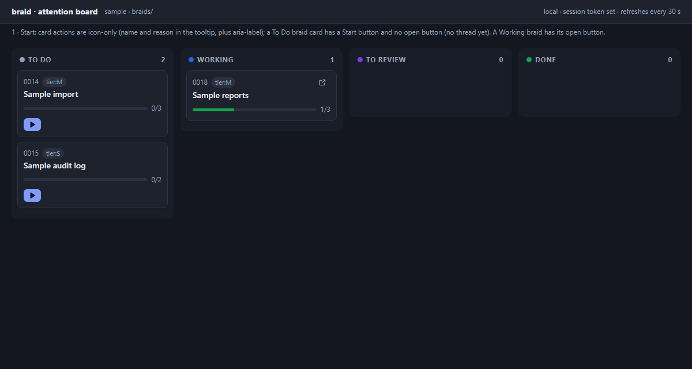

**confirm**

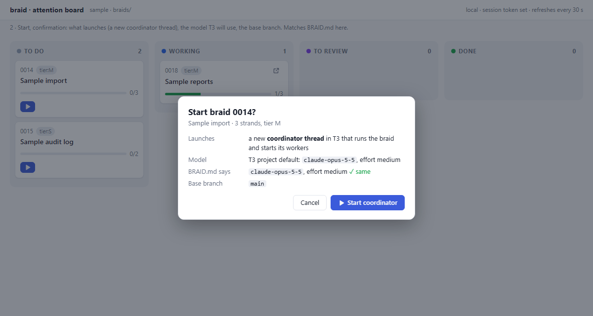 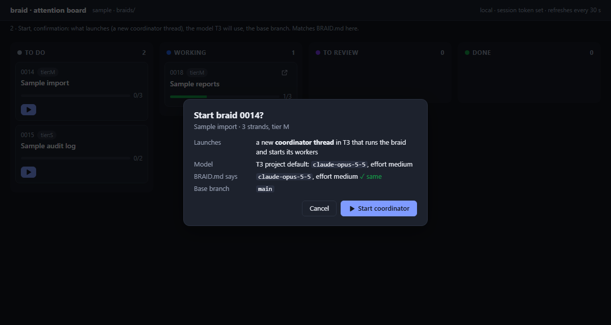

**warn**

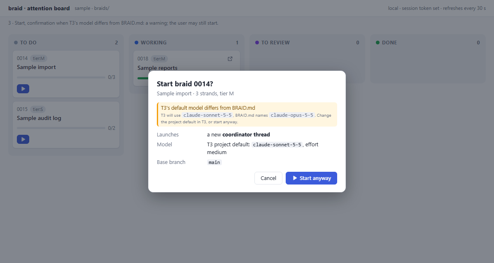 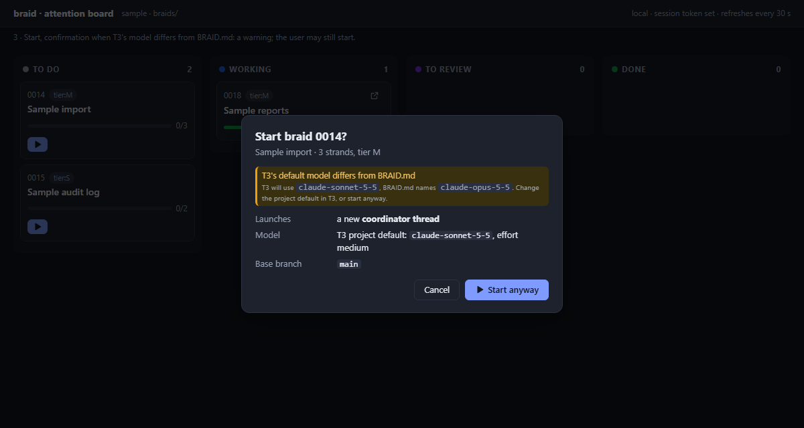

**running**

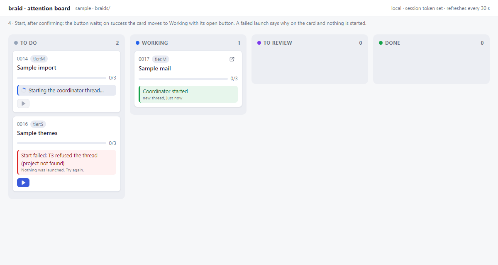 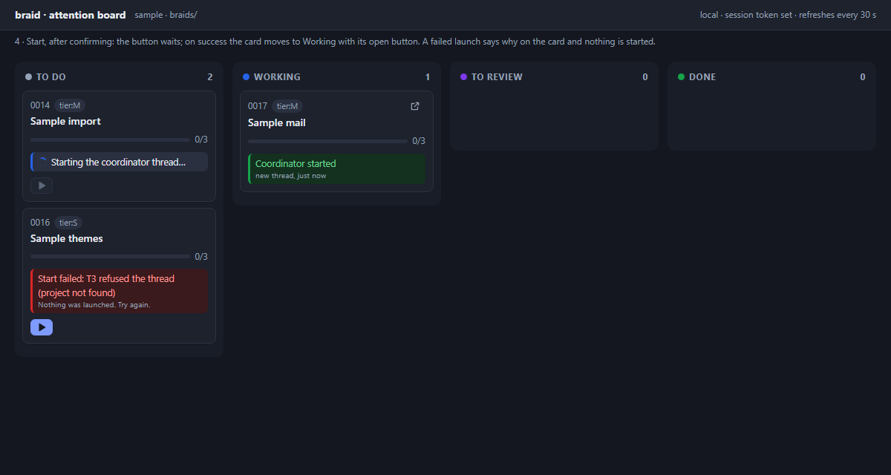

**merge**

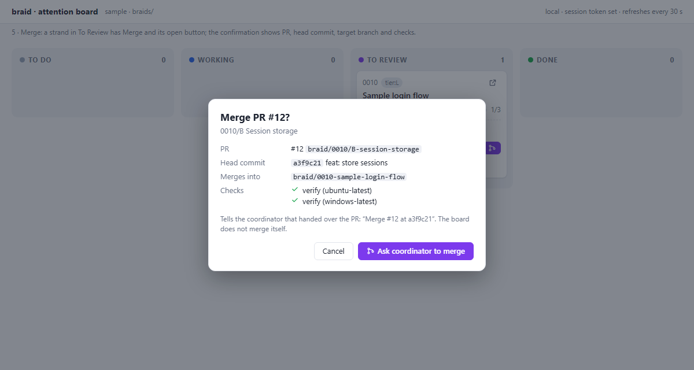 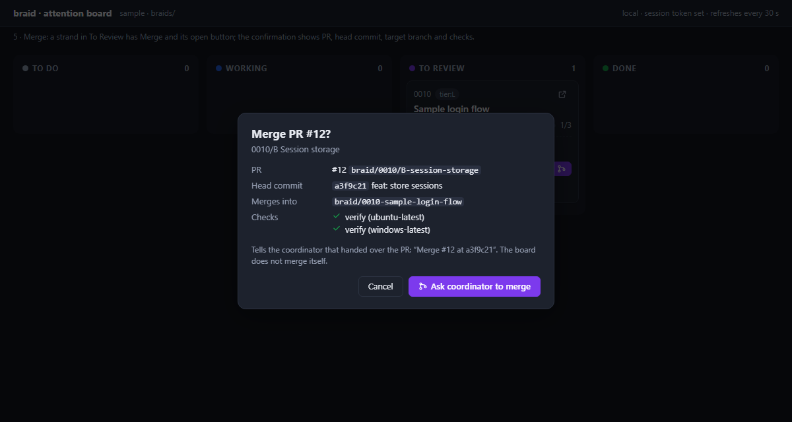

**merging**

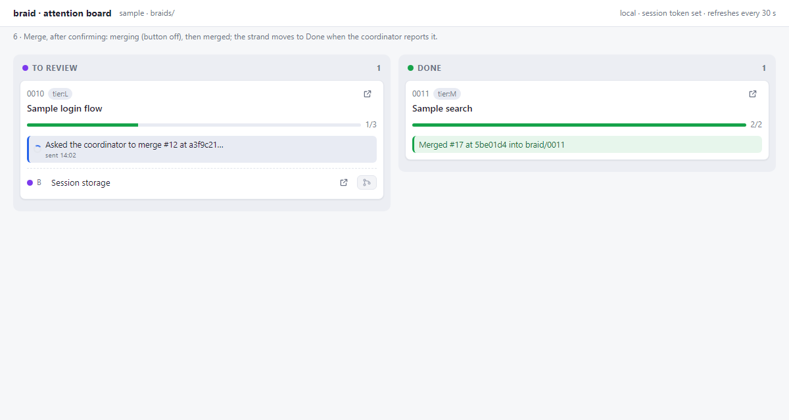 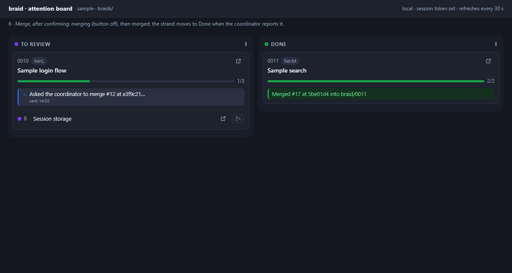

**refuse**

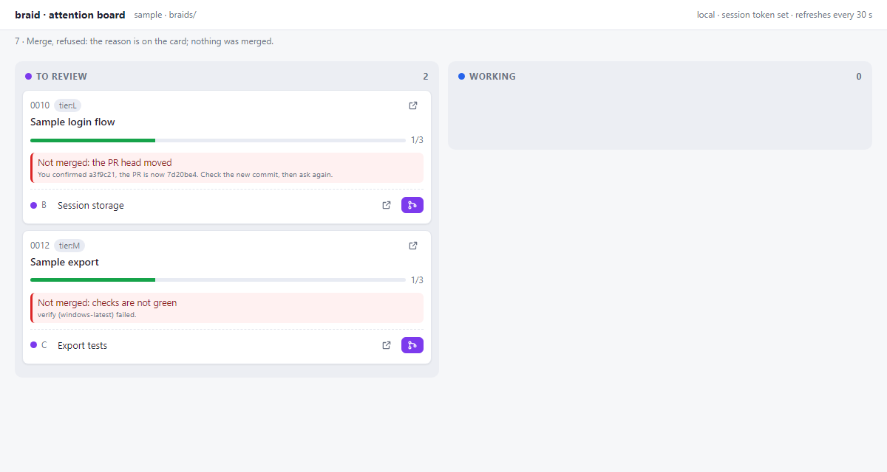 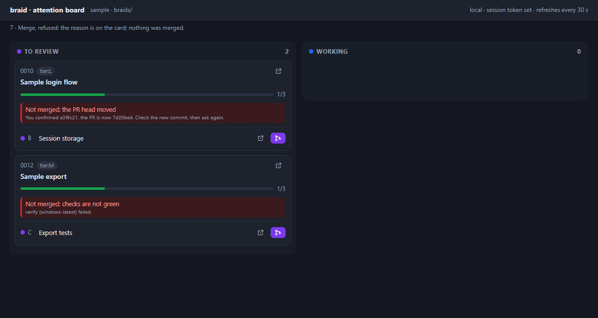

**thread**

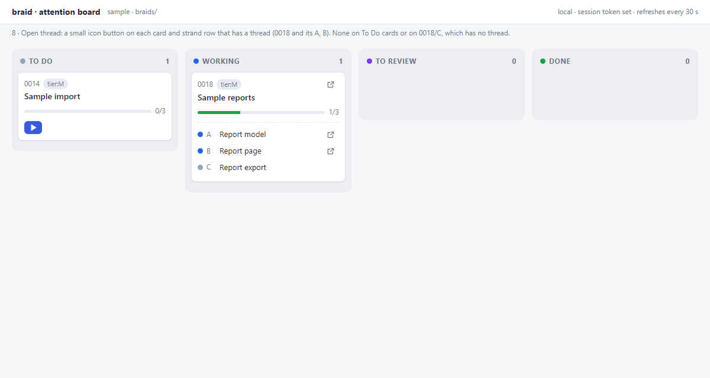 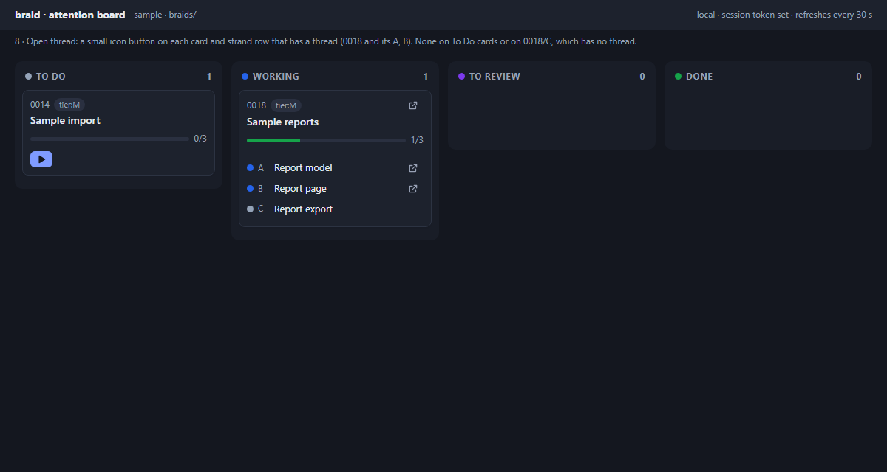

**disabled**

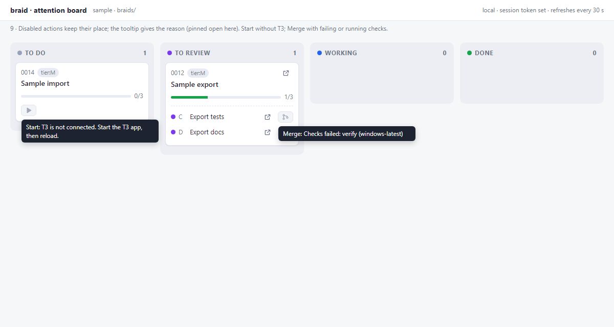 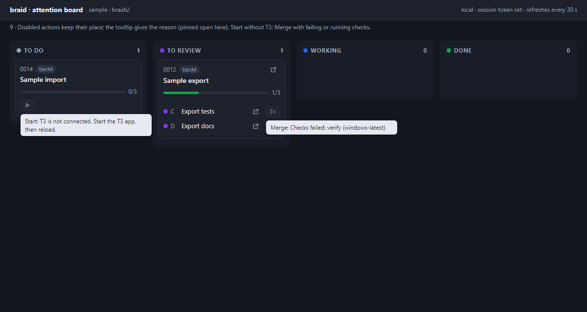

## Open

- The disabled-tooltip view pins one tooltip per row, so the second Merge's reason ("Checks are still running.") shows only on hover.
- The Merge button sits on strand rows (a strand has the PR); a single-story card in To Review would carry it on the card.

For later items: none.
Needs the user: review the mockups; approve or ask changes before strands B to D build anything.
