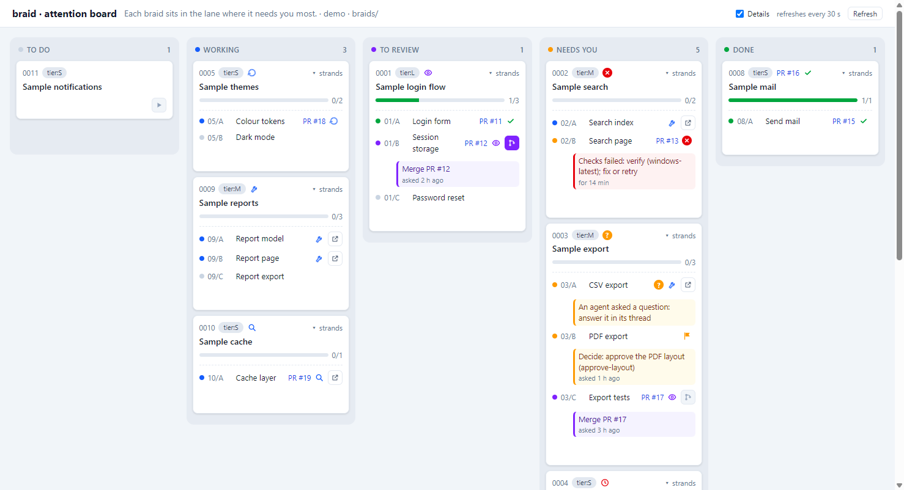
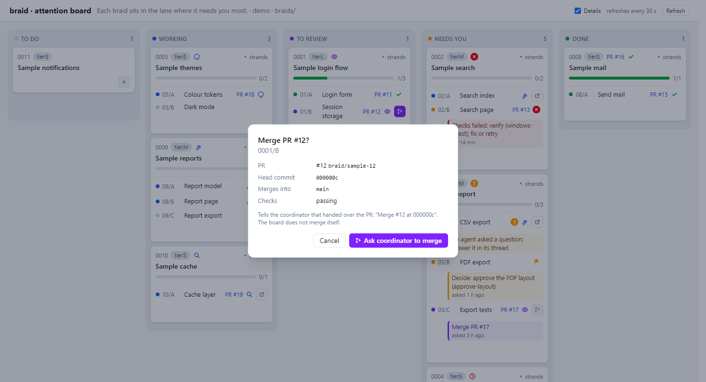
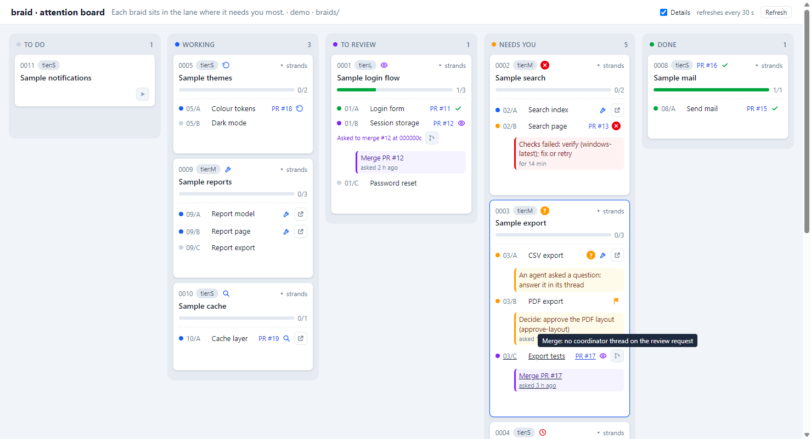

## What changed

- **Open thread:** the board data carries `thread` (the T3 link of an item's running worker, else reviewer) on cards, strand rows and item pages; a small button opens it. No thread, no button.
- **Merge on request:** `merge` in the board data (PR, head, target branch, checks, and the reason it's off). The Merge button opens the approved confirmation; on confirm the `merge` action (`mergeAction`, `src/commands/board.ts`) reads GitHub and the requests again and refuses with the reason unless the review request is open with a coordinator thread, the PR head is the shown one and the checks are green. Then it sends that thread `Merge #<n> at <head>, from the board.` with `t3 thread send`. The card shows "Asked to merge #n at <head>" and Merge stays off until the PR merges or the head changes. Off with `Merge: <reason>` for no open review request, no coordinator thread, a closed PR or failing, running or missing checks.
- The PR gets `base` and `branch` (`gh pr list` now asks for `baseRefName`); the demo has thread links, a review request with a thread (0001/B) and one without (0003/C).
- Skill "Merge on request" covers the board's message. Docs: `docs/board.md`, new D51, D50 reworded for requests without `Origin`; "read-only" removed from the CLI help, `docs/cli.md`, `README.md`, `docs/getting-started.md`, `docs/braids-format.md` and the page header.
- Tests (`test/board-merge.test.ts`, `test/board-actions.test.ts`): thread links in demo data; merge info and reasons; the message sent to the request's thread with the confirmed head, with a fake `t3`; refusals for no request, no thread, red or running checks, a moved head and `t3` failing (nothing sent); a body over 64 KB gets 413 and runs no action; no `Origin` passes with token and `Host`.

- Review changes (the user's, 2026-11-17): the skill's "Merge on request" has the board's message in a sentence of its own, with the same meaning; a braid with strands whose lane would be To Do shows Working when its own status is In Progress or a strand is Done (`braidLane` in `src/board/model.ts`, tested in `test/lanes.test.ts`); the confirmation quotes the full message, ", from the board." included.

## Why

The user's decision of 2026-11-17: the board asks the coordinator that handed the PR over; it doesn't merge (D51).

## Validation

`npm run verify` passes. Drove the built page on `braid board --demo` with headless Chrome: opened the confirmation, confirmed (demo fakes the action), saw the asked state and the disabled tooltip.

## Screenshots

The app has no dark theme (only the 0009/A mockups drew one), so these are light only.

## Open

- A braid card with strands has no Open thread: its coordinator isn't an agent of any item, so the board doesn't know that thread (the mockups drew one). Strand rows carry theirs. Showing the coordinator needs T3 threads that aren't item agents to be read; not done here.
- Decisions (the user's, 2026-11-17): the two review changes above, and the full message in the confirmation.
- The "asked" state lives in the page (`sessionStorage`), keyed by item and head, not on the server: a second browser shows Merge on again.
- The confirmation shows the head as a short sha without its commit subject (the mockup had the subject).
- `t3 thread send` was only run against a fake `t3`; the real command wasn't called.

For later items: show the coordinator's thread on braid cards; keep "asked" server-side.
Needs the user: none
