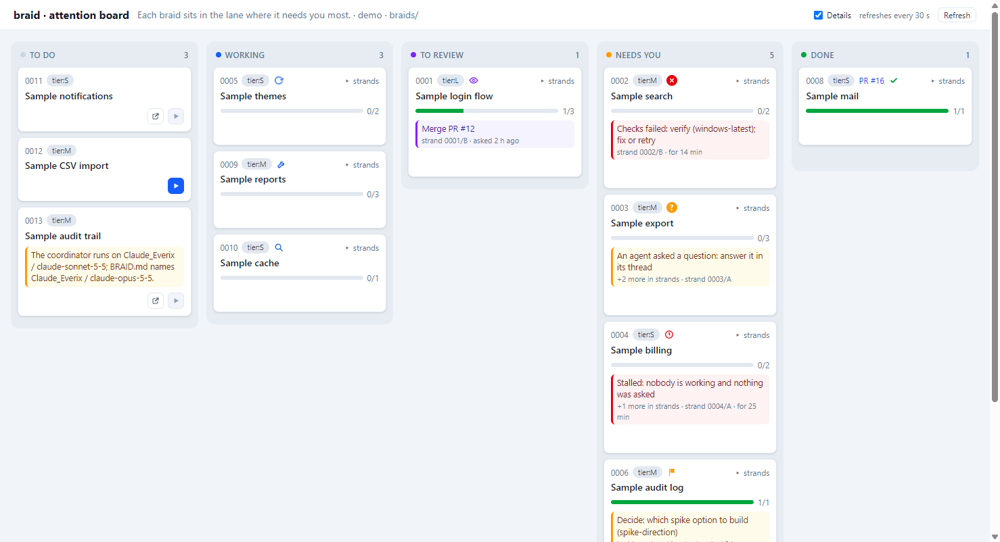
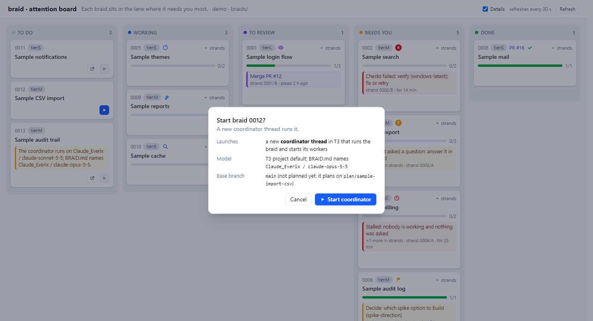
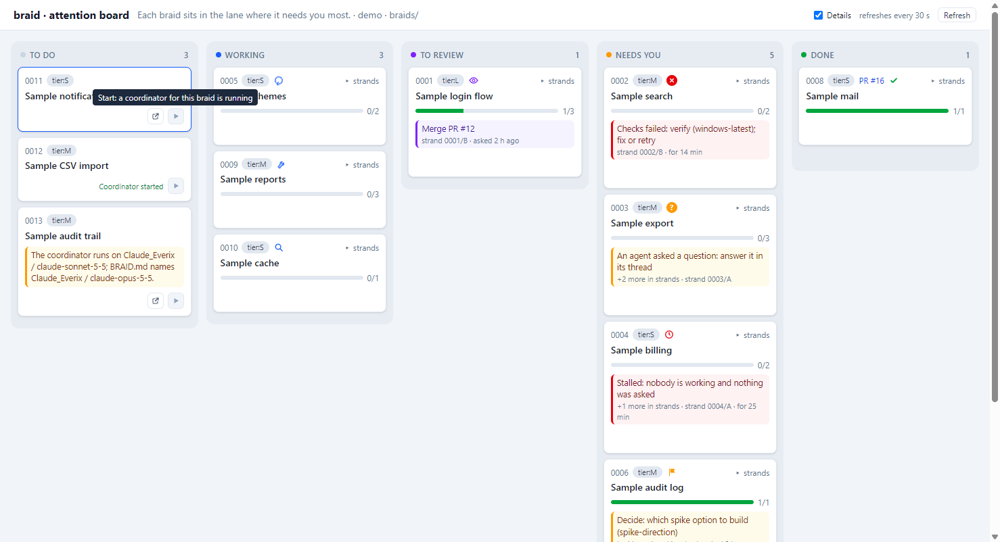

# 0009/D report

**What changed:** **Start** on a To Do braid card launches a new coordinator thread in T3. After a confirmation the board posts `start`; the server recomputes the card, refuses with `Start: <reason>` when it is off, and runs `t3 thread start <main checkout> - --title "<repo> <id> coordinator: <title>" --worktree <base> --branch <name> --json` with the first message (`Use the braid skill and run <id>.` plus where the worktree stands) on standard input and no model flags. Then it reads the thread with `t3 thread show --json` and returns a warning when the provider or model differ from `BRAID.md`'s coordinator. Running coordinator threads (running, titled `<repo> <number> coordinator: …`) are read from `t3 thread list`: the card shows a warning in the Needs You note style when its model differs, and an open button.

- **Base and branch (as built):** a braid whose brief was read from a braid branch starts from it on `coordinator/<number>-<slug>` (Git allows a branch in one worktree only; the coordinator switches to the braid branch, and the first message says so). A braid not planned yet starts from the main branch on `plan/<slug>`, where the coordinator plans it.
- The first message for a braid with a braid branch says it is resuming a braid it didn't plan (skill: "Resuming"), to `git switch` to the braid branch, and what to do if that fails (work on the `coordinator/…` branch merged up, or `braid ask`).
- **Start is off** with the tooltip `Start: <reason>`: the braid isn't To Do, a coordinator for it is running, T3 isn't reachable.
- `BRAID.md`: coordinator effort is `medium`. `docs/board.md` has a Start section; D52 in `docs/decisions.md`.
- The demo has two new To Do braids (0012 startable, 0013 with a coordinator on another model) next to 0011 (coordinator running).

**Why:** the user starts a braid from the board without knowing T3's settings; the warning keeps a wrong project default visible, since `t3 thread start` has no effort option (T3 0.1.6).

**Validation:** `npm run verify` passes (207 tests). New `test/board-start.test.ts`, against the demo data and a fake `t3`: the exact `start` arguments, title and standard input; base and branch for a planned and an unplanned braid; the warning for another model and for another provider, and none for a match; the three disabled reasons (card and action); a failed launch; shell characters stripped from the title (it goes through `cmd.exe` on Windows); coordinator threads read from `thread list`; `BRAID.md` parsing. The real `t3 thread start` was not run (it would start a thread); its `--help` and the list/show output were read.

## Screenshots

Light only: the app has no dark theme (only the 0009/A mockups drew one).

## Open

- The confirmation can't warn about T3's project default before the launch: the CLI doesn't expose it. It names what `BRAID.md` expects; the warning comes after the launch, as the brief says (the mockups warned at confirm time).
- The output of `t3 thread start --json` was not seen; the id is read from `threadId`, `id` or `thread.threadId`. If none is found the launch still counts and the card refreshes from `thread list`.
- A second Start for a braid whose `plan/<slug>` or `coordinator/…` branch already exists (the earlier coordinator stopped) fails with T3's own message shown in the dialog.
- "Coordinator started" and the launch's warning live in the page until the next refresh shows the running thread (the warning shows on the card only, not on the braid page).
- A braid with strands now shows an open button for its running coordinator (the 0009/C open item).

For later items: pass the settings explicitly once `t3 thread start` has `--option`; start a single strand (not in scope).
Needs the user: none
