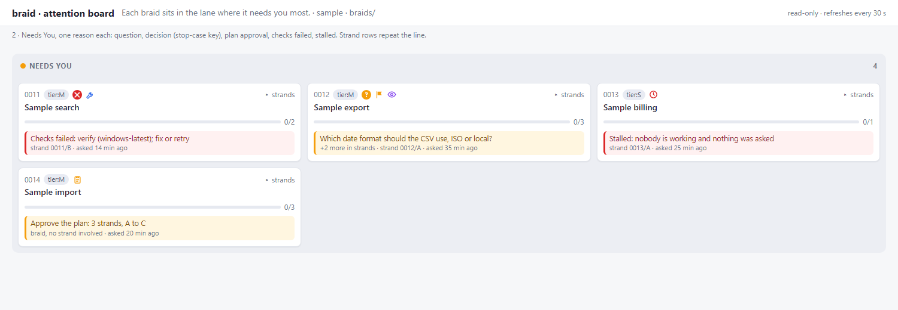
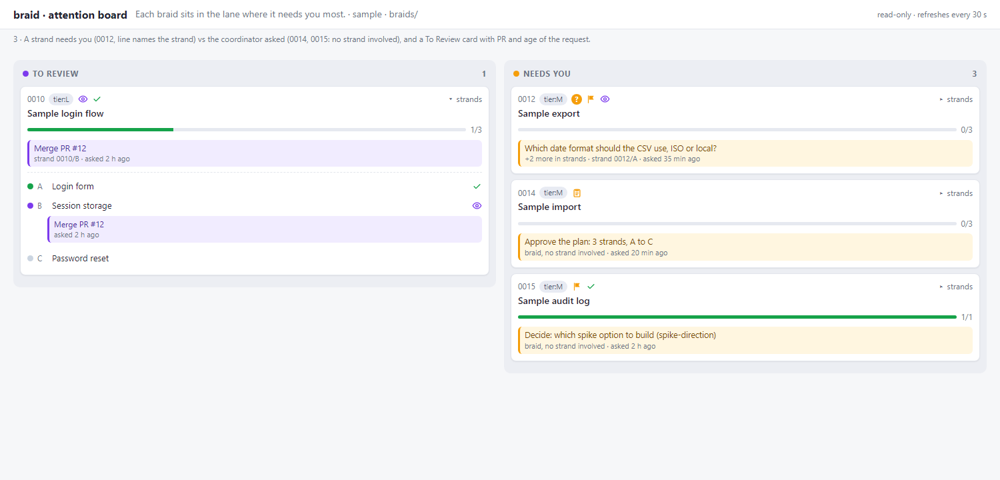

# Report: mockups, five lanes and what is needed

The design to approve. Nothing is built; `src/` is untouched. The page is [needs-you.html](../../../docs/design/board-mockups/needs-you.html) (open it with `#board`, `#needs`, `#braids`, `#working`, `#legend`, `#page`), on demo-style data, with the approved CSS and icons.

## What the design says

- **One new thing on a card: a request line**, text, under the progress bar. Amber = you must answer (question, decision, plan), red = something broke (checks failed, stalled), purple = a PR waits for you to merge. Small print under it: which strand asked (or "braid, no strand involved") and how long ago.
- A braid card shows the line of its most urgent request (its own, else the most urgent strand's); with several, "+N more in strands". Expanded, each strand row repeats its own line.
- Working and To Do cards carry no line: nothing is asked of you.
- No lane text on cards, as decided.

## Screenshots

1. The board, all five lanes: 
2. Needs You, one card per reason (question, decision with its stop-case key, plan approval, checks failed, stalled): 
3. A strand needs you (0012) vs the coordinator asked (0014 plan, 0015 decision: no strand involved), and To Review with PR and request age: 
4. Working: agents running, only CI running, only a review running: 
5. Legend: 
6. A braid page shows the request as a banner: 

## New icons (only where a reason had none)

Plan approval (amber clipboard), stalled (red clock), checks running (blue spinner), review running (blue eye). Decision reuses the amber flag, now meaning "decision needed: key"; it is no longer an `ask:` label.

## Questions for the user

- "Review running" (blue eye) is close to "PR to review" (purple eye). Keep, or use another glyph?
- A card with strands in several states shows the single most urgent line; is "+N more in strands" enough?
- The banner on a braid page is read-only text. A "copy answer command" button was left out; add one?

Acceptance "user approved" stays open until the user decides.

For later items: 0015/D builds the request line, the four icons and the banner; the `ask:<key>` flag in `docs/board.md` is replaced by requests. Names for requests' kinds in the UI: question, decision, plan, review.

Needs the user: design approval of the six screens above.
