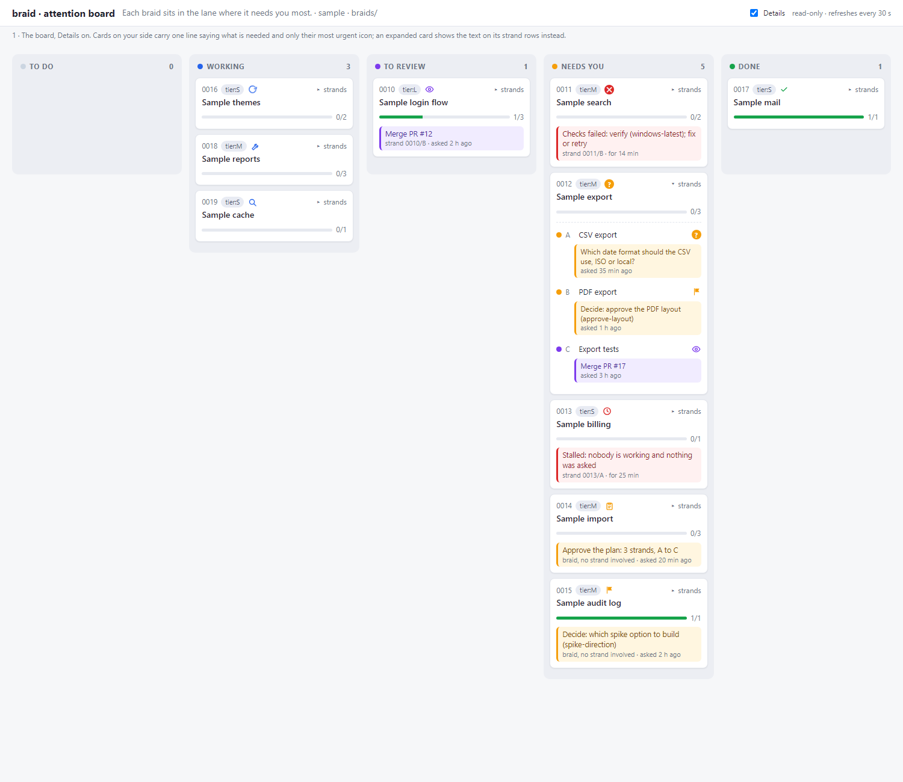
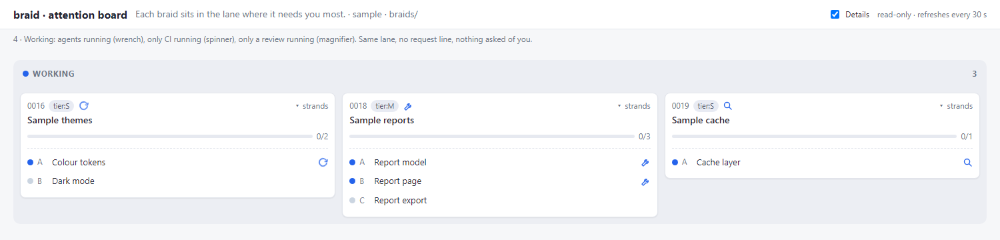
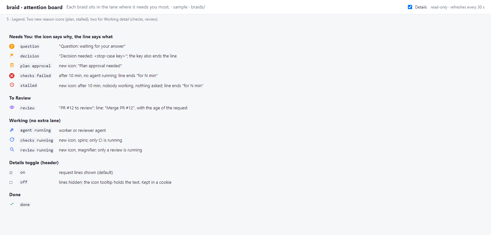
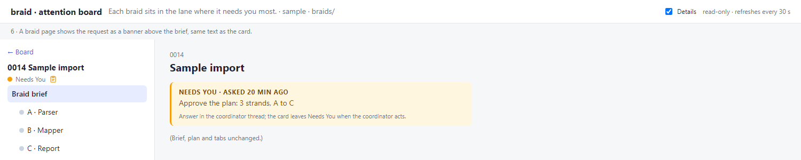
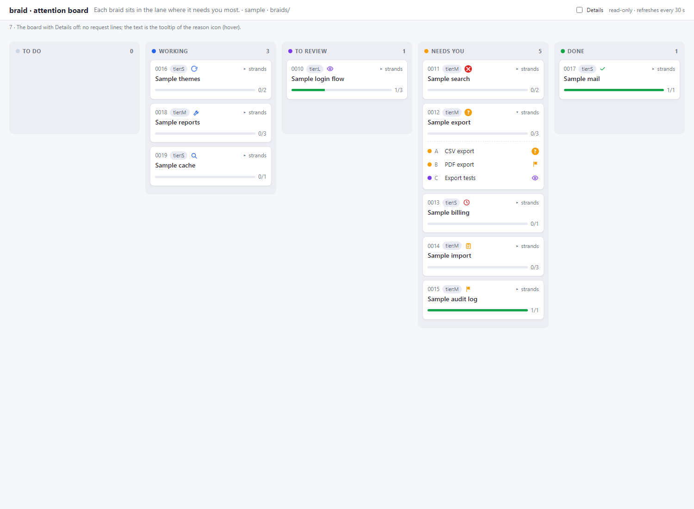
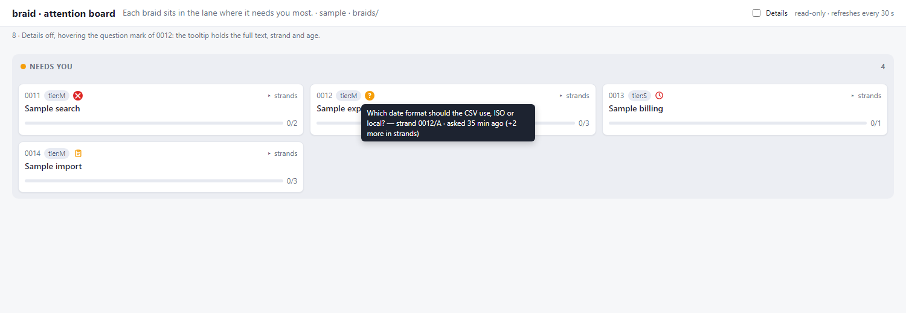

# Report: mockups, five lanes and what is needed

The design to approve (round 1 review applied). Nothing is built; `src/` is untouched. The page is [needs-you.html](../../../docs/design/board-mockups/needs-you.html) (views `#board`, `#needs`, `#braids`, `#working`, `#legend`, `#page`, `#off&details=off`, `#tip&details=off&tip=1`), on demo-style data, with the approved CSS and icons.

## What the design says

- **A request line on a card**, text, under the progress bar. Amber = you must answer (question, decision, plan), red = something broke (checks failed, stalled), purple = a PR waits for you to merge. Small print: the strand (or "braid, no strand involved") and the time: "asked 35 min ago" for requests, "for 14 min" for things that broke, since nobody asked.
- **One icon on your side.** A To Review or Needs You card shows only its most urgent icon (no wrench next to "checks failed"). Working, To Do and Done cards keep all their icons.
- A braid shows the request of its own or of its most urgent strand; with several, "+N more in strands". **Expanded**, the card's own line is hidden and each strand row carries its own line, so no text shows twice.
- Working and To Do cards carry no line: nothing is asked of you. No lane text on cards. The board stays read-only (no answer button).
- **Details toggle** in the header, kept in a cookie (`details=on|off`, one year). On: request lines as above. Off: lines hidden; the full text (with strand, age and "+N more") becomes the tooltip of the card's reason icon, and of a strand row's icon when expanded. In the mockup the cookie is read and written, and the hash `&details=off` forces a state for screenshots; the tooltip is drawn in CSS because headless screenshots can't show native ones (the build can use `title`).

## Screenshots

1. Board, Details on: 
2. Needs You, one reason per card (question, decision with key, plan, checks failed, stalled): 
3. A strand needs you (0012) vs the coordinator asked (0014 plan, 0015 decision), and To Review with PR and age: 
4. Working: agents, only CI, only a review: 
5. Legend, with the toggle: 
6. A braid page shows the request as a banner: 
7. Board, Details off: 
8. Details off, tooltip open on the question mark: 

## New icons (only where a reason had none)

Plan approval (amber clipboard), stalled (red clock), checks running (blue spinner), review running (blue magnifier; the purple eye stays "PR to review"). Decision reuses the amber flag, meaning "decision needed: key".

Acceptance "user approved" stays open until the user decides.

For later items: 0015/D builds the request line, the icons, the banner and the Details toggle with its cookie; the `ask:<key>` flag in `docs/board.md` is replaced by requests. Request kinds in the UI: question, decision, plan, review; broke kinds: checks failed, stalled.

Needs the user: design approval of the eight screens above.
