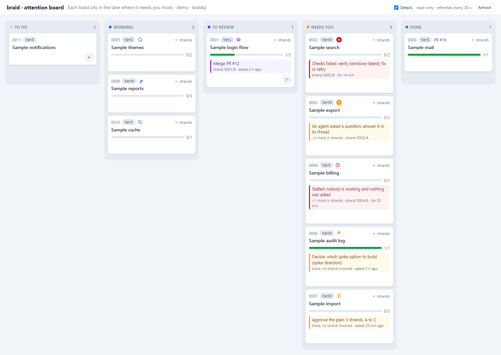
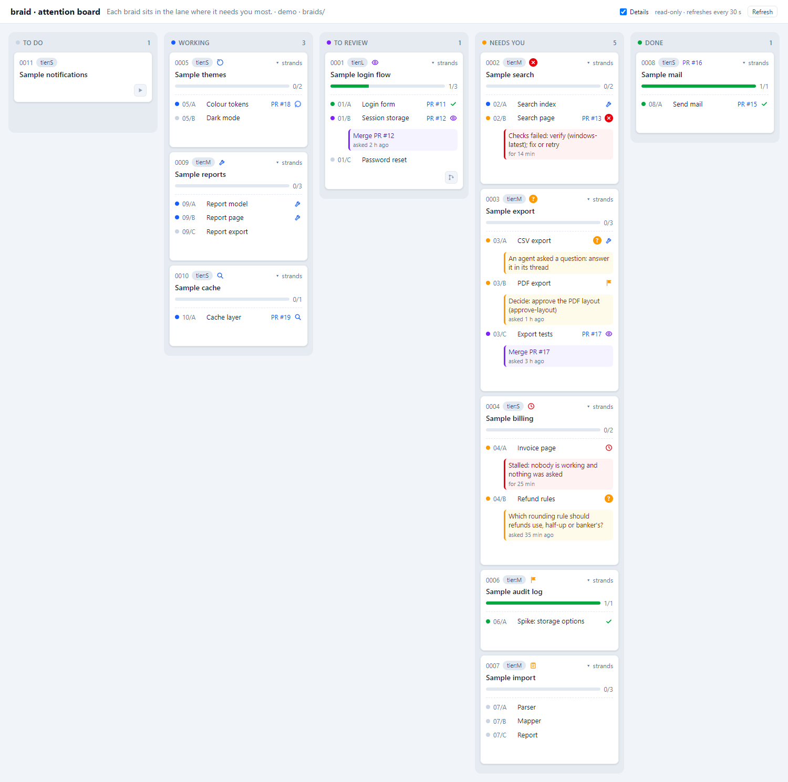
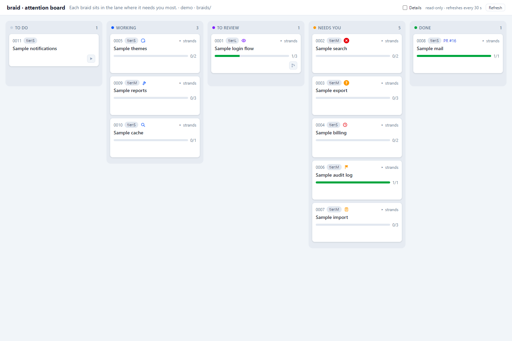
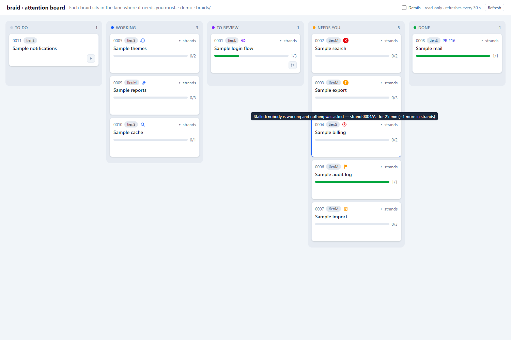
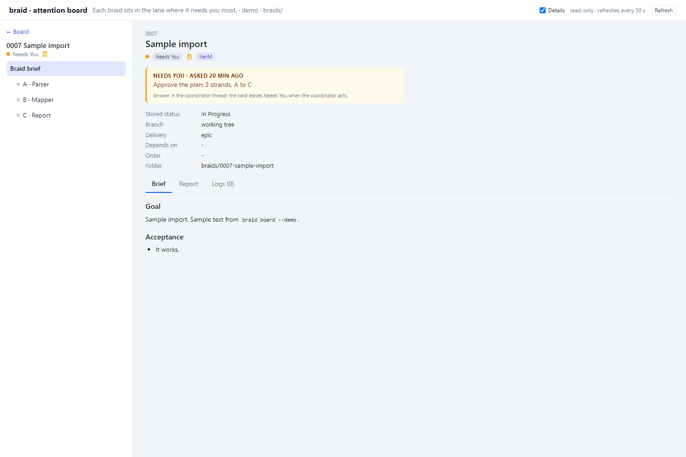
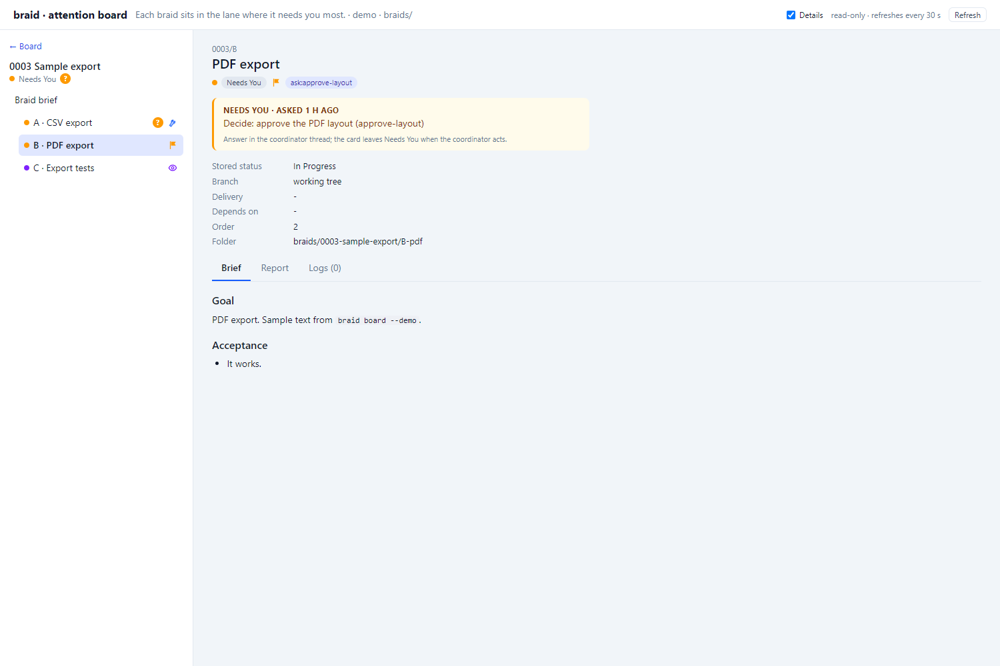

# 0015/D: Board: lanes from requests and broke alarms

## What changed

- **Lane rules** (`src/board/model.ts`, `derive`), first match wins: merged PR or stored Done is Done; an open `review` request is To Review; another open request, or a running agent's pending question, is Needs You with its text; a stored Done next to an open PR is To Review "Merge PR #N"; a broke alarm is Needs You with its reason; started (stored In Progress, an agent running, or an open PR) is Working; else To Do. An open PR without a review request is Working.
- **Broke alarms**, shown only after 10 minutes: `checks failed` (red checks, no agent of the item) and `stalled` (In Progress, no request, no agent, no checks pending). The first sighting is kept in `.braid/broke.json` of the main checkout (`src/board/signals.ts`), shared by the board and `braid status`; a condition that stops holding starts from zero, one that can't be told (GitHub or T3 unreadable) neither starts nor stops the clock.
- **Agents** (`src/board/t3.ts`, `src/braids/worktrees.ts`): a running T3 thread whose worktree is `<worktrees>/<repo>/<number>[-<letter>][-review]`; nothing else joins an item. The coordinator's thread is never one, so `braid done` lost its `--thread` caller skip (`--thread` is only for `--log` now). Stopped threads and PR-link joining are gone (the "agent stopped" reason is replaced by "stalled").
- **Requests** are read through `src/braids/requests.ts` only (`loadRequests`, `filterLive` with the PR's head from `gh pr list`). A braid shows the most urgent of its strands and its own request, its own first on a tie.
- **Cards, `braid status`, page** (`src/board/marks.ts`, `web/src/App.tsx`, `src/commands/coordinate.ts`): the request line with its age and strand, plan/stalled reason icons, wrench/magnifier/spinner activity icons, the banner on the item page, and the **Details toggle** (header; cookie `details`; off moves the text to the reason icon's tooltip). `braid status` prints the board's lane labels and a second line with the same text.
- **`braid start <id> --review`** adds the reviewer's detached checkout of the open PR head in `<repo>/<number>-<letter>-review`; `braid clean` removes it with the merged item.
- **Store lock hardening** (`takeOverStale` in `src/braids/requests.ts`): a lock older than 30 s is taken over under a short guard file, with the staleness checked again under it, so two waiters never both take it. `.braid/` now carries a `.gitignore` of its own so state files never show as untracked.
- **Demo** (`src/board/demo.ts`): 11 sample braids covering every lane, every request kind, both alarms and the three Working icons.
- **Docs**: `docs/board.md` rewritten; D46 in `docs/decisions.md` (replaces D32's lane rules where they differ); `docs/braids-format.md` (status, start --review, clean, done, lock); screenshots in `docs/design/board-screenshots/`.

## Why

States design in `braids/0015-needs-you-when-the-coordinator-waits/states.md`: an item is on the user's side only through an explicit request or a detected break, and the coordinator can never count as an agent.

## Validation

- `npm run verify` passes (169 tests). New or rewritten: `test/lanes.test.ts` (each lane rule, both alarms with fake GitHub, T3 and requests: reviewer checkout is Working, coordinator alone is not, nine minutes shows nothing), `test/marks.test.ts`, `test/t3.test.ts`, `test/coordinate.test.ts` (status text and the 10-minute clock through the real store file), `test/start.test.ts` (`--review`, clean), `test/requests.test.ts` (stale takeover, six processes on a stale lock, the state folder's `.gitignore`), `test/done.test.ts`, `test/github.test.ts`.
- Screenshots below are from `braid board --demo`, taken in headless Edge. The board server and the browser were stopped afterwards.

## Open

- The request's `--thread` is still stored but nothing reads it.
- The first sighting of a broke condition is written by whoever reads first (board or `braid status`), without a lock; two readers racing only delay an alarm.
- The T3 link for a worker started by hand outside the braid worktree folder is no longer joined to its item (by design), so such a thread shows no agent.

For later items: `readT3(root, options)` no longer takes GitHub; `Sources.t3(fresh)`; `T3Thread` has `role` instead of `state`; `Marks.running` became `Marks.activities`; the "agent stopped" reason is gone; `braid done` ignores `--thread` for the running check. 0015/E (the skills) should tell the coordinator that `braid start <id> --review` is the reviewer's step and that a stalled item means it forgot `braid ask`. Idea: an `age` of a stalled alarm could also appear in `braid requests`.

Needs the user: none
