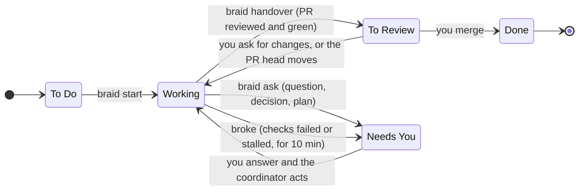

# Status system (draft for the user)

Your attention is the expensive resource. The board answers one question per item: **is it your turn, and what exactly is needed?**

## The five states

| State | Means | Your action |
| --- | --- | --- |
| To Do | not started | none |
| Working | agents have it: implementing, CI, review, fix rounds, the coordinator planning or waiting for agents | none |
| To Review | a PR was handed to you: reviewed, green, with a recap | merge, or ask for changes |
| Needs You | nothing moves until you act; the card says what is needed in one line | answer |
| Done | merged | none |

Working is the default. An item leaves it for your side of the board in only two ways: someone **asks** you (explicit), or something **broke** (detected).

## The one new thing: a request

A request is a small record: the item, the kind, **one line saying what is needed from you**, when, and for a review the PR and its head commit. An item has at most one open request. braid commands write it; nobody edits it by hand.

| Opened by | Kind | State | Closes by itself when |
| --- | --- | --- | --- |
| `braid handover <id> --head <sha>` (also prints the recap draft) | review | To Review | the PR merges or closes, or its head moves |
| `braid ask <id> "<what is needed>" [--key scope]` | question, decision or plan | Needs You | the coordinator acts on the item (`braid start`, `braid done`, `braid answer` with the logged decision) |

So a review request can't go stale (GitHub facts close it), and a question can't outlive progress (any next step closes it).

## The safety net: broke

Detected, not asked, and only after it has held for 10 minutes, so it doesn't flicker:

- **checks failed:** a PR's checks are red and no agent of the item is running.
- **stalled:** the item is In Progress, has no open request, no running agent and no checks pending.

Stalled also catches a coordinator that stopped for you and forgot to ask: the board then says "stalled: nobody is working and nothing was asked", which is true and visible, instead of a silent Working.

## What counts as an agent of an item

Only a thread whose worktree braid created for that item: the worker's (`braid start <id>`) and the reviewer's (`braid start <id> --review`, a detached checkout in a known folder). The coordinator's thread is never counted, so it can't make a braid Working or block `braid done`.

## A braid

A braid shows the most urgent of its strands and its own requests (plan approval, a spike's decision): Needs You, then To Review, then Working, then To Do. Done when its final PR merges.

## Why it isn't shaky

- T3 is read for one fact only: is an agent of this item running. No reading of `completed`, `settled`, inbox or watches.
- Your side of the board comes from explicit records with self-closing rules; the detected part is debounced.
- Forgetting to ask degrades to "stalled", not to a wrong state.

## Decided (user, 2026-11-15)

1. Requests live in a local file under `.braid/` of the main checkout, shared by all worktrees. No commits. The user's answers stay in the braid log as today.
2. "Broke" shows after the condition has held for 10 minutes.
3. Lane names: To Do, Working, To Review, Needs You, Done.
