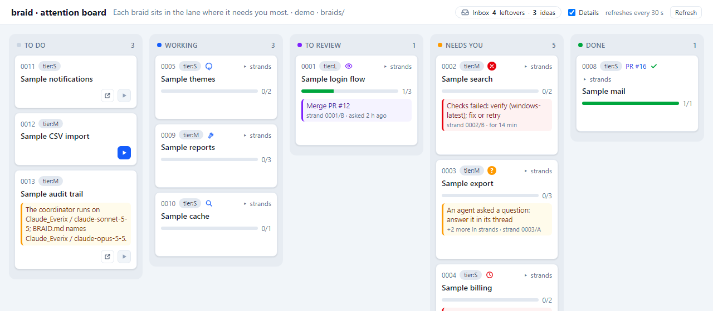

# Report: 0020/C Board: the inbox

## What changed

- `src/board/inbox.ts`: `inboxOf(root, fetch)` reads `braid-inbox` (`readInbox` from 0020/A) and returns the open entries, newest first, as `{ leftovers, ideas, note }`; each entry has `kind`, `id`, `title`, `text` (after the title line), `from`, `ref`, `age` and `passed`. `note` says a fetch failed or a malformed entry was left out.
- `/api/board` carries it as `inbox`. Every refresh reads the local refs; the Refresh button (`?fresh=1`) fetches `braid-inbox` first. `Sources` gained `inbox(fetch)`; the demo board has sample entries (`demoInbox`).
- The page (`web/src/App.tsx`), as the user approved: a header chip `Inbox N leftovers · M ideas` opens `#/inbox`, a read-only page with a Leftovers and an Ideas list. Rows are collapsed (title, source, age, "passed over ×N"; ideas also their first line) and open to the full text, links and id. Empty lists say what fills them.
- Docs: `docs/board.md` ("The inbox", three screenshots), D55 in `docs/decisions.md`.

## Why

The inbox shows the user what agents left behind and what they wrote down, without asking anything (not a lane, nothing in Needs You).

## Validation

- `test/board-inbox.test.ts` (6 tests, temporary repositories with a bare remote and an isolated HOME and Git config): the API data (kinds, text, source, links, age, passed, ideas); only open entries show (a dropped and a taken entry are absent, a reopened one is back; the test fails without the open filter); no fetch on a plain refresh and a fetch on `?fresh=1` (an idea captured in another clone appears); no branch gives empty lists; a failed fetch on Refresh still returns the braids and the local leftover, with the note; the demo has entries.
- `npm run verify` passes.
- The screenshots come from `braid board --demo` (script in the artifacts folder).

## Screenshots

1. Board with the chip: 
2. Inbox page, a leftover and an idea open: 
3. Empty inbox: 

## Open

- The mockup HTML and screenshots of round 1 stay in `mockups/` of this item.
- Titles render inline `code` spans; the rest of a title is plain text.

For later items: none.
Needs the user: none.
