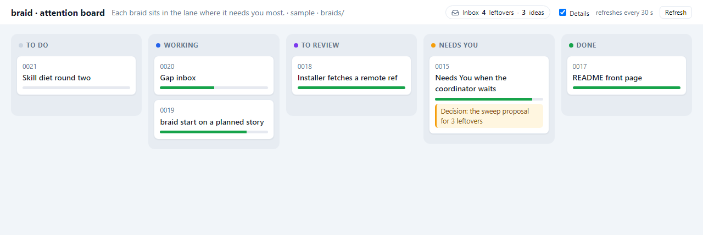
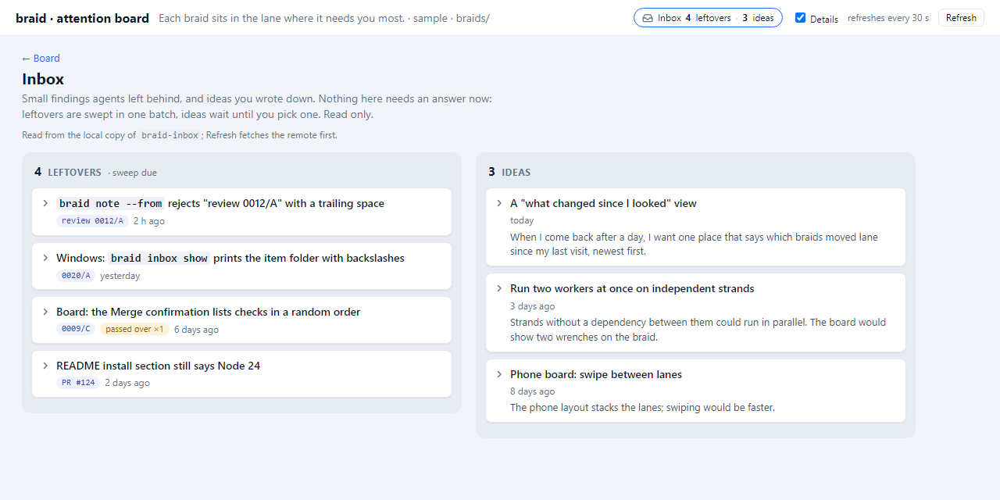
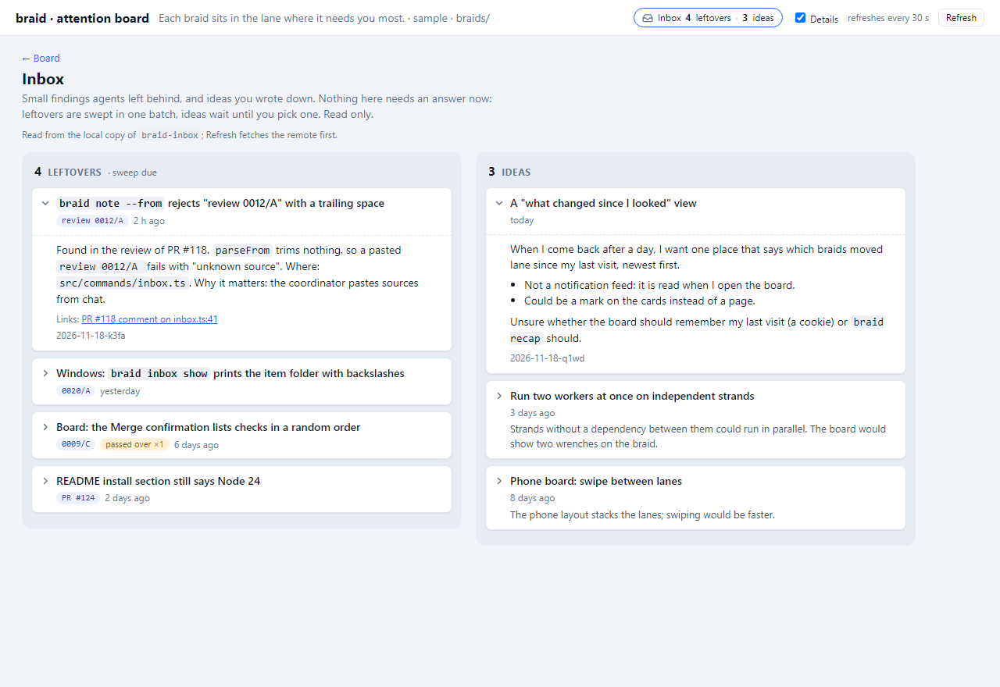
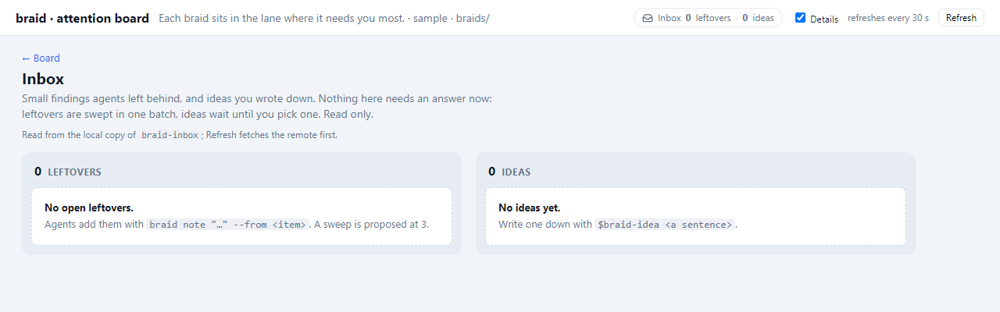
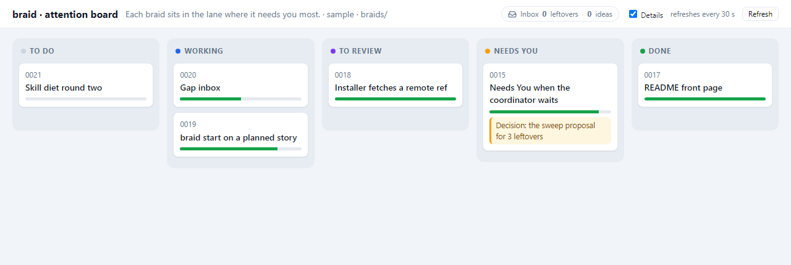

# Report: 0020/C Board: the inbox (mockups, round 1)

Proposal for the user's verdict. Nothing is built; `src/` and `web/` are untouched. The page is [mockups/inbox.html](mockups/inbox.html) (views `#board`, `#inbox`, `#open`, `#empty`, `#board&empty`), on test data: four leftovers from different sources (a review, an item, a PR; one passed over once) and three ideas, one with several paragraphs and a list.

## The design

- **A chip in the header**, left of Details: `Inbox 4 leftovers · 3 ideas`. It is not a lane and puts nothing in Needs You (already decided). Grey when both counts are 0.
- **The chip opens an Inbox page** (`#/inbox`, like a braid page, with "← Board"): two columns, Leftovers and Ideas, each headed by its open count. The leftovers header says "sweep due" at 3 or more.
- **Each entry is a collapsed row**: title, then source (`review 0012/A`, `0020/A`, `PR #124`) and age, and for a leftover passed over, an amber "passed over ×1". An idea row also shows the first line of its text. A click opens the full text, with links and the entry id. Nothing on the page acts: read only.
- **Empty inbox**: each column says what fills it (`braid note … --from <item>`, `$braid-idea <a sentence>`).
- **Refresh** fetches `braid-inbox`; the page says so under the lead text. The 30 s reload and file changes read the local refs only.

## Screenshots

1. Board with the chip: 
2. Inbox page, all rows closed: 
3. A leftover and an idea open: 
4. Empty inbox page: 
5. Board with an empty inbox (grey chip): 

## Open questions for the user

- Is a separate page right, or would a panel over the board be better?
- Should an idea's preview (first line) stay, or show the title only?

Needs the user: ui: approve the inbox design above (chip, page with two lists, read only), or say what to change.
