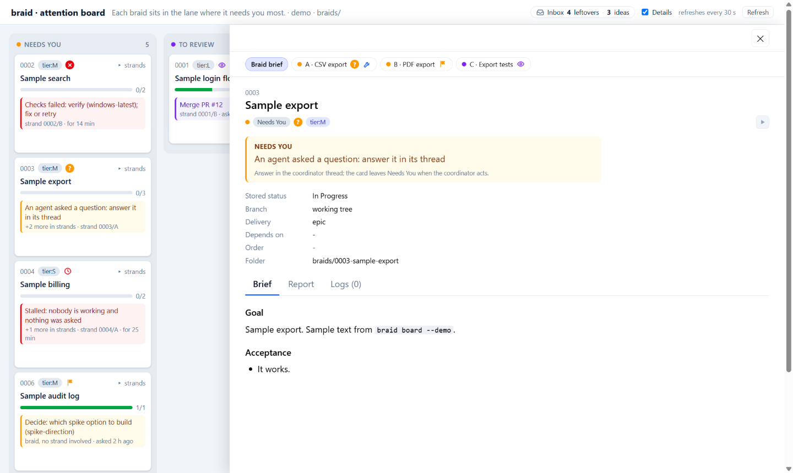
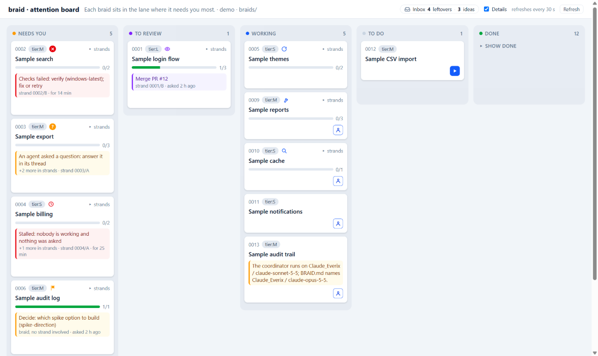
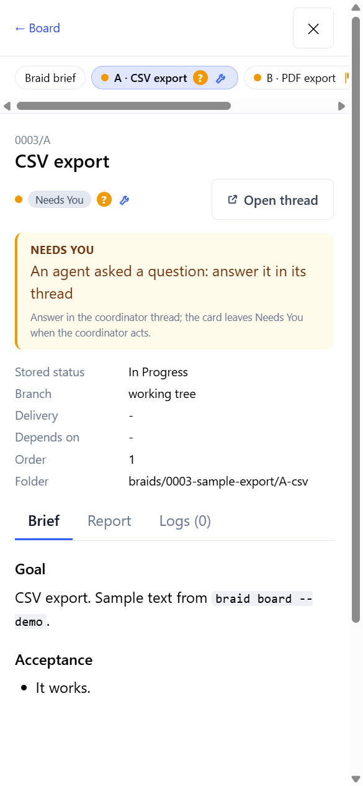

The board's item details now open as a side panel over the board instead of replacing it, in the shape the user chose from mockups (side panel; about two-thirds of the viewport; full screen on phone).

**What changed**
- `web/src/App.tsx`: the board is always rendered; the details are a non-modal Radix Dialog (`DetailsPanel`), `min(70vw, 1200px)` wide and at least 720 px where the screen allows, the whole screen below `md`. A chip row moves between the braid brief and its strands; the header, actions, request banner, fields and tabs are unchanged. The details refresh with the board `tick`.
- `src/board/route.ts` (new): `parseHash` / `hashFor`; an item id never replaces the board, only `#/inbox` is a page. `test/board-route.test.ts` covers it.
- History: opening from the bare board adds one entry; another card, a strand or a tab inside the open details replaces it. Close = Back when the entry was pushed, otherwise replace to `#/`. Esc, the close button, a click on the board (not on a card, which opens that card) and Back close it.
- `docs/board.md` ("The item details", phone section), decision D65, screenshots 71 and 72 in `docs/design/board-screenshots/`.

**Validation** (demo board, 1440 px, in a browser): clicking a card opens `#/0002` with the panel 896 px wide (70% of 1280); Esc closes it and returns to `#/`; Back after opening closes it; the page scroll (150 px) is the same before opening, while open and after Back. Moving to `#/0003/A` stays in the panel. Phone width (390 px): the panel fills the screen with ← Board and ✕.

Screens:   

**Open:** a link opened fresh (reload) at `#/<id>` has no pushed entry, so its close replaces the hash with `#/` instead of going Back; I checked this by reading, not in a fresh page load.

For later items: none.
Needs the user: none
