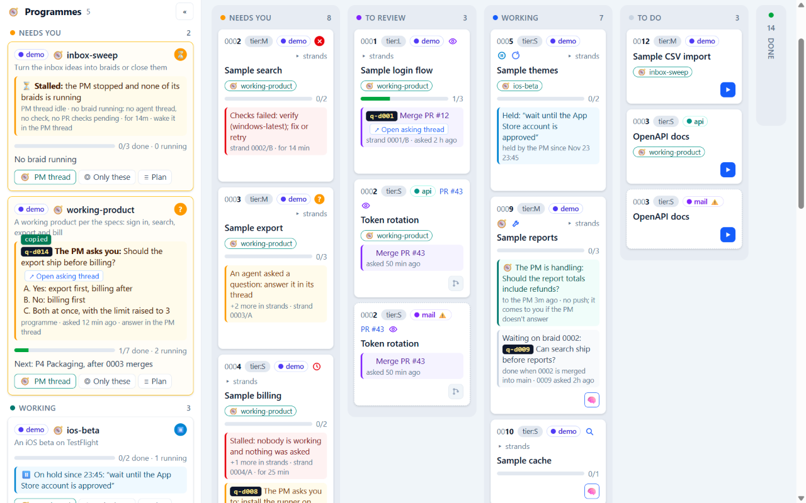
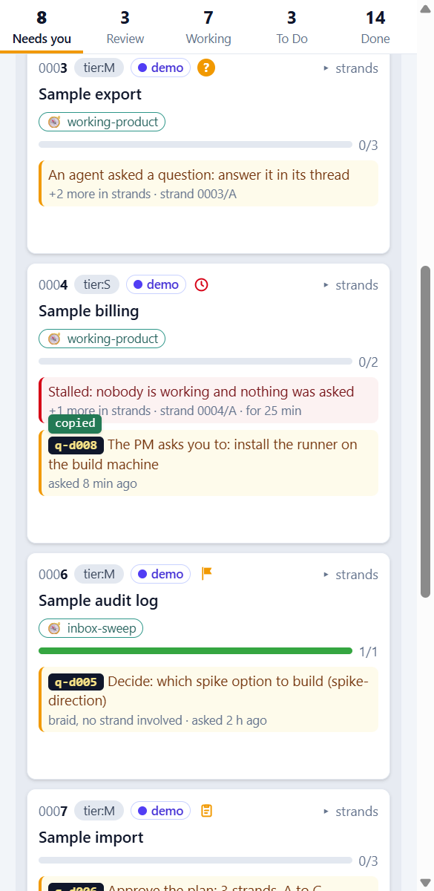

## What changed

- `CodeChip` (`web/src/App.tsx`) is now a `<button>` with the same look, `cursor: copy` and the tooltip `Copy q-7f3k`. A click, tap or Enter copies the code, shows "copied" (or "copy failed") above it for 1.5 s, and stops the click so the card under it doesn't open.
- `copyText` (`src/board/copy.ts`): `navigator.clipboard.writeText` in a secure context; otherwise, or when it rejects, a hidden off-screen textarea (not readonly, 16 px, selection range set) and `document.execCommand("copy")`. It works over plain http.
- `TAG_COLOURS` moved to `web/src/palette.ts` (so a test can import it) with the rule as a comment: no red, pink, rose, orange, amber. `pink-700` and `orange-600` became `violet-600` and `sky-600`; `cyan-600` became `slate-600`, since cyan sits too close to sky. Indigo, teal, violet, sky, slate, lime.
- `docs/board.md`: one sentence on the copy and one on the palette rule.

## Why

The user wants to paste a request code into a chat when answering, and project tags in red tones read as errors.

## Validation

- `test/board-copy.test.ts`: the clipboard path, the fallback (no secure context, no clipboard, rejected write, failed copy and cleanup), and that the palette has no warm hue and is distinct.
- The demo board in a browser: a click shows "copied" and the card stays shut, at 1280 px and 390 px.
- `npm run verify`: see the PR checks.

Screenshots after a click:  

## Docs

`docs/board.md` updated; no other doc is affected.

## Open

None.

For later items: none.
Needs the user: none.
