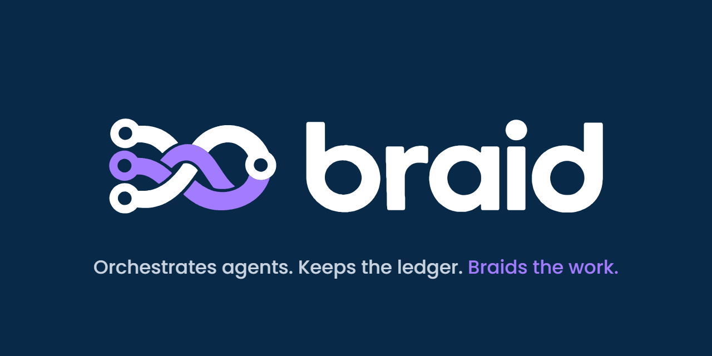

# braid design pack

Brand identity for braid, version 1.0, November 2026.



This folder has the braid logo, icons and colours, and the rules for using them. The full guide, with examples, is [braid-brand-guidelines.pdf](braid-brand-guidelines.pdf). This page is the short version.

## The idea

braid orchestrates coding agents. It splits a goal into braids and strands, gives each strand to an agent, and keeps a ledger of every step.

The symbol shows that work:

- **Endpoints.** Each strand starts at a ring, like a commit in a history: a recorded point in the ledger.
- **Weave.** The strands cross over and under, with clear gaps, the way agents work side by side without colliding.
- **Loop.** The strands meet again in the loop on the right: the work is merged back.

Two strands are Ledger Navy and one is Strand Violet. A strand keeps its colour all the way through.

## What's in the folder

| Path | Contents |
| --- | --- |
| [braid-brand-guidelines.pdf](braid-brand-guidelines.pdf) | The brand guide: idea, lockups, colour versions, clear space, colour, type, misuse, applications. |
| [logo/svg/](logo/svg/) | Master artwork. Vector, transparent background, no font dependencies. Use these whenever you can. |
| [logo/png/](logo/png/) | The same files as transparent PNGs, at 1x and `@2x`. |
| [icons/](icons/) | App icon (navy and light), favicon, and PNG sizes from 16 px to 1024 px. |
| [social/](social/) | GitHub social preview, 1280 × 640, as SVG and PNG. |
| [tokens/](tokens/) | Colours as CSS custom properties and JSON. |
| [source/brand-guidelines.html](source/brand-guidelines.html) | Source of the PDF. Print it to PDF from Chrome or Edge at the page size it sets. |

## Logo

There are four lockups. Each comes in up to four colour versions.

| Lockup | Use it for | Files |
| --- | --- | --- |
| Primary (symbol above the wordmark) | The default: covers, README headers, slides | `braid-logo-primary-*` |
| Horizontal (symbol beside the wordmark) | Wide, short spaces: site headers, banners | `braid-logo-horizontal-*` |
| Symbol | Avatars, app icons, favicons, stickers | `braid-symbol-*` |
| Wordmark | Places where the symbol is already close by | `braid-wordmark-*` |

| Version | Background |
| --- | --- |
| `-color` | White and light backgrounds. The first choice. |
| `-reversed` | Navy and other dark backgrounds. Violet becomes Violet Light. |
| `-mono-navy` | One-colour print, embossing, engraving. |
| `-mono-white` | Violet, photos and other colour fields with enough contrast. |

The wordmark has no `-reversed` or `-mono-navy` file. It has one colour, so those would duplicate `-mono-white` and `-color`.

### Clear space

Keep empty space of at least **x** on every side of the logo, where x is the outer diameter of one endpoint ring. The SVG artboards include a small margin, so measure from the artwork, not from the file edge.

### Minimum size

| Lockup | Screen | Print |
| --- | --- | --- |
| Primary | 120 px wide | 30 mm |
| Horizontal | 140 px wide | 35 mm |
| Symbol | 24 px wide | 8 mm |
| Wordmark | 64 px wide | 16 mm |

Below 24 px, use the favicon, which puts the symbol on a navy tile.

### Don't

- Stretch, squash, rotate or tilt the logo.
- Recolour the strands, or give one strand two colours.
- Add shadows, glows, outlines or bevels.
- Retype the wordmark in a font. It is custom lettering, supplied as outlines.
- Rearrange the symbol and wordmark, or change their size relative to each other.
- Place the colour logo on violet, on mid-tone colour or on a busy image. Use `-reversed` or `-mono-white` instead.

## Colour

| Name | Hex | RGB | CMYK | Use |
| --- | --- | --- | --- | --- |
| Ledger Navy | `#082A48` | 8 42 72 | 100 75 35 50 | Primary: wordmark, two strands, text |
| Strand Violet | `#7835EF` | 120 53 239 | 65 78 0 0 | Accent on light backgrounds |
| Violet Light | `#A27BFF` | 162 123 255 | | Accent on dark backgrounds |
| Mist | `#F4F2FB` | 244 242 251 | | Light surfaces |
| Slate | `#5A6B80` | 90 107 128 | | Secondary text |
| White | `#FFFFFF` | 255 255 255 | | Backgrounds, reversed artwork |

Contrast (WCAG 2.2): Navy on white 14.6:1, Violet on white 5.9:1, Violet Light on Navy 4.8:1, Slate on white 5.5:1. Strand Violet on Navy is only 2.5:1, so use Violet Light on dark backgrounds. The CMYK values are starting points; proof them before a print run.

## Typography

- **Poppins** for headings, UI and body text. Its round, geometric shapes match the wordmark. Use 700 for headings, 600 for subheads and 400 for body.
- **Cascadia Code** for commands, ids, ledger entries and anything a user types.

Both are free under the SIL Open Font License: Poppins from Google Fonts, Cascadia Code from [microsoft/cascadia-code](https://github.com/microsoft/cascadia-code).

## Using the files

README header:

```markdown

```

Website favicon:

```html
<link rel="icon" href="/favicon.svg" type="image/svg+xml">
<link rel="icon" href="/favicon-32.png" sizes="32x32" type="image/png">
<link rel="apple-touch-icon" href="/apple-touch-icon.png">
```

GitHub social preview: upload [social/braid-social-preview.png](social/braid-social-preview.png) under the repository's Settings > General > Social preview.

## Rebuild the files

Every SVG, PNG and the PDF are generated. The scripts are in [source/build/](source/build/) and need only Node.js; `render.mjs` also needs Chrome or Edge. Run them from the repository root.

| Script | What it does |
| --- | --- |
| [build.mjs](source/build/build.mjs) | Composes every SVG (lockups, app icons, favicon, social preview) from [logo-geometry.json](source/build/logo-geometry.json), the master geometry. |
| [render.mjs](source/build/render.mjs) | Rasterizes every SVG to PNG and prints [brand-guidelines.html](source/brand-guidelines.html) to the PDF with headless Chrome or Edge. |

```sh
node design/source/build/build.mjs
node design/source/build/render.mjs
```

Both write into `design/`; pass another folder as the first argument to write elsewhere. `render.mjs` looks for Chrome or Edge in the usual places on Windows, Linux and macOS. If yours is elsewhere, set `BRAID_BROWSER` to the executable. PDF bytes change on every render (internal ids and dates), so commit a regenerated PDF only when the guide changed.

What to edit for common changes, all at the top of `build.mjs` unless noted:

- **Colours:** `NAVY`, `VIOLET`, `VIOLET_LIGHT`, `WHITE`, `MIST`, and the `SCHEMES` table. Update [tokens/](tokens/) and the guide HTML by hand to match.
- **Lockup ratio and spacing:** `HORIZONTAL_WORD_RATIO` (wordmark height against symbol height) and `HORIZONTAL_GAP`; the primary lockup is in the `primary` function.
- **Artboard padding:** `PAD`. **Icon padding:** `ICON_INSET` for the app icons; the favicon inset is in its `squareIcon` call.
- **Social text and layout:** the `SOCIAL` object.
- **Export sizes:** the size lists in `render.mjs` (`1024, 512, 192`, `16, 32, 48`, and the 1x/`@2x` logo exports).

Shape changes (the strands, the weave, the letters) are not made here. Edit the SVGs in a vector editor. Changing the geometry means replacing the paths in `logo-geometry.json`; the tracer that produced them is not part of this repository.

## Notes on the artwork

The logo was drawn as a raster concept and traced to vector paths. The edges were smoothed before tracing and hold up at poster size. For large-format signage or embroidery, have the curves redrawn by hand first. A simpler symbol for sizes under 24 px could also follow if the favicon tile isn't enough.
