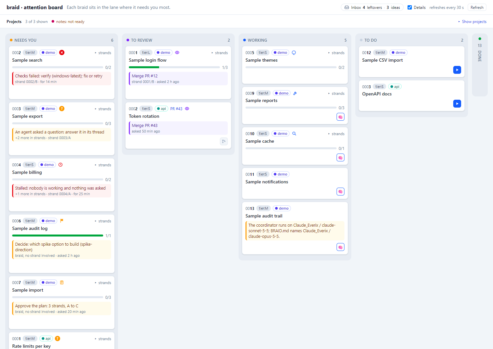
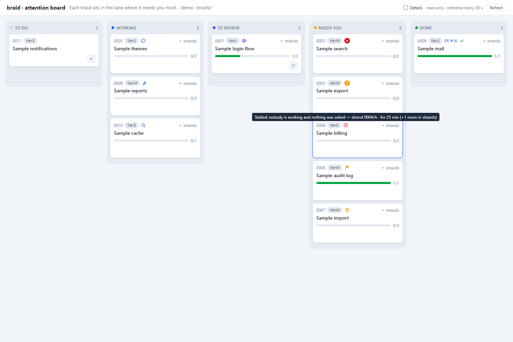
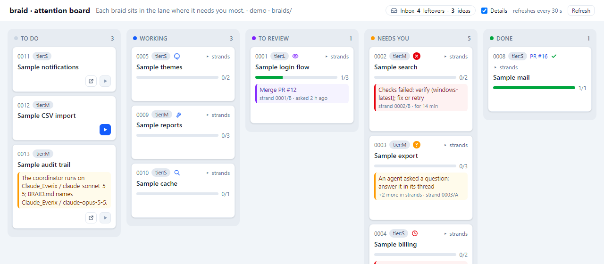
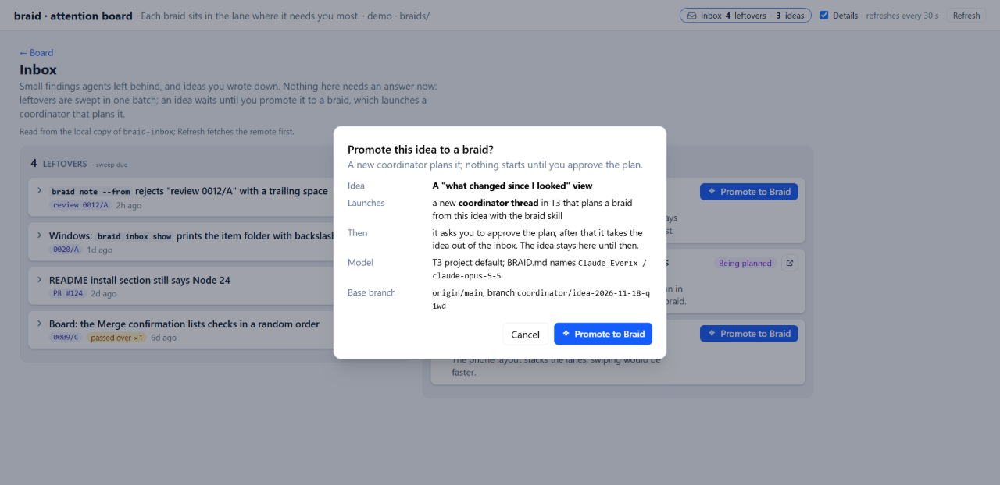
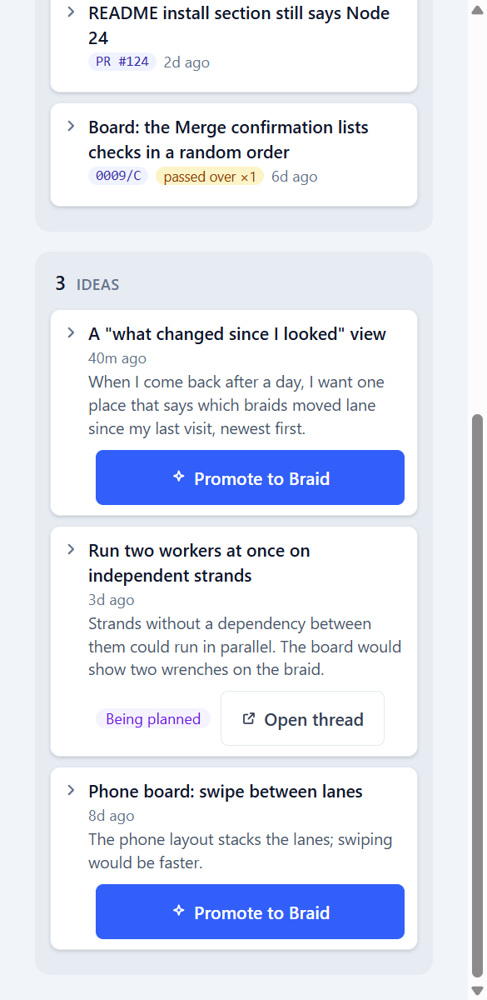
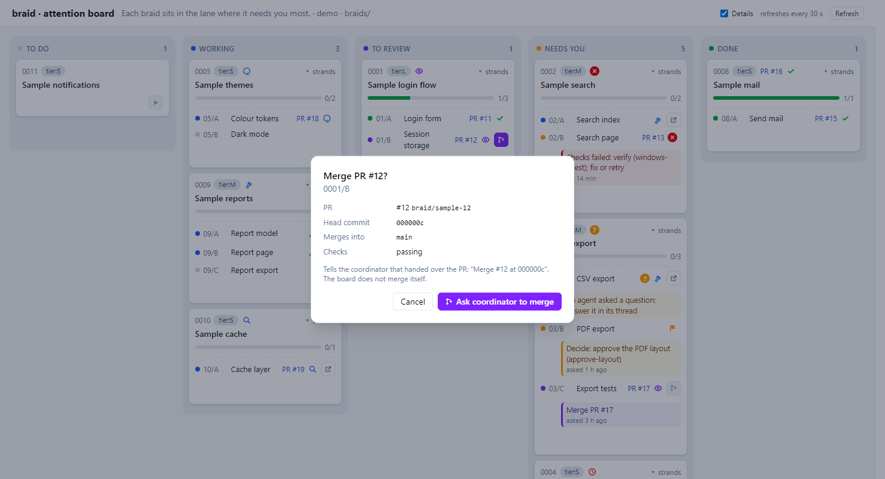
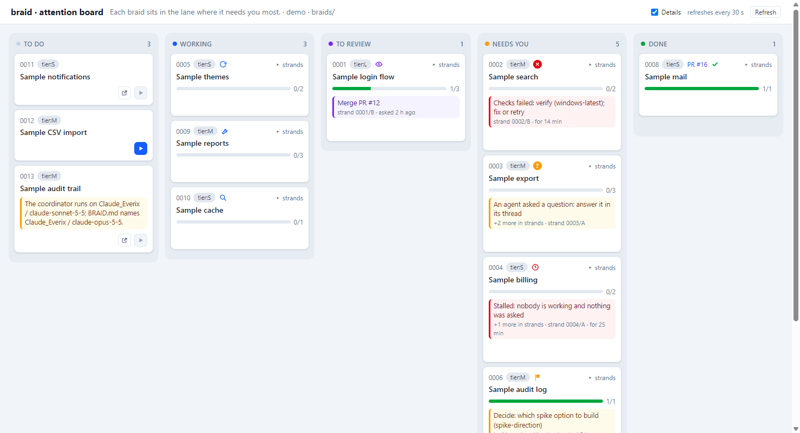
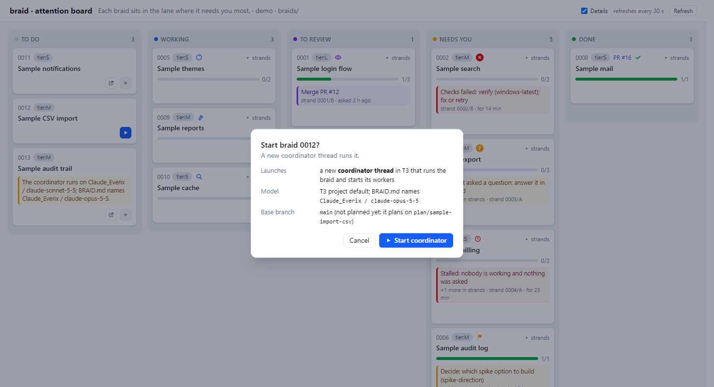
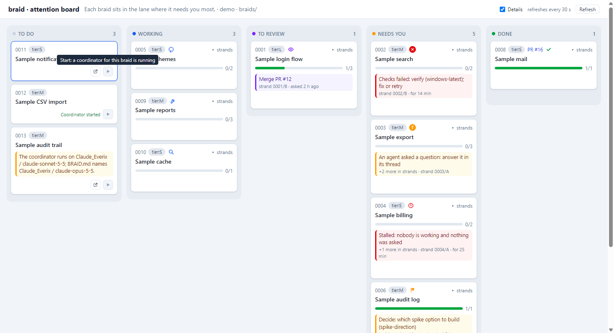

# The attention board

`braid board` serves a local page that shows where the work needs you. It listens on `127.0.0.1` at a free port, prints the address and opens the browser (`--no-open` only prints it). Stop it with Ctrl+C. The files it reads are described in [the braids/ format](braids-format.md); why it is an attention board is decisions D32 and D46 in [decisions](decisions.md).

## Lanes

The lanes say what a braid asks of you, not the braid's own status. An item is on your side of the board in only two ways: someone **asked** you (a request), or something **broke** (detected). Everything else is Working (or To Do, when not started). A braid with strands sits in the lane of its **most urgent** strand or its own request: Needs You, then To Review, then Working, then To Do. A started braid (stored In Progress, or a strand Done) whose strands are all To Do between strands reads Working, not To Do. It is not Done when every strand is: with its final PR open it reads To Review (or Working), and Done only after that PR merges. The card's progress bar counts done strands, so it still shows how far the braid really is.

| Lane | In code | Means | Your action | Colour |
| --- | --- | --- | --- | --- |
| Needs You | `Waiting` | nothing moves until you act; the card says what is needed in one line | answer | amber |
| To Review | `In Review` | a PR was handed to you: reviewed, green, with a recap | merge, or ask for changes | purple |
| Working | `In Progress` | agents have it: implementing, CI, review, fix rounds, the coordinator planning or waiting for agents | none | blue |
| To Do | `To Do` | not started; `Outline` items show here with a badge | none | light grey |
| Done | `Done` | merged | none | green |

The lanes stand in this order left to right (`LANES` in `src/board/model.ts`, the same order as the urgency above), on the phone as well. **Done is collapsed**: the lane shows only its count and "Show done". Opened, it lists braids as rows (number, title, the day it became Done), **newest first**, the 10 newest, and "Show more (n)" adds 10 more. "Became Done" is the date of the newest commit that set `status: Done` in the item's brief, read from Git (the brief's history, `git log --follow`, from the commit the brief was read from, else HEAD: the oldest commit of the unbroken run of versions that say `status: Done`; `src/board/done.ts`), so a renamed folder keeps its date, so it needs no GitHub and covers items Done without a PR; it is the commit's committer date, and a result, a miss included, is kept per commit searched for the life of the board process, so an item without a date doesn't run `git log` on every refresh. A braid with strands takes its own Done commit; when its own brief never says Done (its strands did the work), its newest strand's. A Done braid whose date Git doesn't give sorts after the dated ones, highest number first. `doneNewestFirst` and `DONE_PAGE` in `src/board/model.ts` do the ordering and the page size.

The labels live in one place, `LANE_LABEL` in `src/board/marks.ts`. Stored statuses in `brief.md` keep their names (`Outline`, `To Do`, `In Progress`, `Done`). The design is in `braids/0015-needs-you-when-the-coordinator-waits/states.md`.

## How an item's lane is chosen

For each braid and strand, the first rule that matches wins (`derive` in `src/board/model.ts`):

1. **Done:** a merged PR, or stored status `Done` with no open PR. An open PR wins over a stored `Done` (rule 4): `braid accept` stamps a story or a braid's final PR `Done` on its branch before the user's merge (D43). A PR closed without merging never makes Done: a stored `Done` next to one reads as To Do (the state before `Done` isn't known), and the closed PR still shows on the card.
2. **To Review:** an open `review` request (from `braid handover`).
3. **Needs You, with the request's text:** any other open request (`question`, `decision`, `plan`, from `braid ask`), or a running agent's pending question (reason `question`).
4. **To Review, "Merge PR #N":** a stored `Done` next to an open PR, which waits for your merge.
5. **Needs You, broke:** one of two alarms, shown only after its condition has held for 10 minutes (below).
6. **Working:** started, which is stored `In Progress`, an agent of the item running, or an open PR. An open PR without a review request is Working: the agents still have it.
7. **Working, while being planned:** a braid that rules 1–6 leave in To Do is Working when a coordinator thread of it runs (a thread titled `<repo> <number> coordinator: …`), or when a planning PR (`plan/<slug>` into `braid/<number>-<slug>`) into its braid branch is open; the card shows the checks activity while that PR's checks run. This holds with and without strands. It lifts only To Do: Done, To Review and Needs You come first, so an open plan request still shows Needs You. An idle coordinator with no planning PR lifts nothing. A planning PR is never the braid's own PR: it is kept apart from the braid's PRs, so a merged one never makes the braid Done (D53).
8. **To Do:** the rest (stored `To Do` or `Outline`).

An `ask:<key>` label set when planning doesn't move the lane: it marks a decision expected at review (and keeps auto mode from merging), so the item stays in the lane its other state gives and carries the amber flag. `braid status` prints the label as `ask:<key>` after the lane.

### Requests

A request is a small record kept by `braid handover` and `braid ask` in `.braid/requests.json` of the main checkout (see [the format](braids-format.md#commands)). The board reads it through `src/braids/requests.ts` only (`loadRequests`, the pure `filterLive`, `age`) and never writes it. A review request that GitHub says is void (its PR merged, closed or at another head) doesn't count; a PR GitHub can't be read for keeps its request.

### Broke

Detected, not asked, and shown only after the condition has held for 10 minutes, so it doesn't flicker. The time it was first seen is kept in `.braid/broke.json` of the main checkout, so `braid status`, the board and a restart agree; a condition that stops holding starts again from zero, and one that can't be told (GitHub or T3 unreadable) neither starts nor stops the clock and shows nothing.

- **checks failed:** a PR's checks are red and no agent of the item runs. The line names the failing checks.
- **stalled:** the item is stored `In Progress`, has no open request, no agent running and no checks pending. It also catches a coordinator that stopped for you and forgot to ask: the board then says "stalled: nobody is working and nothing was asked", which is true and visible, instead of a silent Working.

### Agents of an item

Only a thread whose worktree braid created for that item counts: the worker's (`braid start <id>`, `<repo>/<number>-<letter>`, or `<number>` for a story) and the reviewer's (`braid start <id> --review`, a detached checkout of the PR head in `<repo>/<number>-<letter>-review`, or `<number>-review` for a story or a braid whose final PR is open; `braid clean` removes it). In wrap-up (every strand Done, final PR open) the braid's card counts its reviewer threads as its agents (review activity; they hold back `checks failed`), shows the checks spinner while the final PR's checks run, and still never counts the coordinator. Any other thread is no agent of any item, so the coordinator, which works on a braid branch with strands or in the main checkout, can't stand for a strand's agent, holds back or starts no alarm, and can't block `braid accept`. It only lifts its own braid from To Do to Working (rule 7) and keeps Start off ("a coordinator for this braid is running"). T3 is read for three facts: whether an agent of the item runs, a running agent's pending question, and which idle thread of an item to open.

## Where the states come from

- **Files:** each item's `brief.md`, read from its own branch when it has one ([Branches](braids-format.md#branches)).
- **GitHub:** one `gh pr list` per refresh (state, head commit and checks); a PR belongs to the item named by its head branch (`braid/0006-slug` or `braid/0006/A-slug`). Merged and closed PRs are cached (an open one wins over both, a merged one over a closed one).
- **T3:** `t3 thread list --project <main checkout>`, plus `t3 thread show` for each running thread (its worktree and pending questions). An idle thread (not running, not archived) is placed by its title alone, with no `show`: `<emoji> <repo> <id> <role>: <title>` (built by `braid title`; the emoji may be missing in older titles, the repo is the GitHub repository's name or the checkout folder's) names its item (`0009` or `0009/D`) and its role (`worker`, `review`, `coordinator`); any other title drops it. A running thread belongs to an item by its worktree folder, as above. `braid clean` reads T3 the same way, so it shows only running threads.
- **Requests and broke clock:** `.braid/` of the main checkout.
- Without `gh` or T3 the board still works on the stored states and requests, and its header says why. Without T3 no agent shows and no alarm can be told.

## Icons and lines

A card on your side (Needs You, To Review) carries one line saying what is needed, with its age ("asked 35 min ago", or "for 14 min" for an alarm), and only its most urgent icon. A braid card also says which strand it comes from (or "braid, no strand involved") and how many more strands need you. An expanded card shows the line on each strand row. Exact icon text is on hover (also the `aria-label`).

| Icon | Means | Hover |
| --- | --- | --- |
| amber `?` | a question: a request, or an agent's pending question | Question: waiting for your answer |
| amber flag | a decision request (`--key` = the stop case); on an item with only an `ask:` label, the label's flag | Decision needed: `<key>` / Will need your decision: `<key>` |
| amber clipboard | a plan to approve | Plan approval needed |
| red circle with a cross | checks failed (alarm) | Checks failed: names of the failing checks |
| red clock | stalled (alarm) | Stalled: nobody is working and nothing was asked |
| purple eye | a PR to review | PR #N to review |
| blue wrench | a worker agent is running | agent running |
| blue magnifier | only a reviewer is running | review running |
| blue spinner | only CI is running | checks running |
| green tick | Done | Done |

Red appears only where something went wrong. Green means Done.

### The Details toggle

The "Details" checkbox in the header shows (default) or hides the request lines. Hidden, the text moves into the tooltip of the card's reason icon, with the strand and the age.

The setting is kept in the cookie `details` (`on` or `off`), so it survives a reload and a restart.

### The item details

Clicking a card, a strand row or a Done row opens the item's details in a **side panel over the right of the board**; the board stays mounted underneath, so its scroll, open lanes and Done list are as they were. The panel is `min(70vw, 1200px)` wide, never under 720 px where the screen allows, so the brief reads comfortably and the left lanes stay visible. It shows a chip row to move between the braid brief and its strands, the header with the actions, the request banner, the fields and the Brief, Report and Logs tabs. It refreshes with the board.

The hash keeps its form (`#/0003`, `#/0003/A?tab=report`; `src/board/route.ts`): the board is always the base view, so a direct link opens the board with those details open. Opening from the bare board adds one history entry; moving to another card, a strand or a tab inside the open details replaces it, so one Back closes the panel. The close button, Esc, a click on the board (a click on another card opens that one instead) and Back all close it and return to the board without a reload or a scroll jump. The Inbox (`#/inbox`) stays a page. Decision D65.

A braid or strand shows the request as a banner above the brief, with the same text as the card. Answering still happens in the coordinator's thread.

## The inbox

The header chip `Inbox N leftovers · M ideas` (grey when both are 0) opens the Inbox page (`#/inbox`, "← Board" returns). The inbox is not a lane and puts nothing in Needs You: capturing asks the user nothing, and the sweep proposal reaches you as a `braid ask`, which the board already shows (decision D55 in [decisions](decisions.md); the storage is [the inbox](braids-format.md#the-inbox)).

The page has two lists, **Leftovers** (with "sweep due" at 3 or more open) and **Ideas**, each headed by its open count. Each entry is a collapsed row: its title, for a leftover its source (`review 0012/A`, `0020/A`, `PR #124`), the age, and an amber "passed over ×N" when a sweep passed it over; an idea also shows the first line of its text. A click opens the full text, its links and its id. An empty list says what fills it (`braid note`, `$braid-idea`).

**Promote to Braid.** Each idea row carries a **Promote to Braid** button on the right of the collapsed row (full width under the preview on a phone, 44 px high). It opens a confirmation (the idea, what launches, what happens after, the model, the base branch and the branch name); on confirm the board posts `promote` with `{ id }`, an idea id, and a new **coordinator thread** starts in T3 whose first message asks it to plan a braid from that idea with the braid skill. The message quotes the idea in full and says that it comes from Promote to Braid, which is the user's request to *plan* the idea, not to start it; the plan still needs your approval in that thread, and after the approval the coordinator takes the idea out of the inbox with `braid inbox take <idea> --into <braid ids>`. The board writes nothing to `braid-inbox` itself, so the idea stays in the list until then. Leftovers have no button: they go through sweeps.

The server reads the inbox again (fetching `braid-inbox`) and refuses with `Promote: <reason>` when the entry isn't an open idea, T3 isn't reachable or a coordinator for the idea runs. Otherwise it does what Start does: `git fetch origin`, a free branch `coordinator/idea-<idea id>` (`-2`, `-3` when taken) from `origin/<main>`, `t3 thread start` with no model flags (T3's project default) and the first message on standard input, and the same model warning when the thread's model differs from BRAID.md. The thread is titled `🧠 <repo> idea coordinator: <idea title>`; the coordinator renames it with `braid title` once the braid has a number. A running thread on `coordinator/idea-<idea id>` (or its `-2`, `-3`) marks the idea **Being planned**: the row shows that and an **Open thread** button (`open` with `{ idea }`) instead of Promote. Over Tailscale it works like Start (the session token rules above apply).

`/api/board` carries it as `inbox: { leftovers, ideas, note, expected }` (`src/board/inbox.ts`): the open entries, newest first, each with `kind`, `id`, `title`, `text` (after the title line), `from`, `ref`, `age`, `passed` and, for an idea with a running coordinator, `planning: { link }`. Every refresh (the 30 s reload and file changes) reads the local `braid-inbox` and `origin/braid-inbox` refs; the **Refresh** button (`?fresh=1`) fetches `braid-inbox` first, so an entry captured in another clone shows up. `note` says when that fetch failed (the local copy is shown) or an entry is malformed and left out. The demo board has sample entries.

## Refresh

The server reads GitHub, T3, the braids and the inbox in the background, never inside a request, and keeps the latest complete result as a **snapshot**. `/api/board` and `/api/item` answer from it, so opening an item costs no `gh` or `t3` call, and `gh` runs without blocking the server (a static file is served while it runs). A snapshot is stored only when every source has been read; before the first one exists a request waits for it, and a failed read of the braids is stored as the error the page shows. Reads run one at a time: a refresh asked for while one runs queues exactly one more read, however many asks come.

A read starts when the server starts, every 30 s, 200 ms after a file under `braids/` changes, and on the page's Refresh button (`?fresh=1`, which also fetches `braid-inbox` and answers when its read is done). When a new snapshot is stored it is pushed over `/api/events` and open pages fetch it; until then they keep showing the last one. Each read notes the first sighting of a broke condition in `.braid/broke.json`, once per read; that is the only thing the board writes on its own.

Open thread (and Coordinator, `{ id, thread: "coordinator" }`) takes the thread's link from the snapshot (a link doesn't change) and reads T3 again only when the snapshot has none. Start and Merge still read GitHub and T3 fresh before they act.

To see what a read costs, start the board with `BRAID_BOARD_TIMINGS=1`: each read prints `board read: braids 160 ms, github 690 ms, t3 2800 ms, signals 50 ms, done dates 60 ms, inbox 150 ms, board 2 ms` to standard error. GitHub and T3 are read in parallel with the braids, so the times overlap.

The reads are cheap by design: the Done dates of all Done items come from one `git log` of the history and one `git cat-file --batch` (the rule is unchanged: the oldest commit of the unbroken run of `status: Done`, following renames; an item whose first version is already Done is checked with its own `git log --follow`, because the one log may not pair its rename); the braids from branches and the inbox entries are read through one `git cat-file --batch` each, and `git` runs without blocking the server; T3 reads are unchanged: every read runs `thread show` for every running thread (in parallel), because `thread list` gives no pending count and its `updatedAt` lags `thread show`, so a skip could hide a pending question. The inbox costs about 1.3 s only on Refresh, which fetches `braid-inbox` from origin; a read without Refresh takes about 150 ms.

## Actions and the session token

The board can also act, but only through `POST /api/action/<name>`, and only for the page this `braid board` run opened. Actions are registered by name in `src/commands/board.ts` (`Sources.action`); the endpoint itself adds none that changes anything. Today there are three, `merge`, `start` and `open` (`open` on the local listener only; the first two below). On the local listener a request is refused with 403 unless it carries this run's token in the `x-braid-token` header, its `Host` is `127.0.0.1:<port>` and any `Origin` it sends is `http://127.0.0.1:<port>`. Unknown names give 404, a body that isn't JSON 400, a body over 64 KB 413, and other methods 405 as before. The 403 body's `error` says which check failed and what to do, and never echoes the token: no token (open the URL `braid board` printed), a token from another `braid board` run (a second tab or a tab kept across a restart; open the printed URL now), a Host or Origin that isn't this board's page, and on the Tailscale listener a missing `x-braid-request` header. The page shows that text in the dialog. The Tailscale listener of `braid board --host` checks identity instead of the token ([On Tailscale](#on-tailscale)); its whois/Host refusal stays a terse plain-text `forbidden`.

The token is 24 random bytes, new on every run. The command opens and prints `http://127.0.0.1:<port>/#token=<hex>`: a fragment never goes to a server log or a `Referer`. The page (`web/src/api.ts`) moves it into `sessionStorage`, removes it from the address bar and sends it with `postAction`. It is nowhere else: not in a file, a cookie or a GET URL. A second tab opened without the fragment can't act.

## Open thread and Merge on request

**Open thread opens the T3 desktop app.** T3's `link` (`http://127.0.0.1:3773/<env>/<thread>`) opens in a browser and asks for pairing, so the button posts the `open` action (`{ id }` of the item or braid; the token path of the other actions) and the server opens `t3code://threads/<env>/<thread>`, built from that link, with the OS: `cmd /c start "" <url>` on Windows, `open` on macOS, `xdg-open` elsewhere, the URL as one argument and never in a shell string. The server takes the thread's link from the snapshot (it reads T3 again only when the snapshot has none; see Refresh), picking the thread by the rule below, so a client can't pass a URL; a link that isn't `/<env>/<thread>` or has odd characters, no thread, or an opener that fails is refused with its reason (the button's tooltip shows it).

**Open thread.** A card or strand row whose item has a thread in T3 carries a small button that opens it (`link` of `t3 thread list`, `thread` in the board data): the running agent's (a worker's, else a reviewer's), else the newest thread of the item that is not running and not archived (a worker waiting for CI, a finished reviewer). Where there is no such thread there is no button. A braid with strands carries no Open thread of its own (each strand row has one); it carries a **Coordinator** button instead (compact: a person icon, with the label on a phone) that opens its coordinator's thread (see Start), running or else the newest idle one that is not archived, so the coordinator stays reachable while a strand runs. A braid without strands keeps Open thread (its worker's) and gets the Coordinator button next to it. The braid's page and the Needs You row follow the same rule; a braid without a coordinator thread has no Coordinator button. The button posts `open` with `{ id, thread: "coordinator" }`; without `thread` the server picks the item's agent thread as before, and the coordinator's for a braid without one. A thread other than `"coordinator"`, a strand id with it, or no coordinator thread is refused. A thread T3 marks archived (`archived`, `archivedAt` or the status `archived`) never gets a button. A Done item (card or strand row) gets no button from an idle thread, because the old threads of finished items keep their worktree path after `braid clean`; a running agent's thread still shows. An idle thread only gets the button: it is no agent, so lanes, Working, `braid accept` and the pending-question reason still read running threads alone, and Start stays off only while a coordinator is running.

**Merge on request.** The board never merges. A card or strand row in To Review with an open `review` request has a Merge button; it opens a confirmation (PR, head commit, the branch it merges into, each check). On confirm the board posts `merge` with the item and the shown head. The server reads GitHub and the requests again, and refuses with the reason unless the item still has an open review request with a coordinator thread, the PR's head is still the shown one and its checks are green. Then it sends the request's coordinator thread `Merge #<n> at <head>, from the board.` with `t3 thread send`; the coordinator (skill: "Merge on request") merges as for "merge it", and the card leaves To Review when the PR merges. Until then the button is off and says so, per head (kept in `sessionStorage`).

The button is off, and its tooltip reads `Merge: <reason>`, when the item has no open review request, the request has no coordinator thread, the PR isn't open, or its checks failed (the failing names), are still running or are missing. A refused confirmation shows its reason in the dialog.

## Start

**Start** on a To Do braid card launches a **new coordinator thread** in T3 that runs the braid. After a confirmation (what launches, the model, the base branch) the board posts `start` with the braid. The server recomputes the card from fresh reads, refuses with `Start: <reason>` when it is off, and runs `t3 thread start <main checkout> - --title "🧠 <repo> <id> coordinator: <title>" --worktree <base> --branch <name> --json` with the first message on standard input: `Use the braid skill and run <id>.` and a sentence saying where the worktree stands. It passes no model flags, so T3 uses the project's default model; the board can't read a thread's effort. The braid skill's coordinator then launches its workers as before; the board binds no worktree itself.

Every braid on the board is already in `braids/`, so Start never plans: the branch is always `coordinator/<number>-<slug>` (Git allows a branch in one worktree only; the coordinator switches to the braid branch). A braid with a braid branch (its brief was read from `braid/<number>-<slug>`) starts from `origin/braid/<number>-<slug>`; one without (an Outline or To Do item merged into the main branch) starts from `origin/<main>` (`main` of `BRAID.md`), and the first message says the item exists and is to be detailed or run, not planned again. Start first runs `git fetch origin` and branches from the remote branch, never from the local one, which goes stale. It checks the local branches and `git ls-remote --heads origin`, and when the name is taken adds `-2`, `-3`, … so T3 is never given an existing branch. A fetch or a check that can't run turns Start off with `Start: <reason>`.

After the launch the server reads the thread (`t3 thread show <id> --json`); a coordinator thread of a braid (running, titled `<emoji> <repo> <number> coordinator: …` in `t3 thread list`) also shows on its card, with its open button. The card warns, in the style of the Needs You notes, when the thread's provider or model differ from `BRAID.md`'s `models.coordinator`; the effort can't be read. The board can't read the project's default model before the launch either, so the confirmation names what `BRAID.md` expects, not what T3 will use.

Start is off, and its tooltip reads `Start: <reason>`, when a coordinator thread for it is running, the braid isn't To Do, or T3 isn't reachable (checked in that order; a running coordinator lifts a To Do braid to Working, so it is checked first and keeps its own reason); and, when pressed, when `git fetch` fails or the branches can't be listed. A refused or failed launch shows its reason in the dialog. Starting a single strand and parallel runs are not part of it (0011).

## On the phone

One page serves desktop and phone; below Tailwind's `md` breakpoint (768 px) CSS and small UI changes make it a phone layout, not a second app (screenshots: `docs/design/board-screenshots/63-phone-needs-you.png`, `64-phone-working.png`, `65-phone-done.png`; the approved design is `docs/design/board-mockups/phone-lanes.html`, variant A).

- A **tab bar with counts** (Needs you, Review, Working, To Do, Done) replaces the five columns; one lane shows at a time, Needs You first. **Swiping** left or right changes lane (a horizontal move of over 60 px that is at least twice the vertical one; a touch starting within 30 px of the screen's left or right edge is the browser's back or forward gesture and is ignored). The Done tab works as on desktop: collapsed, then the 10 newest and Show more.
- Buttons are at least 44 px high and wide, and each shows its icon with a short label: Start, Merge, Open thread, Coordinator (the desktop keeps 24 px icon buttons with tooltips).
- **Open thread and Coordinator are links** to the thread's `t3code://threads/<env>/<thread>` app link (`t3codeUrl` in `src/board/marks.ts`), opened by the phone's own T3 app, not the `open` action, which opens the app on the machine running the board. A thread link that isn't of that shape shows no link there and falls back to the button; over Tailscale the button isn't there (below).
- The details take the whole screen with a clear close (← Board and ✕); Back closes them, and the header wraps. Answering a request still happens in the coordinator's thread: the board has no Answer or Approve button.

## On Tailscale

`braid board --host <address>` also serves the board on this machine's Tailscale address, so the user can open it on their phone (D60). It is opt-in and never on all networks: the address must be `tailscale` (the IPv4 Tailscale address), one of this machine's Tailscale IPs, or its MagicDNS name, all read from `tailscale status --json` at start (`src/board/tailnet.ts`). `0.0.0.0`, `::`, a LAN or public address, `127.0.0.1` or another name are refused with the reason, and so is a start when Tailscale is down, logged out or has no address, or when this machine is a tagged node (no user owns it): nothing listens then. The `127.0.0.1` board stays as it is, token and all; the Tailscale listener is a second one, on the local port number when it is free there, else on a free port. The local port is random per run, so the phone URL changes with it; `--port <n>` puts both listeners on port `n` (a number from 1 to 65535, nothing is remembered in `.braid/`), and a port in use on either address is refused with a message and nothing keeps listening. `--port` also works without `--host`. The command prints `On Tailscale: http://<MagicDNS name>:<port>/` and the login that may use it. There is no HTTPS: inside the tailnet WireGuard encrypts the traffic, and the browser shows "Not secure".

On the Tailscale listener every request, the page, the board data, the refresh events and the actions alike, is checked in this order:

1. **Who.** braid asks tailscaled `tailscale whois --json <ip>:<port>` of the connection. It is allowed only when the peer's `UserProfile.LoginName` is the login that owns this machine (`User[Self.UserID]` in `tailscale status`) and the peer node has no tags. Another user of a shared tailnet, a shared-in node, a tagged node, an unknown peer, tailscaled stopped or logged out, unreadable output or a whois slower than 3 s: 403. An answer is kept 5 s per remote address. The refresh stream is checked when it opens; it carries only "refresh" and no data.
2. **Host.** `Host` must be this listener's address or MagicDNS name with its port (`pc.tail1234.ts.net:<port>`), which stops DNS rebinding: 403 otherwise.
3. **Actions** also need a matching `Origin` when one is sent (`http://<Host>`) and the `x-braid-request: 1` header that every board page sends. A page on another site can't send that header without a CORS preflight, and the board answers none (`OPTIONS` is 405), so another page open on the phone can't act through the board. The local token isn't used there: the page on Tailscale is another origin and never sees it.

**Remote.** `GET /api/board` carries `remote: true` on this listener and `false` on the local one; the page decides from it, not from its address, whether to offer the server-side Open thread button. A local board opened as `http://localhost:<port>` keeps that button (its actions are still refused for that Host).

Start and Merge work over Tailscale as on the PC. The `open` action is refused (403): it would open T3 on the machine running the board. On a page that came over Tailscale, Open thread is only the thread's `t3code://threads/<env>/<thread>` app link, at every width, opened by the T3 app on the phone; a thread link of another shape shows nothing there. T3's mobile app registers the `t3code` scheme and routes `threads/:environmentId/:threadId` to the thread, so the link opens the thread when the phone's T3 app is connected to this machine's T3 environment.

## Demo

`braid board --demo` serves built-in sample braids (`src/board/demo.ts`) with faked GitHub, T3 and requests, so every lane, request kind, alarm and icon shows, and enough Done braids (12, set Done on different days) to show Show more. It reads no repository, `gh` or `t3`, and writes nothing (not even the broke clock). It accepts every action with the token and fakes the result (`{ ok: true, demo: true }`), so the action states can be shown. `--demo-t3-down` shows the note for T3 not running. The screenshots in `docs/design/board-screenshots/` come from it; the mockups the user approved are in `docs/design/board-mockups/` (`needs-you.html`, screens 21 to 28).

## Changing the board

Visible changes start with mockups on the demo data, which the user approves before the build. The PR that changes the board's behaviour or look also updates this page.
