# The attention board

`braid board` serves a local page that shows where the work needs you. It listens on `127.0.0.1` at a free port, prints the address and opens the browser (`--no-open` only prints it). Stop it with Ctrl+C. The files it reads are described in [the braids/ format](braids-format.md); why it is an attention board is decisions D32 and D46 in [decisions](decisions.md).


## Lanes

The lanes say what a braid asks of you, not the braid's own status. The lane is one pure function of its inputs: the board, `braid status`, Start, Open thread and the Merge action all read the same ones (the braids, GitHub, T3, the requests and lifecycle record, the pauses, the programmes' plans and BRAID.md's start context; `src/board/inputs.ts`), so they can't disagree (D106). The derivation writes nothing; the alarms' clock, below, is a separate step after it. An item is on your side of the board in only two ways: someone **asked** you (a request), or something **broke** (detected). Everything else is Working (or To Do, when not started). A braid with strands sits in the lane of its **most urgent** strand or its own request: Needs You, then To Review, then Working, then To Do. A started braid (stored In Progress, or a strand Done) whose strands are all To Do between strands reads Working, not To Do. It is not Done when every strand is: with its final PR open it reads To Review (or Working), without it Working while its coordinator runs (or as the stall rules say), and Done only after that PR merges. The card's progress bar counts done strands, so it still shows how far the braid really is.

| Lane | In code | Means | Your action | Colour |
| --- | --- | --- | --- | --- |
| Needs You | `Waiting` | nothing moves until you act; the card says what is needed in one line | answer | amber |
| To Review | `In Review` | a PR was handed to you: reviewed, green, with a recap | merge, or ask for changes | purple |
| Working | `In Progress` | agents have it: implementing, CI, review, fix rounds, the coordinator planning or waiting for agents | none | blue |
| To Do | `To Do` | not started; `Outline` items show here with a badge | none | light grey |
| Done | `Done` | merged | none | green |

The lanes stand in this order left to right (`LANES` in `src/board/model.ts`, the same order as the urgency above), on the phone as well. **Done is collapsed**: from `md` up the lane is a narrow strip at the right edge (its dot, the count and "Done" set vertically) and the other four lanes share the freed width; the whole strip is the button that opens it (`aria-expanded`), and the open state is not remembered across page loads. On the phone the Done tab shows the "Show done" button as before. Opened, the lane is a full column (five equal columns) with "Hide done" at the top, which collapses it to the strip again; it lists braids as rows (number, title, the day it became Done), **newest first**, the 10 newest, and "Show more (n)" adds 10 more. In a narrow column a row's title wraps and its day drops under it, so the two never overlap. "Became Done" is, first match winning (`doneAtOf` in `src/board/model.ts`): for a brief that stores `status: Done`, the date of the commit that set it, read from Git (the brief's history, `git log --follow`, from the commit the brief was read from, else HEAD: the oldest commit of the unbroken run of versions that say `status: Done`; `src/board/done.ts`), so a renamed folder keeps its date and an item Done without a PR has one; else the merge time of its merged PR, the usual case since Done is read from the merge ([lifecycle](braids-format.md#lifecycle)); else, for a braid with strands, its newest strand's date. The Git date is the commit's committer date, and a result, a miss included, is kept per commit searched for the life of the board process, so an item without a date doesn't run `git log` on every refresh. A Done braid whose date Git doesn't give sorts after the dated ones, highest number first. `doneNewestFirst` and `DONE_PAGE` in `src/board/model.ts` do the ordering and the page size.

The labels live in one place, `LANE_LABEL` in `src/board/marks.ts`. Stored statuses in `brief.md` keep their names (`Outline`, `To Do`, `In Progress`, `Done`). The design is in `braids/0015-needs-you-when-the-coordinator-waits/states.md`.

## How an item's lane is chosen

For each braid and strand, the first rule that matches wins (`derive` in `src/board/model.ts`):

1. **Done:** the item's status is `Done` as [lifecycle](braids-format.md#lifecycle) reads it: its PR merged (a braid with strands: a PR from its branch into `main` merged after every strand; an early PR merged with strands open doesn't count), or an older stored `Done` with no open PR. A stored `Done` whose PR the lookup didn't find keeps an open `review` request: the card stays To Review (a forwarded handover too, unless a programme runs the braid: its card then reads To Do, with the quiet line), so the merge is never dropped (0069/A). A PR closed without merging never makes Done: a stored `Done` next to one reads as To Do (the state before `Done` isn't known), and the closed PR still shows on the card.
2. **To Review:** an open `review` request (from `braid handover`) that is yours: not addressed to the PM, or addressed to it and escalated, or forwarded for a braid no programme runs ([Requests](#requests); a forward under a programme is the PM asking you in the programmes panel and the card keeps its lane).
3. **Needs You, with the request's text:** any other open request that is yours (`question`, `decision`, `plan`, from `braid ask`; a request to the PM only once escalated, or forwarded for a braid no programme runs), any request the PM asks you itself (`--by pm`, also `action`, and it wins over a coordinator's handover on the same card), or a running agent's pending question (reason `question`). A request the PM is still handling skips rules 2 and 3: the item takes the lane its other state gives, with the PM's line.
4. **To Review, "Merge PR #N":** an item accepted at its open PR's head (`braid accept` records it on the record branch; an older braid's stored `Done` next to an open PR counts the same), which waits for your merge.
5. **Needs You, broke:** one of two alarms, shown only after its condition has held for 10 minutes (below).
6. **Needs You, limit:** a braid whose board pause needs you: a **weekly window** (the record's window is a weekly one and its resume time is still ahead; it holds until the reset) or a **failed pause** (the steering thread's outcome is `failed`, at any time). Only a braid carries it, not its strands, and only a pause the board wrote (`by: board`); a hold and an older coordinator or PM record never do. The text is "Weekly limit: …" or "Pause failed: …" ([Provider limits](#the-board-pauses-and-resumes)); it is derived from the record, no request is written. A braid that rule 3 or 5 already put in Needs You keeps that text.
7. **Working:** started, which is a `started` event on the record branch or a stored `In Progress`, an agent of the item running, or an open PR. An open PR without a review request is Working: the agents still have it.
8. **Working, while being planned:** a braid that rules 1–7 leave in To Do is Working when a coordinator thread of it runs (a thread titled `<repo> <number> coordinator: …`), or when a planning PR (`plan/<slug>` into `braid/<number>-<slug>`) into its braid branch is open; the card shows the checks activity while that PR's checks run. This holds with and without strands. It lifts only To Do: Done, To Review and Needs You come first, so an open plan request still shows Needs You. An idle coordinator with no planning PR lifts nothing. A planning PR is never the braid's own PR: it is kept apart from the braid's PRs, so a merged one never makes the braid Done (D53).
9. **To Do:** the rest (stored `To Do` or `Outline`).

An `ask:<key>` label set when planning doesn't move the lane: it marks a decision expected at review (which the coordinator judges against the braid's [autonomy preset](autonomy.md) before it merges by itself), so the item stays in the lane its other state gives and carries the amber flag. `braid status` prints the label as `ask:<key>` after the lane.

### Requests

A request is a small record opened by `braid handover` and `braid ask` on [the request record](braids-format.md#the-request-record), the branch `braid-requests`, with a code (`q-7f3k`). The board reads it through `src/braids/requests.ts` only (`loadRecord`, `ended` for a request whose PR just merged or closed or whose time came, `age`) from the local refs, fetching `braid-requests` only on a fresh read (the Refresh button) alongside GitHub and T3. Its page and lanes never write it; the running board's [wake](#wakes) records the requests whose "done when" holds (and, once, an old `.braid/requests.json` is carried over onto the local branch). A request says whom it is for: `to` is `user` or `pm`, with `pm` the PM's thread id, set by `--to pm` on `braid ask` and `braid handover` from the brief's `PM-run (thread <id>)` line. A request to another braid's coordinator (`--to <braid number>`) isn't the user's: it is no lane, no Needs You and no push; the asking braid's card shows it as a quiet grey line, "Waiting on braid 0002: q-8d1c <text>", with its "done when" and the asking thread. A request waiting on a PR (a review, or `--done-when pr:<n>`) leaves as soon as GitHub shows the PR merged or closed; the board lists it as met or withdrawn at once, and the board's wake records it. Why requests are routed this way: decision D89.

### Wakes

At each refresh the running board (with its limits pause on: not `--no-pause`, not `--demo`; `src/board/wake.ts`, run by the steerer after its pause steps) checks every open request's "done when" with the same check `braid requests` uses: `pr:<n>` (and a review's PR) merged or closed, or a review's head moved; `braid:<number>`: that braid is `Done` on `origin/<main>` (main is fetched when such a request is open); `time:<iso>`: the time has come. When one holds, the board sends the asking thread one `t3 thread send`, `Wake: yellow-bear-7f3k is met (braid 0064 merged into main): <the request's text>. Go on where you left off.` (quotes and shell characters left out), then records the request `met` by `board` on `braid-requests`. A withdrawn ending (a PR closed, a review's head moved), a request with no asking thread and one whose thread T3 shows archived are recorded without a send. A request whose asking braid is held or paused (a hold, a limit pause, a held plan), or a programme request (`pm/<slug>`) of a held or paused programme, is left open, unchecked, until it resumes.

**Answers recorded elsewhere** (0072/D). A request answered outside its asking thread wakes that thread the same way, once: the PM's own answer (`braid answer <name> --from pm --reason …`, recorded by the PM on the record), or the user's answer that the PM records on a request that went through it (`--to pm`, or forwarded). The asker's own role never wakes itself, and the user's answer to a request asked of the user straight is recorded in the asker's thread, so it wakes no one. The message is `Wake: yellow-bear-7f3k answered by the PM: <answer> (reason: <the PM's reason>). Recap it in one line, then act.` (answer and reason without quotes or shell characters). After a successful send the board records a `reminded` event by `board` with the text `answer sent to the asking thread`: the memory that the wake was delivered, in an event kind every braid version since 0071 reads. As with `met`, the record is read again right before the send, a failed send writes nothing and is tried at the next refresh, and a mark that fails to write is retried without sending again. An archived asking thread is skipped, a held or paused braid's answer waits until it resumes, and answers recorded before 2026-11-25 23:00 UTC or more than a day before the refresh are never woken, so a first run doesn't send old answers. A lost thread message from the PM then costs nothing, and the escalation (which reads only open requests) never reaches you for a request the PM answered.

The wake is sent once with no state of its own: the send comes first and the `met` event after it, so the event is the memory. A failed send records nothing and is tried again at the next refresh (the board's standard error says so once). A push that fails or is refused keeps the commit on the local `braid-requests` branch, which the board reads, so it isn't sent again, and the next write pushes it. A record write that fails after a delivered send is retried at each refresh without sending again (the board remembers the codes it sent while it runs). A board killed between a send and its record may send that wake again after a restart. Without a running board nothing is woken and nothing closes: `braid requests` (and every other read) lists a request whose condition holds as still open and writes nothing, so the board closes it and wakes its asker when it next runs.

### Reminders

A wait never goes quiet for ever. At each refresh, after the wake, the running board (`src/board/remind.ts`, the same steerer step, so on only with the limits pause) looks at every open wait (a request to another braid's coordinator) and every open request to the PM it hasn't forwarded; a request to you gets nothing new (it is on the board and pushed already).

- **Who is reminded:** the waited-on braid's coordinator thread (running or idle, not archived). A braid with no coordinator thread: the PM, when the waiting braid is PM-run (its plan lists it and T3 shows the PM thread); with neither, the addressee is **gone** and nobody is reminded. A request to the PM reminds the PM's thread. T3 unread: nothing is decided.
- **When:** an hour after the request opened or was last reminded, and not before the addressee's estimate. The message starts with the user's words: `Gentle hourly reminder: I'm still waiting for you. purple-chair-8d1c from the 0009 coordinator (item 0009): <text> Done when braid 0002 is merged into main. Say when you expect it: braid eta purple-chair-8d1c 2h 'why' (a duration, or a time such as 16:30).` Once the estimate has passed: `Your estimate 13:00 has passed; set a new one: braid eta purple-chair-8d1c 2h 'why'.` (A request opened before 0072/G has no words and is named `q-8d1c`.) Each send is recorded as a `reminded` event by `board` (`sent to the 0002 coordinator`, `sent to the PM`).
- **The estimate:** `braid eta <code> <duration|time> ["<why>"]` ([the CLI](cli.md#commands)) by the addressee sets it; a later call moves it.
- **Escalation:** a wait past its estimate, of a PM-run braid whose coordinator is reminded, sends the PM one message: `From the board: 0009 waits on braid 0002 (purple-chair-8d1c: <text>) past its estimate 13:00. The 0002 coordinator is reminded hourly. See braid requests purple-chair-8d1c.`, recorded as a `reminded` event with the cause as its reason (`missed its estimate 13:00`). A new estimate clears it; a second miss escalates again. Reminders go on hourly meanwhile.
- **Held or paused:** a held or paused braid, asking or waited on, is skipped entirely until it resumes.

As with the wake, the send comes first and the event after it; a failed send records nothing and is tried again at the next refresh.

**On the card:** while all is well the card is as before, with the quiet "Waiting on braid 0002" line, and an open wait keeps the braid and its strands from reading stalled: the coordinator waits on purpose. A broken wait reads as the stall, in Needs You, with one red line: past its estimate at once, "Stalled: waiting on braid 0002 past its estimate 13:00"; a gone addressee after ten minutes (on the alarm clock as `<number> wait`), "Stalled: waiting on braid 0002, whose coordinator is gone". Neither shows while the braid, or the braid it waits on, is held or paused. When the braid also has a question open, the card shows the question first and keeps the red line under it, since both need you.

**Timed waits** (0075/G). A coordinator that is idle on purpose until a time (its own wake-up, a provider window) says so with `braid ask <id> "<why>" --to self --done-when time:<iso>` ([the CLI](cli.md)): the same request record with `to: self`, which asks nobody. The card shows it quietly, "Waiting until 04:15: q-7f3k <why>" (the date too when it isn't today), the Requests tab lists it under Waiting with a "waiting until" badge, and it is never pushed, reminded or put in Needs You. Until its time it keeps the item and the braid from reading stalled, as a wait on a braid does. At its time the board's [wake](#wakes) closes it as `met` and wakes the asking thread once. If nothing happens after that, the stall clock runs from then as usual: the nudge after ten minutes, the stall ten minutes later. The Requests tab's middle group is now "Waiting", for both kinds of wait. The CLI history (`braid requests <code>`) and the details panel name an estimate's author the same way: "the 0002 coordinator". The details panel's Requests tab shows an open request's estimate, "expected by <time>" (", missed" once passed), and its history: opened, eta (with its why) and reminded, with times and who. The mockups and the user's verdict are in `braids/0071-the-board-wakes-reminds-and-nudges/B-reminders-and-the-estimate-hourly/` (the mockups and the log).

**Codes and answers (decision D98).** Every open request the board shows has its handle (`yellow-bear-5asx`, or `q-7f3k` for an old record; decision D108), a dark chip before its text, and an "Open asking thread" link (the T3 app link of the thread that asked, also when the PM forwarded it; the push opens the PM's thread then). A handle chip copies its handle on a click, tap or Enter ("copied" shows for a moment; the card under it doesn't open), also over plain http, so you can paste it into a chat when you answer. Project tags use no red, pink, orange or amber: those mean errors and "needs you". The details panel's Needs-you box shows the same and says to name the handle in any thread. The panel has a **Requests** tab (the count is all of the item's requests; a braid's includes its strands'): Open, Waiting (on another braid, or a timed wait), **Decided** (answered questions, newest first; a wait is never one), then Closed (withdrawn, met, and answered waits), ten at first and "Show more" in each. A decided request shows "decided by you" or "decided by the PM", the answer, the PM's reason when the PM answered, and the times; a closed one its state and why it ended. **What a question unblocks (0072/B, decision D109):** the card's need line, the details panel's Needs-you box and each open request on the tab say `blocks 0072/B, 0072/C · decide` (the same `unblocksOf` and act word as `braid requests`: `decide`, `do` for an action, `merge` for a review), and just the act word when nothing waits on it. The blocked items and the act word are also on the board's data (`Need.blocks`, `Need.act`, and on each tab row) for a panel that ranks questions. A coordinator's action reads "The coordinator asks you to: …" on its card, the PM's "The PM asks you to: …". There is no Answer button and no board-wide list of questions yet. Pushes lead with the code (`q-7f3k · Sample billing`, then the text); a request that is withdrawn or met leaves the open list and its push is cleared, as an answered one is. The mockups are `braids/0070-questions-on-record/C-codes-and-answers-on-the-board-and-in/mockups/requests.html`.

- **A request to the PM** leaves the item's lane alone: it stays where its other state puts it, with the teal line "The PM is handling: <text>" (a handover: "The PM is checking: PR #n, its live check runs") and the 🧭 mark, and sends no push. It also counts as asked, so the item doesn't read `stalled` meanwhile, and Merge on request is off for it.
- **A forwarded request of a braid a programme runs** is the PM asking you, not the braid: it shows in the [programmes panel](#programmes)'s Needs you as `The PM asks you: <text> — <the PM's note>`, answered in the PM's thread, and pushes as the PM's request does. The braid's card stays in the lane of its work with the quiet line `Waiting on the user, through the PM: <text>`. A forwarded handover (a merge) is the same: `The PM asks you: merge PR #<n>` in the panel, the card keeps its lane (a stored Done next to its open PR still reads To Review, with the quiet line) and the merges are one push per PM ([Notifications](#notifications)). A forward of a braid no programme lists stays on the braid's card, as below. The same request record decides it (`to`, `by`, `forwarded`, and the escalation by `routeOf`); no new state.
- **It reaches your side** (Needs You; a handover: To Review; a forward of a braid a programme runs reaches you in the programmes panel instead, below) with "Escalated to you: <text> (the PM hasn't answered for 21 min)" or "(the PM thread is gone)", or "Forwarded by the PM: <text> — <note>", when: 20 minutes passed (60 for a handover), the PM's thread is archived, failed or unknown to T3 (a running or idle one is there; unreadable T3 tells nothing), or the PM ran `braid forward`. All of it is derived at each read from the request's `at` and T3, like the broke alarms; the board writes nothing. While the braid is paused or held, a request to the PM doesn't escalate by time, by a gone thread or by a forward: it keeps the PM line until `braid resume`, then escalates. Your own answer always wins. Why 20 and 60: in the dctl-studio run the PM answered in 6 to 55 s and its live check took up to 19 minutes.

- **The PM's own requests** (`braid ask <braid> … --by pm`, or `braid ask pm/<slug> …` for the whole programme) are always yours: `by` is `pm` (a record without `by` is the coordinator's), and an item has one open question per asker (a question to the user or the PM replaces only its asker's question on the item, and a wait to another braid only its asker's wait to that braid), so a PM request never replaces the coordinator's on the same braid. The PM's request puts the item in Needs You with "The PM asks you: <text>" (`--kind action`, something only you can do: "The PM asks you to: <text>"), and the card or details box shows it next to the coordinator's request when both are open. It is answered in the PM's thread (the click of its push) and leaves when the PM records your reply with `braid answer <code>` (or withdraws it with `braid withdraw <code> --why`). A programme request (`pm/<slug>`) is no card in the lanes: it puts its programme in the [programmes panel](#programmes)'s Needs you.
- **A PM request next to a coordinator's request on one card.** The PM's request wins the lane: the card is in Needs You, the more urgent side, even when the coordinator handed a PR over. The card keeps the coordinator's line (a handover's "Merge PR #n") and shows the PM's request under it, and Merge stays on the card, so you can merge without waiting for the PM's question. A request to the PM keeps its teal "The PM is handling" line next to a PM request too. Only a programme request and a stalled programme put the programme itself in Needs you; a `--by pm` request stays on its braid's card.

A review request that GitHub says is void (its PR merged, closed or at another head) doesn't count; a PR GitHub can't be read for keeps its request.

### Broke

Detected, not asked, and shown only after the condition has held for 10 minutes, so it doesn't flicker. The time it was first seen is kept in `.braid/broke.json` of the main checkout, so `braid status`, the board and a restart agree. A derivation only reads those times and returns the conditions it saw; one step after it starts, keeps or drops them and writes the file; a condition that stops holding starts again from zero, and one that can't be told (GitHub or T3 unreadable) neither starts nor stops the clock and shows nothing.

- **checks failed:** a PR's checks are red and no agent of the item runs. The line names the failing checks.
- **stalled, braid with strands:** the coordinator stopped between strands and asked nothing. The braid is stored `In Progress`, has no open request of its own and no open wait on another braid, every strand is To Do or Done (none Working, Needs You or To Review), no PR of the braid has checks pending, T3 and GitHub were read, and no coordinator thread of the braid runs (an idle one doesn't count). After ten minutes on the same clock (its own key, `<number> coordinator`, apart from the wrap-up one) the braid reads Needs You `stalled` with "Stalled: the coordinator stopped and nothing was asked", no strand named. It stays on the board and is never pushed. Any condition failing clears the clock. A braid whose last strand merged with the final PR open keeps the rules above (To Review or Working). The coordinator still is no agent of an item; its running thread only holds back this alarm (D46).
- **stalled:** the item is stored `In Progress`, has no open request, no open wait of its braid on another braid ([Reminders](#reminders)) and no timed wait still ahead ([timed waits](#reminders)), no agent running and no checks pending. It also catches a coordinator that stopped for you and forgot to ask: the board then says "stalled: nobody is working and nothing was asked", which is true and visible, instead of a silent Working.

**Nudges.** A coordinator that stalls in the sense above (idle, nothing asked, no agent, no hold or pause), or a PM that stalls as a programme ([Programmes](#programmes)), is not shown as stalled at once. When the stall has held ten minutes, the running board (`src/board/nudge.ts`, after the wake and the reminders) sends the thread one message, `Nudge from the board: 0071 looks idle: no running agent, no open request or wait, no hold. Go on with the next step, or open a request or wait and end your turn.` (a PM: `the PM of <slug> looks idle: no braid running, no open request, no hold`), and the card says nothing and stays where it is. If the stall still holds ten minutes after the nudge, it is shown as above, with the line "Stalled after a nudge: the coordinator stopped and nothing was asked" (the PM's: "…the PM stopped and none of its braids is running"), and for a braid its PM is sent one message, `From the board: the coordinator of 0071 was nudged and stopped again ten minutes later, …`. An agent starting or a request or wait opening ends the stall and its memory; a later stall is nudged again. The memory is the alarm clock: `.braid/broke.json` keeps `<key> stalled nudged` and `<key> stalled escalated` beside the first-seen time, and drops them with it. Only an idle coordinator thread, or a PM thread T3 lists and that isn't archived, can be nudged; with none the stall shows after ten minutes as before. A held or paused braid or programme is never nudged. As with the wake and the reminders, the send comes first and the time is recorded after it, and the file is read again right before each send, so a second board of the project (a service and a hand-started run) skips what the first one recorded.

### Paused

A braid paused for a provider's usage limit, or held by you or the PM (`braid pause`, [the CLI](cli.md#pauses)), is a recorded state, read from `.braid/pauses.json` of the main checkout. The board writes it only for its own limits pause ([Provider limits](#provider-limits), `by: board`). The braid and each of its strands not Done carry the pause mark, and a pause opens no Needs You of its own, except a weekly window and a failed pause ([The board pauses and resumes](#the-board-pauses-and-resumes)): the braid stays where its lanes put it (usually Working). While paused, `stalled` is held back (both kinds), so a braid waiting for a reset isn't called stalled.

- **Paused:** a sky pause icon and, on a Working or To Do card with Details on, the line "Paused: Claude_Everix Session 97%, resumes 21:05" with "paused by the coordinator 18 min ago" under it. A strand row shows only the icon; its tooltip holds the line. The details panel shows a box with when it paused, the window and its reset, the resume time with the buffer, who paused (thread), the resume task and `braid resume <number>` for a resume by hand.
- **Paused by the board** ([Provider limits](#provider-limits)): while its 🚦 steering thread runs, a pulsing sky icon and "Pausing for Claude_Everix Session 97%: 3 agents asked to pause" with "🚦 steering thread started 1 min ago"; then "Paused: …, resumes 13:55" with "paused by the board 6 min ago · 3 of 3 agents answered". When an agent didn't answer the line is amber: "Paused: …; 1 agent didn’t answer" with "0026/A: no answer in 10 min; check its thread". Overdue, it reads "no board was running then · resumes at the next refresh after a re-check". The details box names the steering thread and its provider, and says the board re-checks and resumes at the resume time.
- **Held:** the same mark and line, worded "Held: “Please freeze work”" with "held by the PM since 16:31" under it, and a box "Held · since 16:31". A hold has no resume time, so it never turns amber and never reads `stalled`; `braid resume` clears it. A hold outlives a limit pause: the board never pauses a held braid or clears a hold, `braid pause --provider` refuses a held braid, and `braid resume --limit` clears only a limit pause.
- **Resume was due:** 15 minutes past `resumeAt` with the record still there (T3 was down, or no board was running), the icon, line and box turn amber: "Paused: …; resume was due at 20:27", and "reads Stalled at 20:52 unless it resumes".
- **Stalled after all:** 25 minutes past `resumeAt` an item that meets the `stalled` condition reads Needs You `stalled` at once, from that time (not after another ten minutes on the broke clock), with "Stalled: paused for <provider>; resume was due at <time> and nobody resumed it". A dead schedule can't hide a braid for good.

A damaged `pauses.json` reads as no pauses, and the header says ".braid/pauses.json could not be read: no pauses shown" once (the full reason on hover). Times are local; a time on another day shows its date. Decision D86; the mockups are `design/board-mockups/paused.html` (`60-paused.png`).

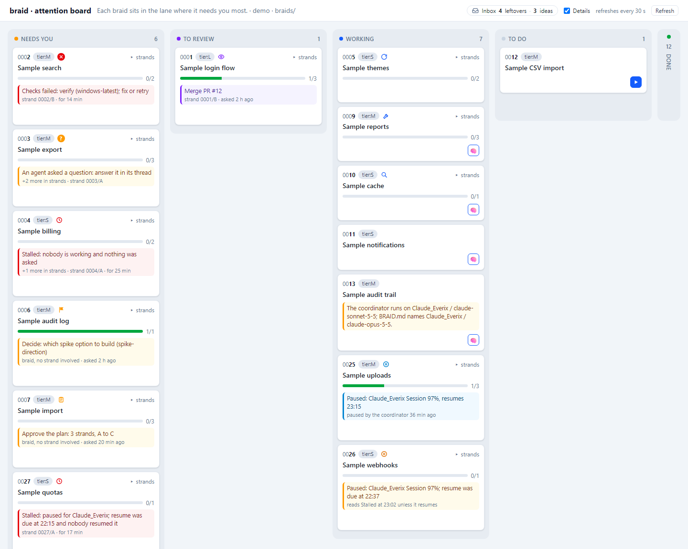

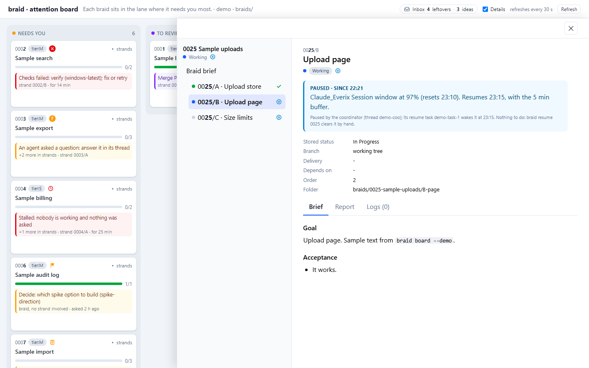

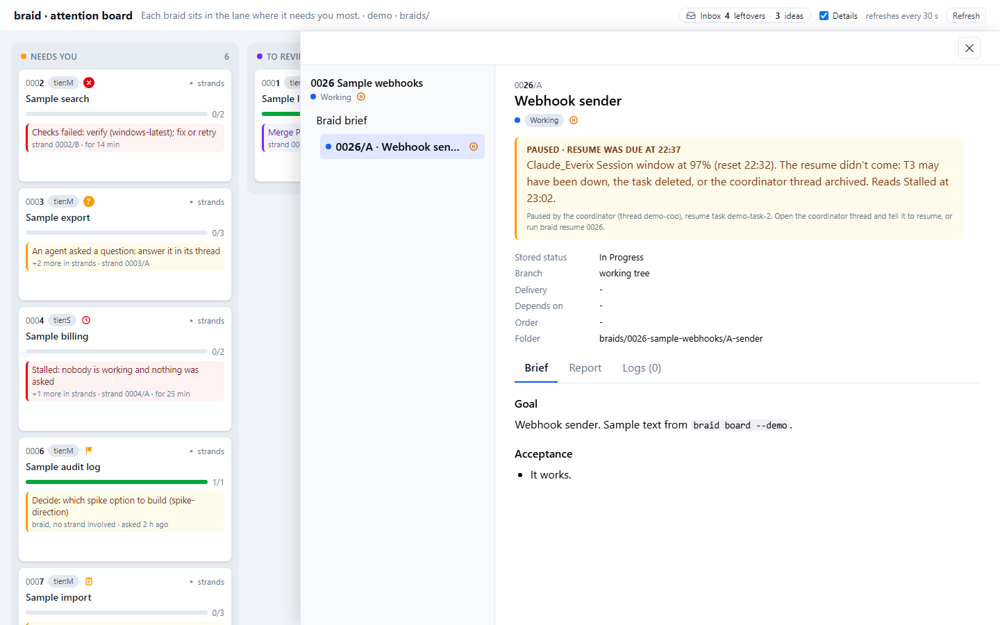

## Provider limits

The header shows a chip per provider: every instance in `BRAID.md` `models` of the listed projects, and any provider a running thread uses (a worker, reviewer or coordinator; T3's `providerInstanceId`). A chip has a Session and a Weekly meter, each with its threshold (`braid limits`: session 90%, weekly 90%, `limits` in `BRAID.md`) as a tick, and a note by its state:

- **ok** (grey) and **near** (amber, within 10 points of a threshold): the meters only.
- **over** (red): a window is past its threshold; "pausing…" while the board's steering thread runs.
- **paused** (sky): a limit pause record names the provider, whatever its cache says (a stale or unmeasured cache doesn't turn it unknown; the combined board keeps `paused` over another project's unknown); its bars stay sky even past a threshold; "paused · resumes 13:55", or "weekly · resumes Thu 07:05" when the window is the weekly one.
- **unknown** (dashed): no usable reading ("no reading for 14 min" for a stale cache). Unknown never pauses anything.
- **not measured** (dashed): T3 can't read this provider's usage (cursor).

A click on a chip opens the limits panel: per provider the windows with their bars, thresholds and reset times, the roles that use it, the braids paused for it and the agents running on it. The readings come from T3's provider caches (`<T3CODE_HOME>/caches`) with the code of `braid limits`, at each refresh and with no extra `t3` call. `/api/board` and `/api/all` carry them as `limits` (the combined board merges the projects' providers). On the phone the chips sit in a strip under the header, scrolling sideways, and the panel opens full-screen. `--demo` shows Claude_Everix paused, codex ok and cursor not measured.

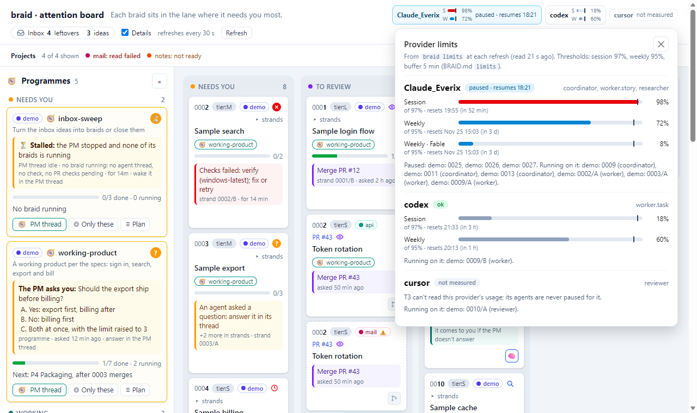

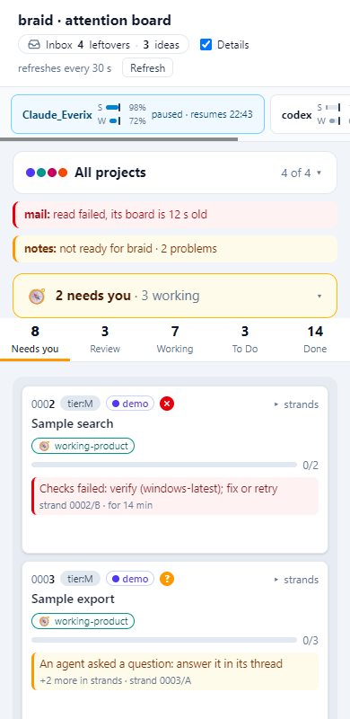

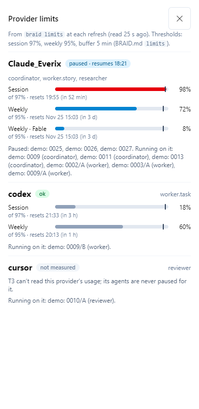

A thread titled `🚦 <repo> steering: …` is the board's own steering thread; no item reads it as one of its agents.

### The board pauses and resumes

This, the [wake, the reminders and the nudge](#wakes) are the exceptions to the rule that the board acts only on your click ([Refresh](#refresh), [Actions](#actions-and-the-session-token)) (decision D90 for limits). `braid board --no-pause` turns both off for one run (the limits still show), `--demo` never acts, and the start line says which mode is on: `Limits: pauses agents over a threshold through a 🚦 steering thread …; steering Claude_Everix / claude-haiku-5-5, then codex / gpt-6-luna`.

- **The steering model** is `models.steering` in `BRAID.md`, with a `first` and a `fallback` line (`steering: first: Claude_Everix / claude-haiku-5-5 / effort=low`, `fallback: codex / gpt-6-luna / effort=low`). The board takes the first line whose provider is under its threshold; when every one is over, it takes `first` and steers from the over provider in its margin, and pushes that. Without a `steering` role the start line says so and nothing is paused.
- **Over a threshold**, at a refresh, the board takes each braid with an agent on that provider: its coordinator (running, else idle), its workers (running or idle, not archived), its running recorded reviewers, and the PM threads whose plan lists it. A braid that already has a pause record (a hold, or another board's pause) is no target. It writes one `by: board` record per braid under the pauses lock, with the threads and the steering line, before anything else: the record is the claim, so a second board or a later refresh starts nothing. Then it starts one 🚦 steering thread per provider and pause (`t3 thread start <project> - --provider --model --title "🚦 <repo> steering: pause <provider> <window> <n>%" --json`), with a first message the board builds from a template: the window, the resume time, the targets, the pause message of the braid skill's limits reference (unchanged for workers; a coordinator and a PM get their own short variant), how to find running children (`t3_thread_list` with `includeSubagents`), at most 10 minutes of waiting for the `Paused:` replies, settling itself (never archiving itself), and a last line `Steering: <provider> paused <n>/<m>; children: <id>:<item>,…; no answer: <ids>`. With several projects, one thread covers all of them; it starts in the first project with a `steering` role.
- **Its outcome:** each refresh reads the thread (`t3 thread show --messages 3 --json`). The `Steering:` line stores the counts, the children (resumed with the braid) and who didn't answer. The pause **failed** when the run ended `failed` or `interrupted` without the line, when no line came within 15 minutes, or when `t3 thread start` failed (the fallback line is tried once, never more): the record stays, and the braid reads Needs You "Pause failed: the 🚦 steering thread …; agents may still be running on <provider>".
- **The resume:** at each refresh, a `by: board` record whose resume time (the reset plus the buffer) has passed is re-checked with `braid limits`. `ok` or `unknown`: each paused thread gets one `t3 thread send` (workers and children `Resume: continue <id> from your checkpoint`; coordinators `Resume: <number> was paused by the board for <provider>; go on where you left off`; PMs the same with their braids), then the record is cleared. A send that fails keeps the record and is retried at the next refresh for that thread only (after five failures it is given up and reported on the board's standard error). `pause`: the record stays with the new resume time. A resume missed while no board ran happens at the first refresh after a start.
- **A weekly window** pauses the same way and reads Needs You (reason `limit`, the ⚖ mark) until the reset: "Weekly limit: Claude_Everix Weekly 96% until Thu 07:00. Wait for the reset, or move its roles to another provider in BRAID.md models". It is derived from the record; no request is written. Waiting is doing nothing: the board resumes at the reset.
- **The limits panel** shows the last steering thread per provider: "🚦 Steering thread on codex / gpt-6-luna, started 12:52: 4 of 5 agents answered Paused:; no answer: 0026/A", with Open thread.

No board running means nothing pauses and nothing resumes. Coordinators and PMs keep only the check before a launch (on exit 3 they launch nothing on that provider and say so once), and they act on the board's pause and resume messages when a board runs; see the braid skill's `references/limits.md`.

## Programmes

A programme is the goal a programme manager (PM, the `braid-pm` agent) runs as several braids. The board shows each one in a **panel left of the lanes**, not in a lane: a programme is no braid, several of its braids run at once, and it can be busy with none running. The user approved the design in 0062/A (`design/board-mockups/programmes.html`, screens 60 to 67) and the stall rule on 2026-11-22; decision D88.

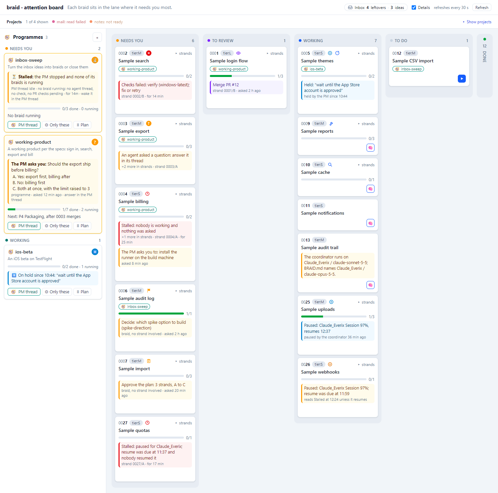

**Where they come from.** Each `pm/<slug>` branch holds the plan file `pm/<slug>.md`, whose front matter the PM writes and the board reads (the format is in [the braids/ format](braids-format.md#plan-files)). The board reads every `pm/*` branch at each refresh with one `git for-each-ref` and one `git cat-file --batch` (`src/board/plans.ts`): a local branch first, else `origin/pm/<slug>`. A plan that can't be read or parsed still shows its programme, in Working, with "plan unreadable: line 5: state is …" (the line of the first error), and the rest of the board works as before. `braid check --plan <file>` checks a plan before the PM pushes it.

**Two sections.** The panel (about 320 px) has **Needs you** on top and **Working** below (`src/board/programme.ts`):

- **Needs you:** a programme with an open programme request (`braid ask pm/<slug>`), shown as on a card: "The PM asks you: …" (or "to: …"), its lettered options as a list, the age and "answer in the PM thread"; or a **stalled** programme (below); or a programme one of whose braids has an open request that is yours: forwarded by the PM, escalated, or addressed to you (the PM's own on a braid too). Its card lists each once, oldest first, under the programme's own request: the handle, what it blocks and decide, do or merge, who asks ("Escalated to you: …", "The coordinator asks you: …", "The PM asks you: …"), the asking thread and "from <id> · asked … · answer in the PM thread". A request the PM is still handling isn't listed. The oldest first, across projects.
- **Working:** every other programme whose plan says `running` or `held`, in project order, then slug. Its card has the goal, a done bar ("3/10 done · 3 running"), and one status line: `Next: …` from the plan, "No braid running · the PM is working", or the hold in your words ("On hold since 18:02: “wait until …”", on a sky box).
- `done` and `stopped` programmes leave the panel; their braids keep the 🧭 tag.

Each card has **🧭 PM thread** (opens the PM's thread in T3; on the phone the app link), **◎ Only these** and **≡ Plan**. With no programme to show, the panel isn't drawn, so a project without a PM sees the board as before.

**Working and stalled.** A programme is Working while its PM thread runs, or while one of its braids runs: its coordinator thread runs, an agent of it runs (a worker or reviewer, as D46 counts agents; D46 never counts the coordinator as an agent, so the coordinator is named here on its own), the PM's checker for it runs (a thread titled `🧭 <repo> pm check: …`, which has no slug, so it counts for the programme whose slug or braid number it names, or for any programme while that is the project's only running or held one; or a checker the PM recorded with `braid review pm/<slug> --thread <id>`, because T3 lists no subagent thread and shows no children of the PM thread, and it counts while T3 says it runs; each run of it is a task the PM starts, and between runs T3 shows the thread `completed`, so the record is kept (not counted) and counts again when a later run starts; it is dropped from `.braid/reviews.json` only once T3 shows the thread archived, or 24 hours after its record, which bounds the `thread show` reads; a thread T3 can't be asked about keeps its record), or a PR of it has checks pending. Otherwise, after ten minutes on its own clock (`<repo>/<slug> pm` in `.braid/broke.json`, apart from the braids' keys), the PM is nudged once ([Nudges](#broke)), and ten minutes after the nudge it reads Needs you `stalled` (at ten minutes when its thread can't be nudged): "⏳ Stalled: the PM stopped and none of its braids is running", with what the board saw ("PM thread idle · no braid running: no agent thread, no check, no PR checks pending"; "the PM thread is gone" when T3 doesn't know it). An idle, failed or archived PM thread counts as not running. The stall is pushed once at high priority and clears as soon as the PM or a braid runs again. As with the braid alarms, it is told only after T3 and GitHub were read: an unread source neither starts nor stops the clock. Never stalled: a `done` or `stopped` programme; a held one (the plan's `state: held` or `hold`, or every braid of it that isn't Done paused for a limit or a hold); and one with an open programme request, which shows the request instead.

**Held.** A plan with `hold` (or `state: held`) shows your words on its card (with `state: held` and no `hold`: "On hold: the plan says held") and stays in Working. Its braids show 0061's sky pause mark with "Held: “…”" ("Held: the plan says held" when the plan gave no words) and are not stalled: a braid of a held plan without a pause record of its own reads as held by the PM (`braid pause --hold` records it per braid; the plan's hold also covers a braid the PM didn't record).

**Collapse.** « in the panel's header folds it to a rail of icons, » unfolds it; the choice is kept in the browser (local storage `braid-programmes-open`). The rail lists the programmes that need you first, amber with ? (⏳ when stalled) and a count, then 🧭 (⏸ when held); each icon has its project's colour dot, and its tooltip names the programme.

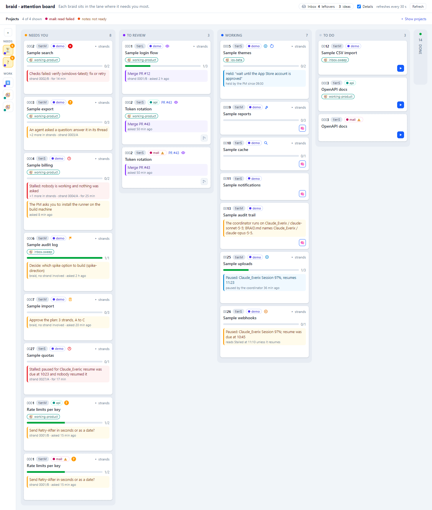

**Only these.** "◎ Only these" narrows the lanes to the programme's braids (the numbers in its plan's rows). The button stays pressed, the other programme cards dim, and a teal bar above the lanes says what is shown, with **Show all**; pressing the button again does the same. The address keeps it as `?programme=<project>/<slug>` next to `?projects=`, rewritten without a history entry, so it survives a reload and a phone link opens the same view. Lane counts, the phone tabs and the cards follow it. On a one-project board `?programme=<slug>` works too. A programme whose project isn't shown, or that the board doesn't know, is dropped from the address.

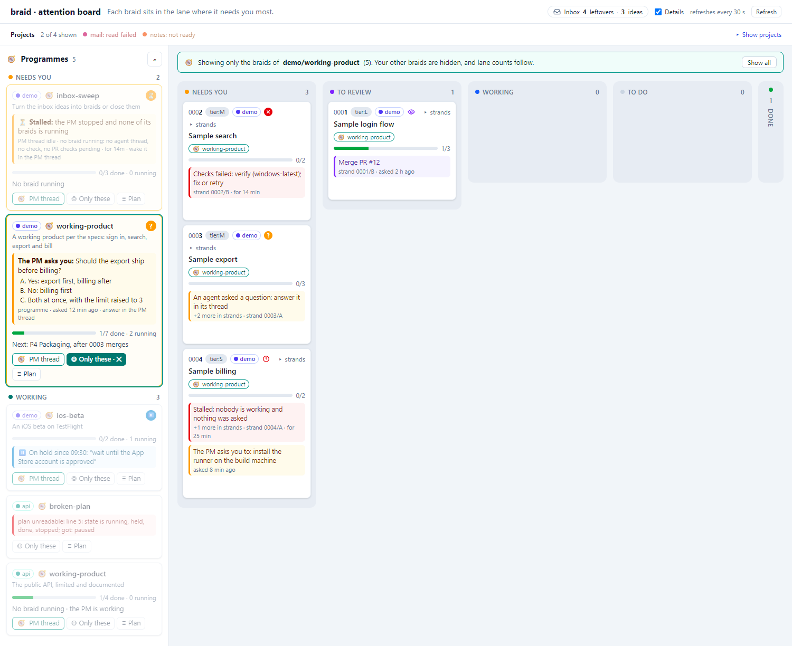

**Details.** ≡ Plan, or a click on the name or a rail icon, opens the programme's details over the right of the board, like an item's (`#/programme/<project>/<slug>`; Back, Esc and ✕ close it): the open request, the goal, every plan row (P-name, lane dot, braid number, title, state; a click opens the braid), next, what the PM is handling now, the last digest, the parallel limit, the hold, and where the plan file is.

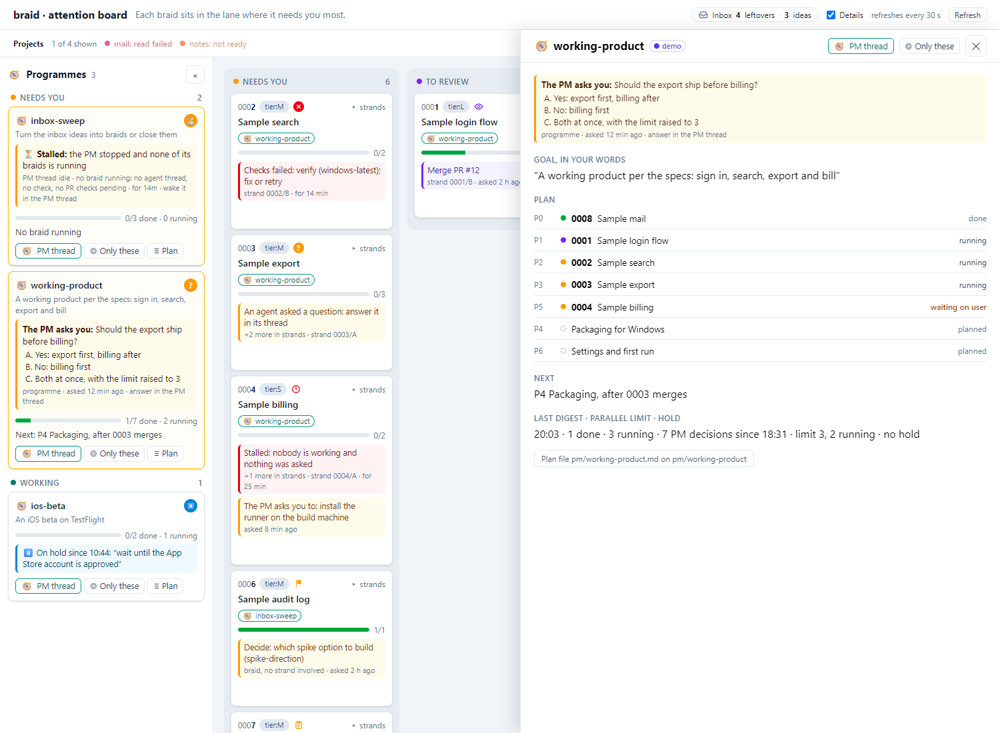

**Marks.** A braid that a programme's rows list carries a teal 🧭 `<slug>` tag on its card, and a 🧭 on its Done row. With several projects shown, programme cards carry their project's colour tag, as cards do.

**Several projects.** The panel lists the programmes of every project shown, keyed `<project>/<slug>`, so the same slug in two projects stays two programmes in the panel, the filter and the pushes. `/api/board` and `/api/all` carry `programmes` (done and stopped ones too), each with `key`, `project`, `slug`, `title`, `goal`, `state`, `section`, `thread` and `link`, `pmState`, `hold`, `paused`, `need`, `rows` (with each braid's lane), `braids`, `done`, `total`, `running`, `forwards` (what the PM forwarded from its braids), `requests` (their other requests that are yours), `status`, `next`, `digest`, `limit`, `handling`, `seen` and `error`. A braid card carries `programme`, the slug of the programme that runs it.

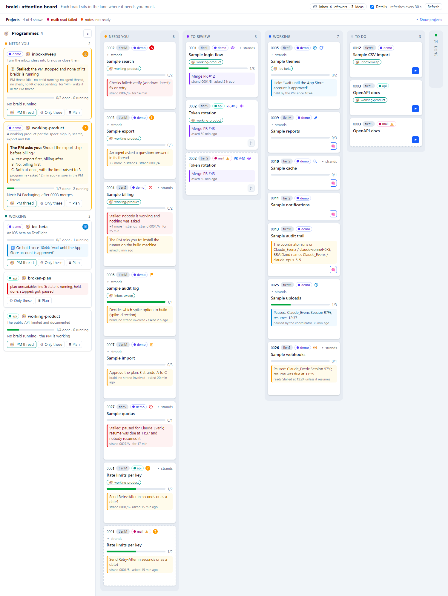

**On the phone** the panel is a strip above the lane tabs. Closed it is one line, "🧭 2 needs you · 3 working", amber when a programme needs you; opened like a drawer, it lists the programmes that need you as cards (the request, its options, a 44 px Open PM thread button and Only), then the working ones one line each with 🧭 and ◎. A programme filter shows as a chip under the strip ("Only: 🧭 working-product"), and ✕ clears it.

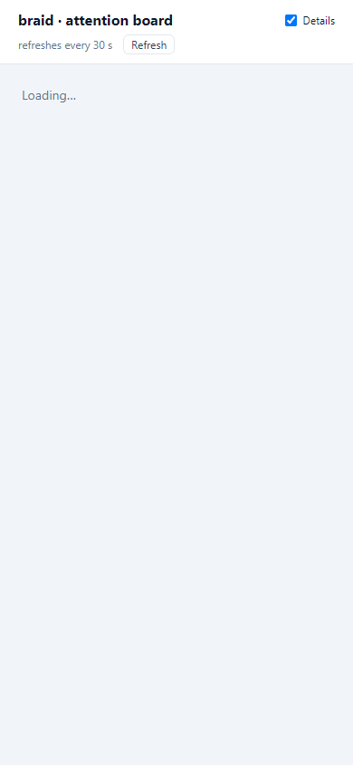

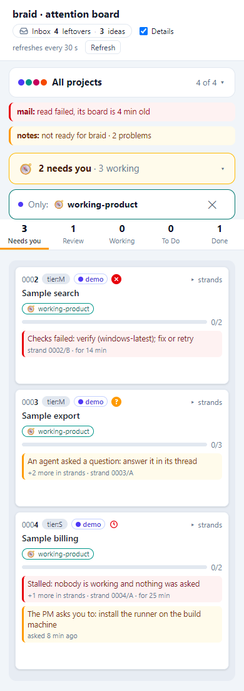

### Agents of an item

Two kinds of thread count. The worker's: a running thread whose worktree braid created for that item (`braid start <id>`, `<project>/<number>-<letter>`, or `<number>` for a story; `<project>` is the project's name when the checkout is listed, else the checkout's folder name, and worktrees made under the checkout's folder name before 0053/B are still searched). The reviewer's: a thread recorded with `braid review <id> --thread <thread id>`, which the coordinator runs right after launching the reviewer (in `.braid/reviews.json` of the main checkout, with the folder and branch T3 gives for it; several per item, one per review or re-check), counted while T3 says it runs. A reviewer is a subagent of the coordinator (D69): T3 makes its checkout, `t3 thread list` doesn't show it, and it has no Open thread of its own; the braid's Coordinator button opens the thread it shows in. A recorded thread that has ended, or that T3 doesn't know, counts for nothing, and a top-level thread in a leftover `-review` checkout or titled as a review is no agent of any item. A running reviewer gives the item review activity and its pending questions, and holds back `checks failed` and `stalled`. In wrap-up (every strand Done, final PR open) the braid's card counts its recorded reviewer threads as its agents (review activity; they hold back `checks failed`), shows the checks spinner while the final PR's checks run, and still never counts the coordinator. Any other thread is no agent of any item, so the coordinator, which works on a braid branch with strands or in the main checkout, can't stand for a strand's agent, holds back or starts no alarm of an item (only the braid-level `stalled`), and can't block `braid accept`. It only lifts its own braid from To Do to Working (rule 7) and keeps Start off ("a coordinator for this braid is running"). T3 is read for three facts: whether an agent of the item runs, a running agent's pending question, and which idle thread of an item to open.

**What runs** (0075/G). A thread runs when T3 says `running` or `waiting` (its turn waits on a background task it awaits, such as a local gate), and also when it has background work pending (`pendingBackgroundTasks` in `t3 thread list --json`: a background command such as a gate rerun, or a subagent) or is blocked on a thread wait (`blockedOnThreadWait`). T3 shows such a thread `completed` or `waiting` between turns, yet it is working. One rule (`working` in `src/board/t3.ts`) decides it everywhere the board asks whether something runs: a worker, a recorded reviewer, a coordinator and the PM, so none of them is nudged or reads stalled while it works in the background.

## Where the states come from

- **Files:** each item's `brief.md`, read from its own branch when it has one ([Branches](braids-format.md#branches)).
- **GitHub:** one `gh pr list` per refresh (state, head commit and checks); a PR belongs to the item named by its head branch (`braid/0006-slug` or `braid/0006/A-slug`). Merged and closed PRs are cached (an open one wins over both, a merged one over a closed one).
- **T3:** `t3 thread list --project <main checkout>`, plus `t3 thread show` for each running thread (its worktree and pending questions) and for each recorded review thread (whether it runs, and its pending questions). An idle thread (not running, not archived) is placed by its title alone, with no `show`: `<emoji> <repo> <id> <role>: <title>` (built by `braid title`; the emoji may be missing in older titles, the repo is the GitHub repository's name or the checkout folder's) names its item (`0009` or `0009/D`) and its role (`worker`, `coordinator`); a `review` title and any other title drop it. A running thread belongs to an item by its worktree folder, as above. `braid clean` reads T3 the same way, so it shows only running threads.
- **Requests, review threads and broke clock:** `.braid/` of the main checkout.
- **Programmes:** the plan files on the `pm/*` branches ([Programmes](#programmes)).
- Without `gh` or T3 the board still works on the stored states and requests; without `gh` the banner says why (see [Not ready](#not-ready)), without T3 the header does. Without T3 no agent shows and no alarm can be told.

## Icons and lines

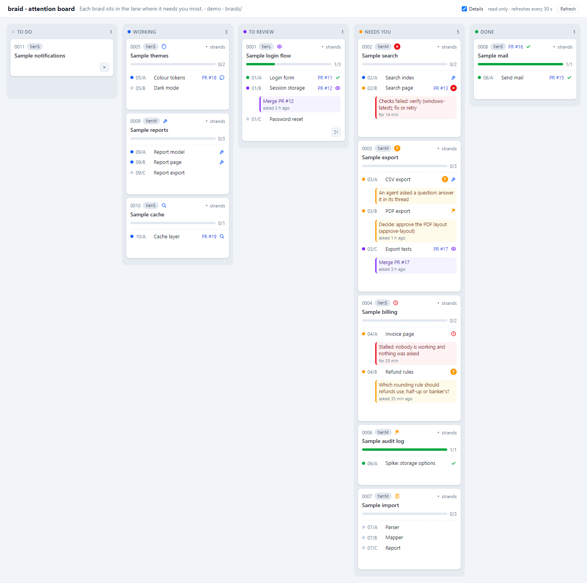

A card on your side (Needs You, To Review) carries one line saying what is needed, with its age ("asked 35 min ago", or "for 14 min" for an alarm), and only its most urgent icon. A braid card also says which strand it comes from (or "braid, no strand involved") and how many more strands need you. An expanded card shows the line on each strand row. Exact icon text is on hover (also the `aria-label`).

| Icon | Means | Hover |
| --- | --- | --- |
| amber `?` | a question: a request, or an agent's pending question | Question: waiting for your answer |
| amber flag | a decision request (`--key` = the stop case); on an item with only an `ask:` label, the label's flag | Decision needed: `<key>` / Will need your decision: `<key>` |
| amber clipboard | a plan to approve | Plan approval needed |
| red circle with a cross | checks failed (alarm) | Checks failed: names of the failing checks |
| red clock | stalled (alarm) | Stalled: nobody is working and nothing was asked |
| scales ⚖ | a board pause that needs you: a weekly window, or a failed pause | Provider limit: a weekly window or a failed pause needs you |
| sky pause | the braid is paused for a provider limit (also on its strands not Done) | Paused: `<provider> <window> <n>%`, resumes `<time>` |
| amber pause | paused, and the resume was due more than 15 min ago | Paused: …; resume was due at `<time>` |
| teal compass 🧭 | a request addressed to the PM, which it is handling | The PM is handling: `<text>` · to the PM `<age>` ago |
| purple eye | a PR to review | PR #N to review |
| blue wrench | a worker agent is running | agent running |
| blue magnifier | only a reviewer is running | review running |
| blue spinner | only CI is running | checks running |
| green tick | Done | Done |

Red appears only where something went wrong. Green means Done.

### The Details toggle

The "Details" checkbox in the header shows (default) or hides the request lines. Hidden, the text moves into the tooltip of the card's reason icon, with the strand and the age.


The setting is kept in the cookie `details` (`on` or `off`), so it survives a reload and a restart.

### The item details

Clicking a card, a strand row or a Done row opens the item's details in a **side panel over the right of the board**; the board stays mounted underneath, so its scroll, open lanes and Done list are as they were. The panel is `min(70vw, 1200px)` wide, never under 720 px where the screen allows, so the brief reads comfortably and the left lanes stay visible. A braid with strands, or one of its strands, is two columns inside the panel: a **rail** on the left (280 px, scrolls on its own) with the braid's id and title, its lane and marks, "Braid brief" and one row per strand (lane dot, `A · Title`, marks) with the current one highlighted, and the details on the right; a click on a rail row moves inside the panel. A braid without strands has no rail. The details show the header with the actions, the request banner, the fields and the Brief, Report, Logs and Requests tabs. It refreshes with the board.

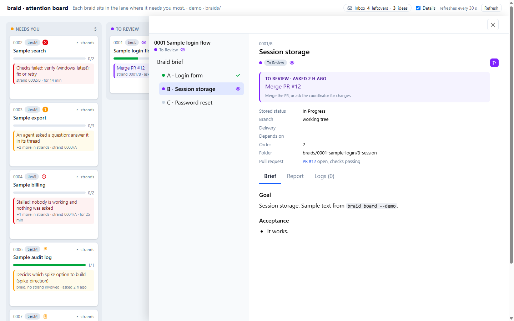

The hash keeps its form (`#/0003`, `#/0003/A?tab=report`; `src/board/route.ts`): the board is always the base view, so a direct link opens the board with those details open. Opening from the bare board adds one history entry; moving to another card, a strand or a tab inside the open details replaces it, so one Back closes the panel. The close button, Esc, a click on the board (a click on another card opens that one instead) and Back all close it and return to the board without a reload or a scroll jump. The Inbox (`#/inbox`) stays a page. Decision D65.

A braid or strand shows the request as a banner above the brief, with the same text as the card. Answering still happens in the coordinator's thread.

## The inbox

The header chip `Inbox N leftovers · M ideas` (grey when both are 0) opens the Inbox page (`#/inbox`, "← Board" returns). The inbox is not a lane and puts nothing in Needs You: capturing asks the user nothing, and the sweep proposal reaches you as a `braid ask`, which the board already shows (decision D55 in [decisions](decisions.md); the storage is [the inbox](braids-format.md#the-inbox)).


The page has two lists, **Leftovers** (with "sweep due" at 3 or more open) and **Ideas**, each headed by its open count. Each entry is a collapsed row: its title, for a leftover its source (`review 0012/A`, `0020/A`, `PR #124`), the age, and an amber "passed over ×N" when a sweep passed it over; an idea also shows the first line of its text. A click opens the full text, its links and its id. An empty list says what fills it (`braid note`, `$braid-idea`).

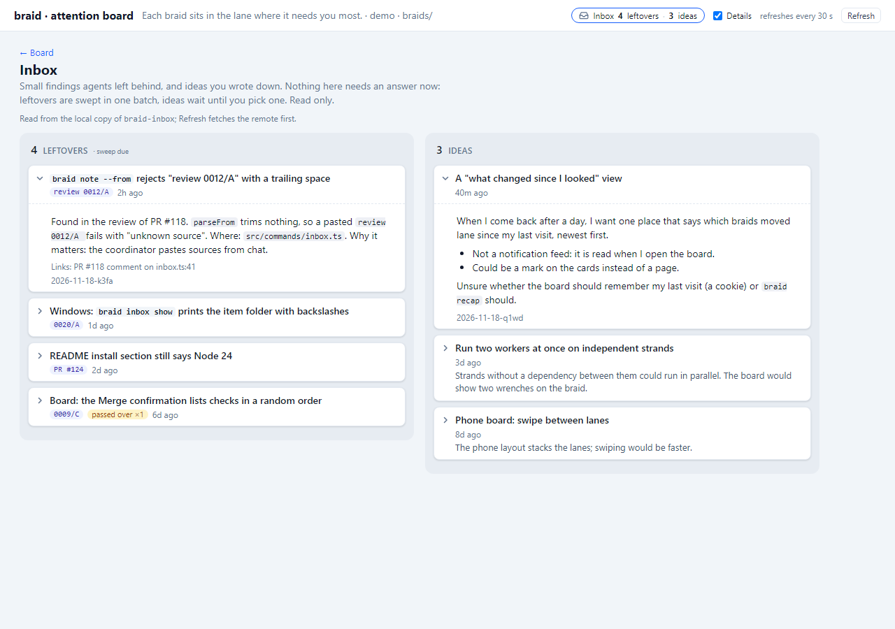

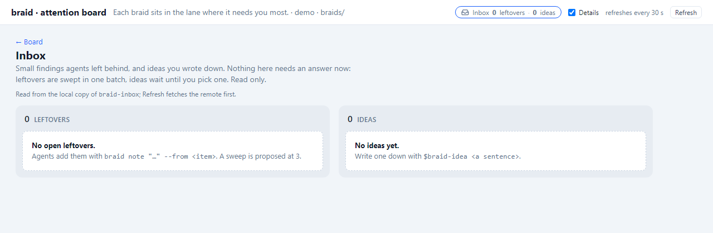

**Promote to Braid.** Each idea row carries a **Promote to Braid** button on the right of the collapsed row (full width under the preview on a phone, 44 px high). It opens a confirmation (the idea, what launches, what happens after, the model, the base branch and the branch name); on confirm the board posts `promote` with `{ id }`, an idea id, and a new **coordinator thread** starts in T3 whose first message asks it to plan a braid from that idea with the braid skill. The message quotes the idea in full and says that it comes from Promote to Braid, which is the user's request to *plan* the idea, not to start it; the plan still needs your approval in that thread, and after the approval the coordinator takes the idea out of the inbox with `braid inbox take <idea> --into <braid ids>`. The board writes nothing to `braid-inbox` itself, so the idea stays in the list until then. Leftovers have no button: they go through sweeps.

The server reads the inbox again (fetching `braid-inbox`) and refuses with `Promote: <reason>` when the entry isn't an open idea, T3 isn't reachable or a coordinator for the idea runs. Otherwise it does what Start does: `git fetch origin`, a free branch `coordinator/idea-<idea id>` (`-2`, `-3` when taken) from `origin/<main>`, `t3 thread start` with no model flags (T3's project default) and the first message on standard input, and the same model warning when the thread's model differs from BRAID.md. The thread is titled `🧠 <repo> idea coordinator: <idea title>`; the coordinator renames it with `braid title` once the braid has a number. A running thread on `coordinator/idea-<idea id>` (or its `-2`, `-3`) marks the idea **Being planned**: the row shows that and an **Open thread** button (`open` with `{ idea }`) instead of Promote. Over Tailscale it works like Start (the session token rules in [Actions and the session token](#actions-and-the-session-token) apply).

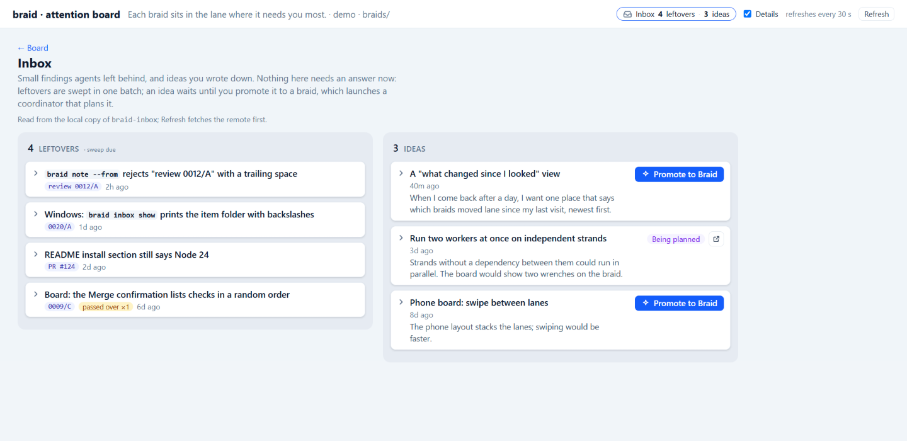


`/api/board` carries it as `inbox: { leftovers, ideas, note, expected, base }` (`src/board/inbox.ts`): the open entries, newest first, each with `kind`, `id`, `title`, `text` (after the title line), `from`, `ref`, `age`, `passed` and, for an idea with a running coordinator, `planning: { link }`. Every refresh (the 30 s reload and file changes) reads the local `braid-inbox` and `origin/braid-inbox` refs; the **Refresh** button (`?fresh=1`) fetches `braid-inbox` first, so an entry captured in another clone shows up. `note` says when that fetch failed (the local copy is shown) or an entry is malformed and left out. The demo board has sample entries.

## Not ready

A folder that isn't a working braid project would show an empty board, so the board and `braid status` say what is wrong and what to do (`src/braids/readiness.ts`). Nothing is stored: the problems are computed at each read, and the board is still served with what it can read. The page shows them in a note above the lanes; startup prints one `not ready: <reason>; <what to do>` line per problem, and `braid status` prints the same lines before the strand lines (when it can't show a braid at all, for a folder with `backlog/` and no `braids/`, it prints the lines and why, instead of failing). Startup prints the lines of the first snapshot, so `gh` runs once. `readiness(folder, github)` never throws: a file it can't read is a problem, and `null` for `github` leaves GitHub unchecked. The problems:

- no `braids/` folder (when `backlog/` exists: run `braid import-backlog`);
- `BRAID.md` missing, its front matter unreadable, or missing `gate`, `main`, `ci` or `models`;
- `braid check` reports errors (a brief the loader can't read counts: the board is then served without braids, with the note instead of an error page);
- GitHub can't be read (`gh` missing, not logged in, or the repository unknown). This is the only GitHub message, on the board and in `braid status`; it says that PRs and checks are missing and lanes come from stored statuses.

T3 not running is not one of them: it keeps its own note in the header. T3 not knowing the main checkout is not checked yet: the `t3` CLI has no project list, and `t3 thread list --project <folder>` prints `[]` for a folder T3 doesn't know just as for a project with no threads (see the log of 0049/A).

`braid projects add|list` print the same problems for each project in this machine's [project list](braids-format.md#the-project-list) (`~/.braid/projects.json`), with GitHub unchecked. With a list, the board shows each listed project's problems ([Several projects](#several-projects)), and startup prints them as `<name>: not ready: …`.

## Several projects

One `braid board` serves every project in this machine's [project list](braids-format.md#the-project-list) (`~/.braid/projects.json`, `braid projects add`), or only the one `--project <name>` names: one port, one token, one Tailscale listener and one process for the pushes (D78). In a folder with no list (no file, or an empty list) it serves that folder alone, as before. `--port` and `--host` work as for one project; a project's own `port` in the list isn't used here. The list is read at the start (a list braid can't read stops the start, exit 2) and again at each refresh: a project added shows up, a project removed disappears at the next read, and a read of it still under way stores nothing and sends no pushes. A list that turns unreadable while the board runs keeps the projects as they were and prints one line to standard error. Startup prints `Projects: <names>` and each project's [not ready](#not-ready) lines as `<name>: not ready: …`.

**Reads.** Each project has its own snapshot cycle ([Refresh](#refresh)): its own reads, one at a time, its own watcher on its `braids/` folder and its own notifier. The projects are read in parallel, and each project's whole read has a timeout of 60 s (`src/board/feed.ts`) on top of the 30 s of each GitHub call. A read that takes longer counts as failed: the project keeps its last good snapshot, marked with the failure and its age, its late result is dropped (no snapshot, no pushes), and its next read starts only once that one has settled, so `gh` and `t3` of one project never run twice at once. One slow or broken project never holds up the others: they refresh and push as usual, and a request waits for a project's read at most that timeout.

**API** (`src/board/combined.ts`), all answered from the snapshots:

- `GET /api/all`, optionally `?projects=<name>,<name>`: one combined board. `braids` holds every card of every project (or of the named ones), each with its own lane, derived per project as for one project, and tagged `project: <name>`; the projects come in list order, each with its cards in its own order, Done included. `projects` has one entry per project: `name`, `repo`, `counts` (cards per lane), `problems` (readiness), the `github` and `t3` states, `readAt`, `ageMs`, `failure` and its `inbox`. `missing` lists asked-for names that aren't served (a project removed from the list); `lanes` and `remote` are as in `/api/board`.
- `GET /api/projects`: the `projects` entries alone. No folder path is sent.
- `GET /api/board?project=<name>` and `GET /api/item?project=<name>&id=<id>`: one project's board and item, in the shape of a single board, with `project`, `readAt` and `failure` added. Without `project` they answer for the first project; an unknown name is 404.

**Actions** carry the project they are for: `POST /api/action/<name>` with `{ project: <name>, ... }`. The server looks the name up among the projects it serves and runs the action in that project's main checkout; with one project served, `project` may be left out. Anything else is refused with 400 before the action runs: no `project` while several are served, a name that isn't served (removed from the list, or never in it), and anything that looks like a folder path (a path from the client is never accepted; only the list says where a project lives). The token, Host, Origin, `x-braid-request` and whois checks come first and are unchanged ([Actions and the session token](#actions-and-the-session-token), [On Tailscale](#on-tailscale)).

**Pushes** come from one notifier per project, each with its sent keys in that project's own `.braid/notified.json`, so the keys of two projects never mix, also when both have the same repository name; push titles name the repository and the item ([Notifications](#notifications)), except that two listed projects with the same repository name use their project names in them (`work-app 0001/B: Needs You`) so a phone can tell them apart (D83). A project that couldn't be read, or whose read timed out, sends nothing for that read. Every listed project is notified, whatever a page shows.

**The page.** One combined board: every lane holds the cards of every project shown, each card tagged with its project (`web/src/App.tsx`, fed by `/api/all`). With one project served the page looks as it always did: no project block, no tags, the project's problems in the banner above the lanes (a failed read gets a red banner of its own).

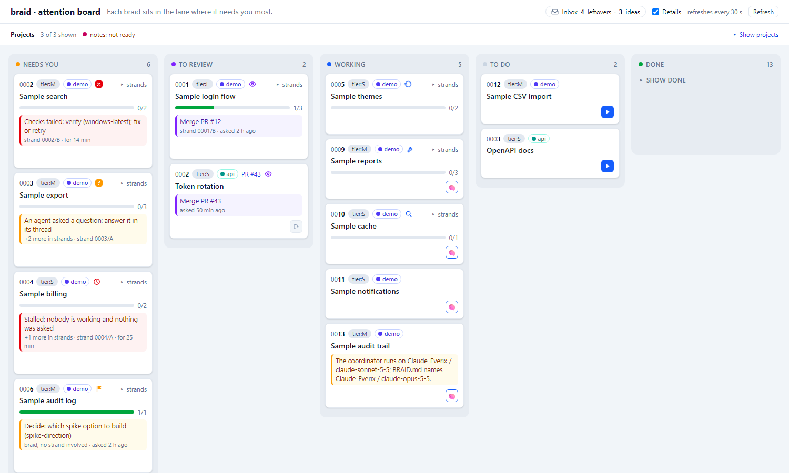

- **The filter** is `?projects=a,b` in the address (`/?projects=api`; `?project=a` is the older form and works the same). Without it, or with no served name in it, every project shows; names are taken in the order the projects are served, and names that aren't served are ignored. The address is rewritten (`replaceState`, no history entry) when the filter changes, and it is empty again when every project is selected, so a bookmark or a phone link opens the same view. The last project shown can't be unticked. The lanes, their counts, the tab bar on a phone, the inbox chip and the inbox page all follow it. It is read by `src/board/filter.ts`.
- **The Projects block** (desktop) is one summary line by default: `Projects · 3 of 3 shown · api: read failed · notes: not ready ▸ Show projects`. The summary always names a project whose latest read failed and a project that isn't ready, also when it is unticked (muted), so a problem is never hidden by the collapse. A click opens it to one line per project, and a click on the summary folds it again; the open state is remembered in this browser (`localStorage`, `braid-projects-open`), so it stays open once opened.

  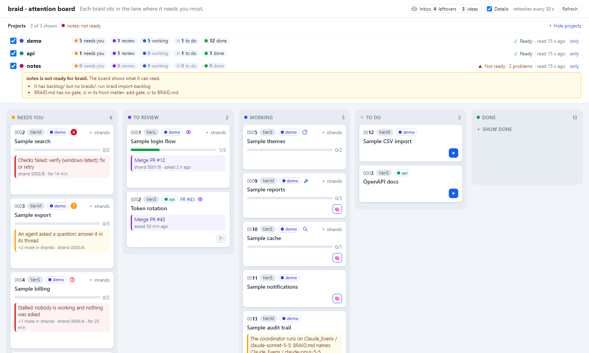

  Each line has a tick box, the project's colour and name, its five lane counts, its readiness, and **only** (show just this project). A line's readiness is *Ready · read 12 s ago*, *Not ready · 2 problems* (its problems are listed in an amber box under the line, as the single-project page shows them), *Read failed · board is 14 min old* (a red box under the line gives the reason from `failure`; with no snapshot yet it says *no board yet*), or *Not read yet*. The ages come from `readAt` and `ageMs` of `/api/all`.

  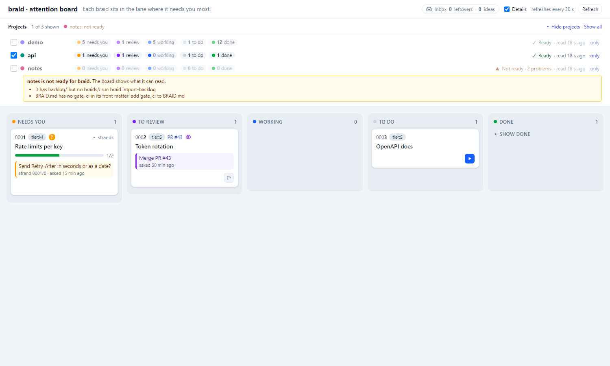
- **Project tags.** With two or more projects shown, a card, a Done row and an inbox entry carry a tag with the project's name and a colour (placeholder colours by position in the project list). With one project shown the tags are hidden. Cards of a project whose latest read failed have a dashed edge and a ⚠ in the tag (its tooltip says how long ago the read failed): they show that project's older board.
- **Addresses.** With several projects served, an item opens at `#/p/<project>/0003` (`#/p/<project>/0003/A?tab=report`); `#/0003`, `#/0003/A` and `#/inbox` still work and mean the first project shown. A project name that isn't served (a project removed from the list, a mistyped link) is not asked of the server: the panel says "No such project" and names the served ones (`resolveProject` in `src/board/filter.ts`). The panel's header shows the project's tag, and a red note when its latest read failed. Every action the page sends carries the item's `project`, so Start, Merge, Open thread and Promote run in that project. The Merge "asked" memory is kept per project and item.

  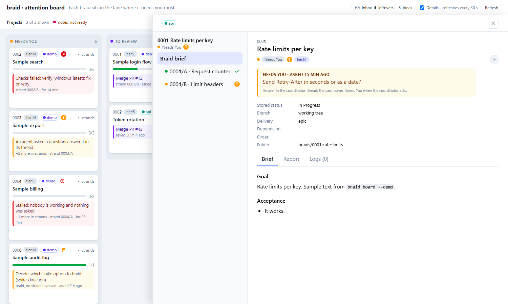
- **Inbox.** One page for the projects shown; each entry is tagged with its project, and Promote uses that project's `expected` and `base`.
- **On a phone** the Projects block is a picker above the lane tabs ("All projects · 3 of 3 ▾", or the names shown): a tap opens a bottom sheet with one 56 px line per project (tick, counts, readiness, **only**), a *Show all* link and a button that closes it. Failed or not-ready projects that are shown get a note under the picker, so a problem is visible with the sheet closed.

  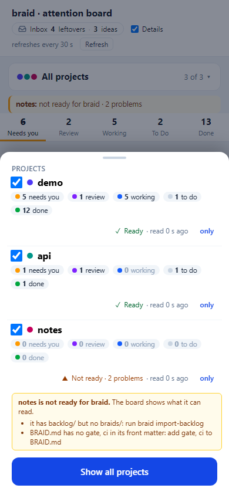


## Refresh

The server reads GitHub, T3, the braids and the inbox in the background, never inside a request, and keeps the latest complete result as a **snapshot**. `/api/board` and `/api/item` answer from it, so opening an item costs no `gh` or `t3` call, and `gh` runs without blocking the server (a static file is served while it runs). A snapshot is stored only when every source has been read; before the first one exists a request waits for it (at most the read timeout of [Several projects](#several-projects)). A read that fails keeps the last good snapshot, with when it was read and what failed (`readAt` and `failure` in `/api/board`); only when there is none yet is the failure the error the page shows. Reads run one at a time: a refresh asked for while one runs queues exactly one more read, however many asks come.

A read starts when the server starts, every 30 s, 200 ms after a file under `braids/` changes, and on the page's Refresh button (`?fresh=1`, which also fetches `braid-inbox` and answers when its read is done). When a new snapshot is stored it is pushed over `/api/events` and open pages fetch it; until then they keep showing the last one. Each read notes the first sighting of a broke condition in `.braid/broke.json`, once per read; with notifications on, it also records the pushes sent in `.braid/notified.json` ([Notifications](#notifications)). Those, the board's limits pause in `.braid/pauses.json` ([The board pauses and resumes](#the-board-pauses-and-resumes)), the `met` and `reminded` events it records on the request record `braid-requests` ([Wakes](#wakes), [Reminders](#reminders)) and the `pm/` checker records of archived or day-old checkers it drops from `.braid/reviews.json` during the T3 read are the only things the board writes on its own.

Open thread (and Coordinator, `{ id, thread: "coordinator" }`) takes the thread's link from the snapshot (a link doesn't change) and reads T3 again only when the snapshot has none. Start, Merge and Promote still read GitHub and T3 fresh before they act (Promote reads the inbox and T3 fresh, fetching `braid-inbox`). `open` also takes `{ idea }`, an idea with a running coordinator: the link is the snapshot's, else T3 is read again.

To see what a read costs, start the board with `BRAID_BOARD_TIMINGS=1`: each read prints `board read: braids 160 ms, github 690 ms, t3 2800 ms, signals 50 ms, done dates 60 ms, inbox 150 ms, board 2 ms` to standard error. GitHub and T3 are read in parallel with the braids, so the times overlap.

The reads are cheap by design: the Done dates of all Done items come from one `git log` of the history and one `git cat-file --batch` (the rule is unchanged: the oldest commit of the unbroken run of `status: Done`, following renames; an item whose first version is already Done is checked with its own `git log --follow`, because the one log may not pair its rename); the braids from branches and the inbox entries are read through one `git cat-file --batch` each, and `git` runs without blocking the server; T3 reads are unchanged: every read runs `thread show` for every running thread (in parallel), because `thread list` gives no pending count and its `updatedAt` lags `thread show`, so a skip could hide a pending question. The inbox costs about 1.3 s only on Refresh, which fetches `braid-inbox` from origin; a read without Refresh takes about 150 ms.

## Actions and the session token

The board can also act, but only through `POST /api/action/<name>`, and only for the page this `braid board` run opened. Actions are registered by name in `src/commands/board.ts` (`Sources.action`); the endpoint itself adds none that changes anything. Today there are four, `merge`, `start`, `promote` and `open` (`open` on the local listener only; the first three below). On the local listener a request is refused with 403 unless it carries this run's token in the `x-braid-token` header, its `Host` is `127.0.0.1:<port>` and any `Origin` it sends is `http://127.0.0.1:<port>`. Unknown names give 404, a body that isn't JSON 400, a body over 64 KB 413, and other methods 405 as before. The 403 body's `error` says which check failed and what to do, and never echoes the token: no token (open the URL `braid board` printed, or the one `braid board --url` prints), a token from another `braid board` run (a second tab or a tab kept across a restart; open the printed URL now, or `braid board --url`'s), a Host or Origin that isn't this board's page, and on the Tailscale listener a missing `x-braid-request` header. The page shows that text in the dialog. The Tailscale listener of `braid board --host` checks identity instead of the token ([On Tailscale](#on-tailscale)); its whois/Host refusal is a 403 too: for an `/api/` path a JSON body whose `error` says the board couldn't confirm through Tailscale who is asking (or that the Host isn't this listener's) and that refreshing asks again; for any other path a terse plain-text `forbidden`. The page never shows a JSON parse error for a non-JSON error body: it shows the status and text.

**Every request on the local listener**, the page, the board data, the refresh events and the actions alike, needs `Host: 127.0.0.1:<port>` or `localhost:<port>` with this board's own port; anything else gets 403 before anything is read (D78). A page on another name that resolves to `127.0.0.1` (DNS rebinding) so reads no board data of any listed project. Actions are stricter still, as above: only `127.0.0.1:<port>`, plus the token. The Tailscale listener has its own Host check ([On Tailscale](#on-tailscale)).

The token is 24 random bytes, new on every run. The command opens and prints `http://127.0.0.1:<port>/#token=<hex>`: a fragment never goes to a server log or a `Referer`. The page (`web/src/api.ts`) moves it into `sessionStorage`, removes it from the address bar and sends it with `postAction`. Besides that, it is only in the run's [address file](#the-address-file), owner-only under `~/.braid`: not in a project's `.braid/`, a log, a push, a cookie or a GET URL. A second tab opened without the fragment can't act.

### The address file

A real `braid board` run (not `--demo`) also writes its full address, `http://127.0.0.1:<port>/#token=<hex>`, to `~/.braid/board-<port>.url` once it listens, so a board with no console (started [at login](#run-the-board-at-login) or as a service) can still be acted on from its page (D94). One file per port, so two boards keep their own. The file is created owner-only (through a temporary file renamed into place: on POSIX the temporary file is created with mode 0600, never a chmod after; on Windows it is created empty and given its own ACL, inheritance off and only you with full control, before the token is written, so the folder's ACL, which may let other accounts such as a sandbox group read it, doesn't apply; if that ACL can't be set the board says so on standard error and writes no file), and a newer run on the same port replaces it. It is removed when the board stops: `Ctrl+C`, `SIGTERM`, `SIGHUP` (a console window closed), Windows' Ctrl+Break and a normal exit. A board killed outright (`Stop-Process`, Task Manager, `SIGKILL`) leaves its file behind with a dead run's token.

`braid board --url` prints the address of each board running for you, one per line (`--port <n>`: only that port's), and exits 0. It asks each file's port `GET /api/session` with the file's token (the local listener answers 204 for this run's token and 403 otherwise, and reads nothing), so a file whose port answers nothing, or answers with another run's token, is no running board. When none answers it prints `no braid board is running for this user; start one with braid board` to standard error and exits 1. It leaves stale files alone; the next run on that port replaces its file.

## Open thread and Merge on request

**Open thread opens the T3 desktop app.** T3's `link` (`http://127.0.0.1:3773/<env>/<thread>` or, since a T3 update, `https://app.t3.codes/threads/<env>/<thread>`) opens in a browser and asks for pairing, so the button posts the `open` action (`{ id }` of the item or braid; the token path of the other actions) and the server opens `t3code://threads/<env>/<thread>`, built from that link, with the OS: `cmd /c start "" <url>` on Windows, `open` on macOS, `xdg-open` elsewhere, the URL as one argument and never in a shell string. The server takes the thread's link from the snapshot (it reads T3 again only when the snapshot has none; see Refresh), picking the thread by the rule below, so a client can't pass a URL; a link that is neither `/<env>/<thread>` nor `/threads/<env>/<thread>` or has odd characters, no thread, or an opener that fails is refused with its reason (the button's tooltip shows it).

**Braid numbers and thread emojis.** A braid number or strand id is shown in full everywhere on the board (cards, strand rows, Done rows, the details header and contents, the inbox source chip): the leading zeros in normal weight and the significant digits in bold, `00`**`34`**`/A`. The CLI's text output is unchanged. The Coordinator button shows 🧠; Open thread shows the emoji of the role of the thread it opens, read from the thread's title (`threadRole` in the board data): 💻 for a worker, 👀 for a review, 💻 when the role is not known. These are the emojis of `braid title`; no icon library.

**Open thread.** A card or strand row whose item has a thread in T3 carries a small button that opens it (`link` of `t3 thread list`, `thread` in the board data): the running agent's (a worker's, else a reviewer's), else the newest thread of the item that is not running and not archived (a worker waiting for CI, a finished reviewer). Where there is no such thread there is no button. A braid with strands carries no Open thread of its own (each strand row has one); it carries a **Coordinator** button instead (compact, drawn as the 🧠 of coordinator thread titles) that opens its coordinator's thread (see Start), running or else the newest idle one that is not archived, so the coordinator stays reachable while a strand runs. A braid without strands keeps Open thread (its worker's) and gets the Coordinator button next to it. The braid's page and the Needs You row follow the same rule; a braid without a coordinator thread has no Coordinator button. The button posts `open` with `{ id, thread: "coordinator" }`; without `thread` the server picks the item's agent thread as before, and the coordinator's for a braid without one. A thread other than `"coordinator"`, a strand id with it, or no coordinator thread is refused. A thread T3 marks archived (`archived`, `archivedAt` or the status `archived`) never gets a button. A Done item (card or strand row) gets no button from an idle thread, because the old threads of finished items keep their worktree path after `braid clean`; a running agent's thread still shows. An idle thread only gets the button: it is no agent, so lanes, Working, `braid accept` and the pending-question reason still read running threads alone, and Start stays off only while a coordinator is running.

**Merge on request.** The board never merges. A card or strand row in To Review with an open `review` request has a Merge button; it opens a confirmation (PR, head commit, the branch it merges into, each check). On confirm the board posts `merge` with the item and the shown head. The server reads GitHub and the requests again, and refuses with the reason unless the item still has an open review request with a coordinator thread, the PR's head is still the shown one and its checks are green. Then it sends the request's coordinator thread `Merge #<n> at <head>, from the board.` with `t3 thread send`; the coordinator (skill: "Merge on request") merges as for "merge it", and the card leaves To Review when the PR merges. Until then the button is off and says so, per head (kept in `sessionStorage`).


The button is off, and its tooltip reads `Merge: <reason>`, when the item has no open review request, the request has no coordinator thread, the PR isn't open, or its checks failed (the failing names), are still running or are missing. A refused confirmation shows its reason in the dialog.

## Start

**Start** on a To Do braid card launches a **new coordinator thread** in T3 that runs the braid. After a confirmation (what launches, the model, the base branch) the board posts `start` with the braid. The server recomputes the card from fresh reads, refuses with `Start: <reason>` when it is off, and runs `t3 thread start <main checkout> - --title "🧠 <repo> <id> coordinator: <title>" --worktree <base> --branch <name> --json` with the first message on standard input: `Use the braid skill and run <id>.` and a sentence saying where the worktree stands. It passes no model flags, so T3 uses the project's default model; the board can't read a thread's effort. The braid skill's coordinator then launches its workers as before; the board binds no worktree itself.

Every braid on the board is already in `braids/`, so Start never plans: the branch is always `coordinator/<number>-<slug>` (Git allows a branch in one worktree only; the coordinator switches to the braid branch). A braid with a braid branch (its brief was read from `braid/<number>-<slug>`) starts from `origin/braid/<number>-<slug>`; one without (an Outline or To Do item merged into the main branch) starts from `origin/<main>` (`main` of `BRAID.md`), and the first message says the item exists and is to be detailed or run, not planned again. Start first runs `git fetch origin` and branches from the remote branch, never from the local one, which goes stale. It checks the local branches and `git ls-remote --heads origin`, and when the name is taken adds `-2`, `-3`, … so T3 is never given an existing branch. A fetch or a check that can't run turns Start off with `Start: <reason>`.

After the launch the server reads the thread (`t3 thread show <id> --json`); a coordinator thread of a braid (running, titled `<emoji> <repo> <number> coordinator: …` in `t3 thread list`) also shows on its card, with its open button. The card warns, in the style of the Needs You notes, when the thread's provider or model differ from `BRAID.md`'s `models.coordinator`; the effort can't be read. The board can't read the project's default model before the launch either, so the confirmation names what `BRAID.md` expects, not what T3 will use.

Start is off, and its tooltip reads `Start: <reason>`, when a coordinator thread for it is running, the braid isn't To Do, or T3 isn't reachable (checked in that order; a running coordinator lifts a To Do braid to Working, so it is checked first and keeps its own reason); and, when pressed, when `git fetch` fails or the branches can't be listed. A refused or failed launch shows its reason in the dialog. Starting a single strand and parallel runs are not part of it (0011).


## On the phone

One page serves desktop and phone; below Tailwind's `md` breakpoint (768 px) CSS and small UI changes make it a phone layout, not a second app (screenshots: `docs/design/board-screenshots/63-phone-needs-you.png`, `64-phone-working.png`, `65-phone-done.png`; the approved design is `docs/design/board-mockups/phone-lanes.html`, variant A).

- A **tab bar with counts** (Needs you, Review, Working, To Do, Done) replaces the five columns; one lane shows at a time, Needs You first. **Swiping** left or right changes lane (a horizontal move of over 60 px that is at least twice the vertical one; a touch starting within 30 px of the screen's left or right edge is the browser's back or forward gesture and is ignored). The Done tab works as on desktop: collapsed, then the 10 newest and Show more.
- Buttons are at least 44 px high and wide. Start and Merge show their icon with a short label; Open thread and Coordinator show only their emoji (🧠, 💻, 👀), with "Open thread" and "Coordinator" as `aria-label` and tooltip (the desktop keeps 24 px buttons with tooltips).
- **Open thread and Coordinator are links** to the thread's `t3code://threads/<env>/<thread>` app link (`t3codeUrl` in `src/board/marks.ts`), opened by the phone's own T3 app, not the `open` action, which opens the app on the machine running the board. A thread link that isn't of that shape shows no link there and falls back to the button; over Tailscale the button isn't there (below).
- The details take the whole screen with a clear close (← Board and ✕); Back closes them, and the header wraps. The rail sits above the details, at most a third of the screen high, and scrolls on its own. Answering a request still happens in the coordinator's thread: the board has no Answer or Approve button.

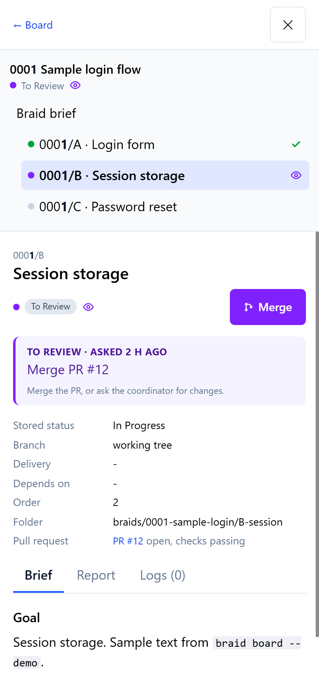

## On Tailscale

`braid board --host <address>` also serves the board on this machine's Tailscale address, so the user can open it on their phone (D60). It is opt-in and never on all networks: the address must be `tailscale` (the IPv4 Tailscale address), one of this machine's Tailscale IPs, or its MagicDNS name, all read from `tailscale status --json` at start (`src/board/tailnet.ts`). `0.0.0.0`, `::`, a LAN or public address, `127.0.0.1` or another name are refused with the reason, and so is a start when Tailscale is down, logged out or has no address, or when this machine is a tagged node (no user owns it): nothing listens then. The `127.0.0.1` board stays as it is, token and all; the Tailscale listener is a second one, on the local port number when it is free there, else on a free port. The local port is random per run, so the phone URL changes with it; `--port <n>` puts both listeners on port `n` (a number from 1 to 65535, nothing is remembered in `.braid/`), and a port in use on either address is refused with a message and nothing keeps listening. `--port` also works without `--host`. The command prints `On Tailscale: http://<MagicDNS name>:<port>/` and the login that may use it. There is no HTTPS: inside the tailnet WireGuard encrypts the traffic, and the browser shows "Not secure".

On the Tailscale listener every request, the page, the board data, the refresh events and the actions alike, is checked in this order:

1. **Who.** braid asks tailscaled `tailscale whois --json <ip>:<port>` of the connection. It is allowed only when the peer's `UserProfile.LoginName` is the login that owns this machine (`User[Self.UserID]` in `tailscale status`) and the peer node has no tags. Another user of a shared tailnet, a shared-in node, a tagged node, an unknown peer, tailscaled stopped or logged out, unreadable output or a whois slower than 3 s: 403. A definite answer (the owner, or not) is kept 5 s per remote address; a timeout, a failure to run or a non-zero exit refuses only that request and isn't kept, so the next request (the page's next poll) asks again. The refresh stream is checked when it opens; it carries only "refresh" and no data.
2. **Host.** `Host` must be this listener's address or MagicDNS name with its port (`pc.tail1234.ts.net:<port>`), which stops DNS rebinding: 403 otherwise.
3. **Actions** also need a matching `Origin` when one is sent (`http://<Host>`) and the `x-braid-request: 1` header that every board page sends. A page on another site can't send that header without a CORS preflight, and the board answers none (`OPTIONS` is 405), so another page open on the phone can't act through the board. The local token isn't used there: the page on Tailscale is another origin and never sees it.

**Remote.** `GET /api/board` carries `remote: true` on this listener and `false` on the local one; the page decides from it, not from its address, whether to offer the server-side Open thread button. A local board opened as `http://localhost:<port>` keeps that button (its actions are still refused for that Host).

Start and Merge work over Tailscale as on the PC. The `open` action is refused (403): it would open T3 on the machine running the board. On a page that came over Tailscale, Open thread is only the thread's `t3code://threads/<env>/<thread>` app link, at every width, opened by the T3 app on the phone; a thread link of another shape shows nothing there. T3's mobile app registers the `t3code` scheme and routes `threads/:environmentId/:threadId` to the thread, so the link opens the thread when the phone's T3 app is connected to this machine's T3 environment.

## Notifications

The running board sends a push to your phone over [ntfy](https://ntfy.sh) only when someone explicitly needs you: an open request addressed to you, a PM forward or escalation, the PM's own request, or a merge into `main` that is yours to make. A lane moving never pushes by itself, and there is no mode setting to choose between pushes. The one exception is a programme whose PM went silent: its stall pushes, since no one else can be asked. Every push opens the thread that needs you, so you don't have to keep watching the board. Set it up once per machine with `braid notify setup` ([the CLI](cli.md)); one topic then covers every project on the machine. There is no daemon: the running board sends (also with `--no-open` or `--host`), and when no board runs nothing is sent; and `braid board` prints `Notifications: on (<server>, topic <first 10 characters>…)` or how to turn them on. `--demo` never sends. Why: D70 and D93 in [decisions](decisions.md).

**What triggers a push** (`src/notify/message.ts`, `src/notify/notifier.ts`), checked after each refresh that read both GitHub and T3 (a source that couldn't be read can make a lane only look changed, so such a refresh sends nothing and changes nothing):

- **One rule** (`forUser` in `src/notify/message.ts`, from the request record: `to`, `by`, `forwarded` and its state through `routeOf`) says whether a need pushes and which thread the push opens. A push is for what an open request asks of you, nothing else (the one exception: a programme's stall, below), and it always opens the thread that needs you:
  - **A request addressed to you** (no `to`, or `to: user`; any kind, a handover too) opens its asking thread: the request's `thread`, else the braid's coordinator. A braid with strands pushes one per strand request, plus its own request or final-PR request.
  - **A request to the PM that reached you** by escalation (timeout or a gone PM thread) opens the asking thread, titled `<repo> <id>: Escalated to you`; one the PM **forwarded** is the PM asking you, not the braid: the push is the PM's (🧭, high, `<repo> <id>: the PM asks`, `The PM asks you: <text>`) and opens the PM's thread (the request's `pm`).
  - **The PM's own request** (`--by pm`, a programme request) and **a programme's stall** (its PM thread gone or silent, no braid running) open the PM's thread: nobody else can be asked.
  - **Nothing else pushes:** a request the PM is handling, a broke alarm (`checks failed`, a braid's `stalled`), an agent's pending question in T3, a story accepted and waiting for its handover with no request, a strand PR in To Review with no request. They stay on the board; the PM pushes "nothing can run until you act" itself (below).
  - **Every push has a click link.** The thread's link is T3's; when T3 doesn't list the thread it is built from the thread id (the environment of any listed thread); when that can't be done the body ends with "Open the board" and the push still goes. That is the only case: a push says "Open the board" only when no thread can be named at all (none recorded and T3 lists none). A programme request opened without `--thread` opens the PM's thread from the plan file's `thread`; a Done push (a braid no programme runs) opens the braid's coordinator thread (0069/F).

  A need is new when its key wasn't sent before: item id, lane, reason (or request kind) and when the request was made or the alarm began (for a Done waiting for its merge, the PR number). The keys sent are kept in `.braid/notified.json` of the main checkout (a temp file, then a rename, like `broke.json`), so a restart sends nothing twice. A key whose need has gone is dropped, so a need that comes back is sent again. On the first run, the needs already on the board are sent once.
- **A request to the PM is not a need of yours** and is never pushed while the PM handles it. An escalation is pushed once, at high priority, titled `<repo> <id>: Escalated to you`, opening the asking thread; a forward once, as the PM's request (above); the key holds the time of the escalation, or of the forward.
- **The merges the PM forwarded to you are one push per PM thread**, not one per merge: titled `<repo>: <n> merges wait for you` (just one: `<repo> <id>: merge PR #<n>`), and per PR, separated by a blank line: `<handle> · <id> <title>`, `PR #<n> at <short head> · blocks <items>`, and `PM: <note>` when the forward had a note; high priority, 👀, opening the PM's thread. Its key holds the set of PRs and their heads and its sequence ID belongs to the PM thread, so a merge joining or leaving, or a moved head, sends it again in place of the old one on the phone, and when none is left it is cleared. It is built per board (per project): one push per project and PM thread, since the snapshot of one project doesn't see another's. A merge waiting for you with no PM keeps its own push (the coordinator's handover).
- **The PM's own request is pushed once, at high priority, tagged 🧭 (`compass`), titled `<repo> <id>: the PM asks` (a programme request: `<repo> <slug>: the PM asks`; the project name replaces the repository's when two listed projects share it, D83) and opening the PM's thread. It has its own key and sequence ID, so the coordinator's push for the same item stays.
- **A programme** pushes its programme request (as above) and its stall: once, at high priority, tagged ⏳, titled `<repo> <slug>: Needs You` and opening the PM's thread (key: `pm/<slug>`, `Waiting`, `stalled` and when the stall began). Done and stopped programmes push nothing.
- **A braid Done** with no PM: a story or goal card that moves into Done while the board runs (key: its number and `done`), unless a programme runs it: its PM handles what follows with its after-merge request, and nothing is pushed for it here. Braids already Done at the first run (no or unreadable `notified.json`) are recorded without a push, so setting up never floods the phone with history. Strands merging send nothing.
- **The PM's own line** with no board item (its digest, "nothing can run until you act"): `braid notify send "<line>" --thread <PM thread id> [--programme <slug>]` sends it at once, without the board and storing nothing. Titled `<repo> pm/<slug>: the PM` (no `--programme`: `<repo>: the PM`), the line as body (cut at 200 characters), 🧭, high, opening the thread (T3's link from `t3 thread show`; T3 doesn't know it: "Open the board"), sequence ID `braid-<repo>-pm-<slug>-send`, so a newer line of a programme replaces the older. Off, not set up or a failed send: it prints why and exits 0. It never prints the topic or the token, and the PM's line carries no repository details.
- **The limits pause** ([The board pauses and resumes](#the-board-pauses-and-resumes)) pushes once per event and provider, never once per braid; the bodies name braids and strands only. Keys start with `pause:<provider>:<window>:<reset>` and end in the event; they stay in `notified.json` for 8 days (the value is when it was sent), and the weekly and failed Needs You aren't pushed again as needs. Paused, every agent answered: `Claude_Everix paused until 13:55` (⏸️, low). Paused, someone didn't answer: `Claude_Everix paused; 1 agent didn’t answer` (⚠️, high). Still pausing after a minute: `Claude_Everix: pausing` (⏸️; none when the pause completes within the minute). Failed: `Claude_Everix: pause failed` (❌, high). Resumed: `Claude_Everix resumed`, or `… resumed (was due 12:40)` when no board ran at the time (▶️). Still over at the resume time: `Claude_Everix still over: resumes 18:55` (⏸️). Weekly window: `Claude_Everix weekly limit: needs you` (⚖️, high). No provider to steer from: `Claude_Everix over, steering from it` (⚠️). The click is the steering thread's app link where the mockups name one.

**What a push contains**, and nothing else from the repository (no brief text, log, diff, branch or path): the title, which depends on what pushes: `<repo> <id>: <lane>` for a request to you (`agento 0044/A: Needs You`; after an escalation `agento 0044/A: Escalated to you`; a handover: `In Review`) or a braid Done (`Done`); `<repo> <id>: the PM asks` for the PM's own or forwarded request; `<repo> <slug>: Needs You` for a programme's stall; `<repo>: <n> merges wait for you` for the PM's merges; `<repo> pm/<slug>: the PM` for `braid notify send`. The body of a request's push is `<handle> · <title>`, then `blocks <items> · decide|do|merge` (the act word alone when nothing waits on it), then the request's line (an escalation's without "Escalated to you:", which the title says; a programme request has no item, so its first line is `<handle> · decide`). A forwarded merge push carries the short head and the PM's note, as above (for Done its title and `PR #n merged`; the PM's line for `send`). The ntfy tag is the request's kind (`question` ❓, `decision` ⚖️, `plan` 📋; a review 👀), 🧭 for the PM, ⏳ for a stall, ✅ for Done; alarms never push, so `checks failed` has none. Priority is high for a request to you, an escalation, a forward, the PM's request, the merges and a stall, and default for a handover to you or a Done, and as its click action the T3 app link (`t3code://threads/<env>/<thread>`, opened by the T3 app on the phone) of the thread the rule above names; a body without a link ends with "Open the board".

**Sending.** One JSON publish per push (`POST <server>` with `topic`, `title`, `message`, `tags`, `priority`, `click` and `sequence_id`, the repository and item: `braid-<repo>-<id>`), so a newer push of an item replaces its older one. When a need is gone (its request answered or closed) the board clears its push by its own sequence ID, with `PUT <server>/<topic>/<sequence id>/clear`, unless a current push carries that same ID (it replaced the old one), best effort and once (Android and the ntfy web app only; a failure is printed, not retried). Both use Node's `fetch` with a 10 s timeout. The board never waits for it: a send runs on its own, a key in flight isn't sent twice, and a key is stored only after its send succeeded. A failed send (no network, an HTTP error, a timeout) is retried at the next refresh and printed once per outage to the board's standard error (`braid notify: a push failed (<server> answered HTTP 403 …); retrying at each refresh`, then `braid notify: sending again`); it names the server, never the topic or the token. The settings are read at each refresh, so `braid notify off` stops the pushes without a restart. Two boards on one repository share `notified.json`: a duplicate push can happen, a lost or broken file can't (each write re-reads it first; an unreadable file starts empty).

**Privacy.** A topic on `ntfy.sh` is public to anyone who knows its name, so setup makes one nobody can guess, and braid shows it in full only in the output of `braid notify setup`; elsewhere it shows the first 10 characters. The pushes carry no more than listed above. For more privacy, run your own ntfy server with access control: `braid notify setup --server https://ntfy.example.com`, and give the board an access token in `BRAID_NTFY_TOKEN` (sent as `Authorization: Bearer`; read only from the environment, never written to a file or printed). `braid notify test` checks the whole path: a plain test push, then a second push with a sequence ID that it clears at once, so you can see the clear work (it leaves the device on Android and the web app).

## Run the board at login

Pushes come only from a running board ([Notifications](#notifications)), and so are a request's escalation and a programme's stall. To have them without keeping a terminal open, start the board when you log in, with `--no-open` (no browser tab) and a fixed `--port` (so a bookmark keeps working). With a [project list](#several-projects) one board covers every project, so it doesn't matter which folder it starts in; without one, start it in your main checkout. Only one board should run per project: stop the one at login before you start another by hand, or two boards may send the same push twice.

The board needs what it needs from a terminal: `braid`, `node`, `git`, `gh` (logged in) and `t3` on `PATH`, and `BRAID_NTFY_TOKEN` in your user environment if your ntfy server needs it. Add `--host tailscale` to also serve it to your phone.

**Windows: `braid board service`.** From your main checkout (or any checkout of a project in your [project list](#several-projects)), as yourself, no administrator needed. First stop a board you started by hand on that port (`Ctrl+C` in its console): it would keep the task's board from listening.

```powershell
braid board service install --port 8765               # add --host tailscale to also serve it to your phone
braid board service status                            # the task, the port, the address, the versions, the log
braid board service restart                           # stop and start it, e.g. after an update
braid board service remove                            # stop it and remove the task
```

`install` registers a Task Scheduler task named `braid board` that runs as you, only while you are logged in (no stored password, D95), and starts it at once. It starts at each logon, and Task Scheduler starts it again every 5 minutes; a running board ignores that (`IgnoreNew`), so a board that crashed or was killed is back within 5 minutes. There is no time limit and no battery rule. The task runs `conhost.exe --headless cmd.exe /d /c braid board --service --no-open --port <n>` in the checkout's main folder: no window opens (also with Windows Terminal as the default terminal), and `braid` is found on `PATH` at each start, so after a reinstall the task starts the new code; it never points into a versioned install folder (Volta's image, an npm cache). `--service` makes the board stop when its headless console goes away, which is what stopping the task does, so `restart`, `remove` and `Stop-ScheduledTask` end the board's `node` as well (no process stays behind) and its address file goes with it. `install` over an installed task stops that one first and replaces it, also on another port.

`status` prints the task's state and last result (a result of 0 says only that the run ended: the task's process is `conhost`, which exits 0 however the board ended, so the address and the log say whether it runs and why it stopped; while the task runs, its last result is the previous run's and is shown as `previous run:`, such as `ended by a logoff or a stop` after you logged off), the port, the folder, the address with its token when the board answers ([The address file](#the-address-file); a file left by a killed run is reported as no board answering), the braid version the running board started from next to this braid's own (a board still on older code after an install says so; `restart` starts the installed one), and the log: `~/.braid/board-<port>.log`, the board's output, replaced at each start, with the token hidden. It exits 1 when no board answers. A board you started by hand on the same port keeps the task's board from listening: `install` then keeps the task installed but doesn't start it, says the port is held, and exits 1; stop that board, then `braid board service restart` (or wait: the task tries again every 5 minutes, and its log says why it couldn't listen). For Start, Merge and Open thread, open the address `braid board --url` prints, or the Tailscale address on the phone.

**Updating.** `scripts/Install-Skills.ps1` ([getting started](getting-started.md)) ends with `braid board service restart --if-installed`, run by the braid it just installed: with a task installed it restarts the board on the same port, on the new code, with a fresh address file, and prints one line (`braid board service: restarted the board on port 8765 (braid <version>); ...`); with none it prints nothing. A restart keeps a running [limits pause](#the-board-pauses-and-resumes): its record is in `.braid/pauses.json` and the new board picks it up.

**After a reboot.** The task needs your logon: the board, and T3 (every Start and Merge goes through the T3 desktop app, which runs only in your session), start when you sign in. To have them back after a reboot with no hands on the PC, turn on automatic sign-in for your account (Sysinternals Autologon, which keeps the password encrypted, or `netplwiz`), and lock the screen at sign-in if others can reach the PC. For the phone before anyone signs in, Tailscale on Windows needs unattended mode, or it disconnects until a login: `tailscale set --unattended=true`.

**Linux: a systemd user service.** Save as `~/.config/systemd/user/braid-board.service`:

```ini
[Unit]
Description=braid board
After=network-online.target

[Service]
WorkingDirectory=%h/code/my-project
# A login shell, so PATH has node, braid, gh and t3 as in your terminal.
ExecStart=/bin/bash -lc 'exec braid board --no-open --port 8765'
# The start lines hold the address with the token: keep them out of the journal (braid board --url gives it).
StandardOutput=null
Restart=on-failure
RestartSec=30

[Install]
WantedBy=default.target
```

Then `systemctl --user daemon-reload` and `systemctl --user enable --now braid-board`. It starts when you log in and stops when your last session ends; `loginctl enable-linger $USER` keeps it running after you log out. `systemctl --user status braid-board` shows it and `journalctl --user -u braid-board` its standard error (any failed push or warning); `StandardOutput=null` keeps the start lines, the tokened address among them, out of the journal, which others in the `adm` or `systemd-journal` group may read. `braid board --url` prints the address for Start, Merge and Open thread; `systemctl --user stop` sends `SIGTERM`, which removes the address file. `BRAID_NTFY_TOKEN` goes in an `Environment=` line, or better an `EnvironmentFile=` only you can read. `systemctl --user disable --now braid-board` removes it from login.

## Demo

`braid board --demo` serves built-in sample braids (`src/board/demo.ts`) with faked GitHub, T3 and requests, so every lane, request kind, alarm and icon shows (0025 to 0027 are paused: waiting for the resume, resume overdue, and stalled after a resume that never came; the programmes `working-product` (asks you), `inbox-sweep` (stalled), `ios-beta` (held) and `launch-v1` (done) run some of them, and `api` has a second `working-product` and a plan that doesn't parse), and enough Done braids (12, set Done on different days) to show Show more. It reads no repository, `gh` or `t3`, and writes nothing (not even the broke clock). It accepts every action with the token and fakes the result (`{ ok: true, demo: true }`), so the action states can be shown. `--demo-t3-down` shows the note for T3 not running, and `--demo-not-ready` the note for a project with problems. The demo serves four sample projects ([Several projects](#several-projects)): `demo` (the sample above, the one the page shows first), `api` (a small project with a question waiting and a PR in review), `mail` (every read fails behind a stored last-good snapshot, so it shows the failed-read marks from the first page load: a dashed card edge, ⚠, the red note in the Projects block and in a card's panel) and `notes` (not ready: still on Backlog.md, with an incomplete `BRAID.md`); `--demo-t3-down` and `--demo-not-ready` change `demo`, and `--project <name>` serves one of them. The screenshots in `docs/design/board-screenshots/` come from it; the mockups the user approved are in `docs/design/board-mockups/` (`needs-you.html`, screens 21 to 28; the all-projects page is `all-projects.html`, screens 41 to 50). The failed-read state is in the built page too: screenshots 81 (all projects, the ⚠ tag and dashed edge), 82 (the Projects block opened, with its red note) and 83 (a card's panel with its red note), taken from `mail`.

## Changing the board

Visible changes start with mockups on the demo data, which the user approves before the build. The PR that changes the board's behaviour or look also updates this page.
