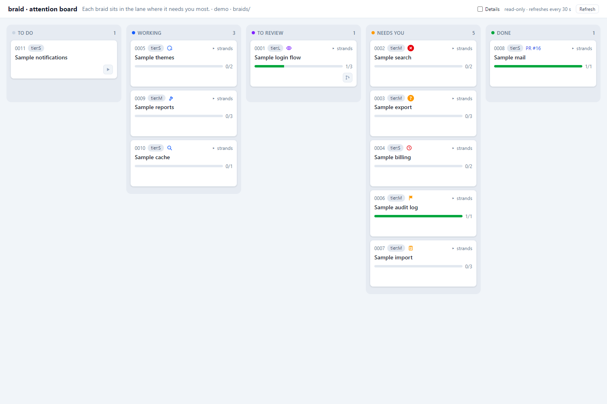
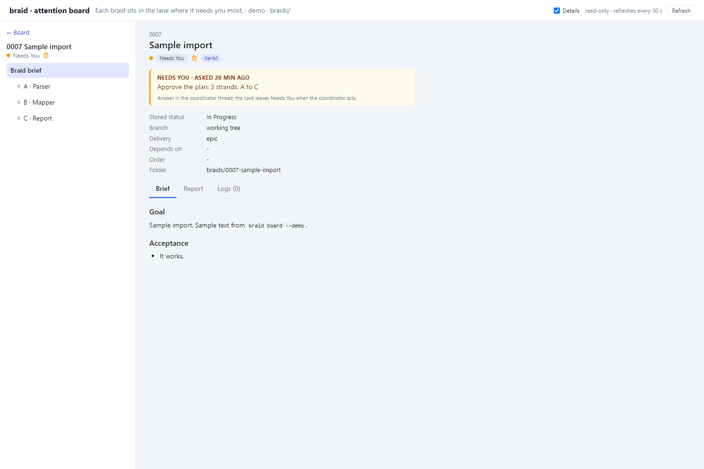
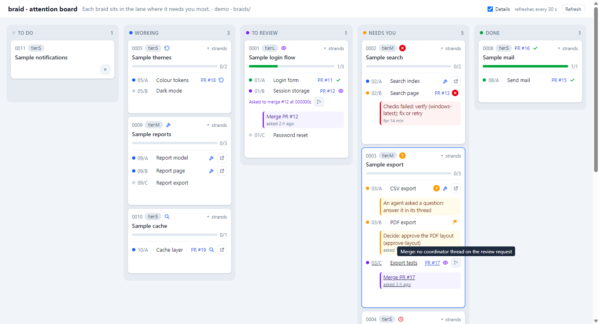

# The attention board

`braid board` serves a local page that shows where the work needs you. It listens on `127.0.0.1` at a free port, prints the address and opens the browser (`--no-open` only prints it). Stop it with Ctrl+C. The files it reads are described in [the braids/ format](braids-format.md); why it is an attention board is decisions D32 and D46 in [decisions](decisions.md).

## Lanes

The lanes say what a braid asks of you, not the braid's own status. An item is on your side of the board in only two ways: someone **asked** you (a request), or something **broke** (detected). Everything else is Working (or To Do, when not started). A braid with strands sits in the lane of its **most urgent** strand or its own request: Needs You, then To Review, then Working, then To Do. A started braid (stored In Progress, or a strand Done) whose strands are all To Do between strands reads Working, not To Do. It is not Done when every strand is: with its final PR open it reads To Review (or Working), and Done only after that PR merges. The card's progress bar counts done strands, so it still shows how far the braid really is.

| Lane | In code | Means | Your action | Colour |
| --- | --- | --- | --- | --- |
| To Do | `To Do` | not started; `Outline` items show here with a badge | none | light grey |
| Working | `In Progress` | agents have it: implementing, CI, review, fix rounds, the coordinator planning or waiting for agents | none | blue |
| To Review | `In Review` | a PR was handed to you: reviewed, green, with a recap | merge, or ask for changes | purple |
| Needs You | `Waiting` | nothing moves until you act; the card says what is needed in one line | answer | amber |
| Done | `Done` | merged | none | green |

The labels live in one place, `LANE_LABEL` in `src/board/marks.ts`. Stored statuses in `brief.md` keep their names (`Outline`, `To Do`, `In Progress`, `Done`). The design is in `braids/0015-needs-you-when-the-coordinator-waits/states.md`.

## How an item's lane is chosen

For each braid and strand, the first rule that matches wins (`derive` in `src/board/model.ts`):

1. **Done:** a merged PR, or stored status `Done` with no open PR. An open PR wins over a stored `Done` (rule 4): `braid accept` stamps a story or a braid's final PR `Done` on its branch before the user's merge (D43). A PR closed without merging never makes Done: a stored `Done` next to one reads as To Do (the state before `Done` isn't known), and the closed PR still shows on the card.
2. **To Review:** an open `review` request (from `braid handover`).
3. **Needs You, with the request's text:** any other open request (`question`, `decision`, `plan`, from `braid ask`), or a running agent's pending question (reason `question`).
4. **To Review, "Merge PR #N":** a stored `Done` next to an open PR, which waits for your merge.
5. **Needs You, broke:** one of two alarms, shown only after its condition has held for 10 minutes (below).
6. **Working:** started, which is stored `In Progress`, an agent of the item running, or an open PR. An open PR without a review request is Working: the agents still have it.
7. **To Do:** the rest (stored `To Do` or `Outline`).

An `ask:<key>` label set when planning doesn't move the lane: it marks a decision expected at review (and keeps auto mode from merging), so the item stays in the lane its other state gives and carries the amber flag. `braid status` prints the label as `ask:<key>` after the lane.

### Requests

A request is a small record kept by `braid handover` and `braid ask` in `.braid/requests.json` of the main checkout (see [the format](braids-format.md#commands)). The board reads it through `src/braids/requests.ts` only (`loadRequests`, the pure `filterLive`, `age`) and never writes it. A review request that GitHub says is void (its PR merged, closed or at another head) doesn't count; a PR GitHub can't be read for keeps its request.

### Broke

Detected, not asked, and shown only after the condition has held for 10 minutes, so it doesn't flicker. The time it was first seen is kept in `.braid/broke.json` of the main checkout, so `braid status`, the board and a restart agree; a condition that stops holding starts again from zero, and one that can't be told (GitHub or T3 unreadable) neither starts nor stops the clock and shows nothing.

- **checks failed:** a PR's checks are red and no agent of the item runs. The line names the failing checks.
- **stalled:** the item is stored `In Progress`, has no open request, no agent running and no checks pending. It also catches a coordinator that stopped for you and forgot to ask: the board then says "stalled: nobody is working and nothing was asked", which is true and visible, instead of a silent Working.

### Agents of an item

Only a thread whose worktree braid created for that item counts: the worker's (`braid start <id>`, `<repo>/<number>-<letter>`, or `<number>` for a story) and the reviewer's (`braid start <id> --review`, a detached checkout of the PR head in `<repo>/<number>-<letter>-review`, or `<number>-review` for a story or a braid whose final PR is open; `braid clean` removes it). In wrap-up (every strand Done, final PR open) the braid's card counts its reviewer threads as its agents (review activity; they hold back `checks failed`), shows the checks spinner while the final PR's checks run, and still never counts the coordinator. Any other thread is no agent of any item, so the coordinator, which works on a braid branch with strands or in the main checkout, can't make a braid Working, can't stand for a strand's agent and can't block `braid accept`. T3 is read for two facts only: whether an agent of the item runs, and a running agent's pending question.

## Where the states come from

- **Files:** each item's `brief.md`, read from its own branch when it has one ([Branches](braids-format.md#branches)).
- **GitHub:** one `gh pr list` per refresh (state, head commit and checks); a PR belongs to the item named by its head branch (`braid/0006-slug` or `braid/0006/A-slug`). Merged and closed PRs are cached (an open one wins over both, a merged one over a closed one).
- **T3:** `t3 thread list --project <main checkout>`, plus `t3 thread show` for each running thread (its worktree and pending questions). A thread belongs to an item by its worktree folder, as above.
- **Requests and broke clock:** `.braid/` of the main checkout.
- Without `gh` or T3 the board still works on the stored states and requests, and its header says why. Without T3 no agent shows and no alarm can be told.

## Icons and lines

A card on your side (Needs You, To Review) carries one line saying what is needed, with its age ("asked 35 min ago", or "for 14 min" for an alarm), and only its most urgent icon. A braid card also says which strand it comes from (or "braid, no strand involved") and how many more strands need you. An expanded card shows the line on each strand row. Exact icon text is on hover (also the `aria-label`).

| Icon | Means | Hover |
| --- | --- | --- |
| amber `?` | a question: a request, or an agent's pending question | Question: waiting for your answer |
| amber flag | a decision request (`--key` = the stop case); on an item with only an `ask:` label, the label's flag | Decision needed: `<key>` / Will need your decision: `<key>` |
| amber clipboard | a plan to approve | Plan approval needed |
| red circle with a cross | checks failed (alarm) | Checks failed: names of the failing checks |
| red clock | stalled (alarm) | Stalled: nobody is working and nothing was asked |
| purple eye | a PR to review | PR #N to review |
| blue wrench | a worker agent is running | agent running |
| blue magnifier | only a reviewer is running | review running |
| blue spinner | only CI is running | checks running |
| green tick | Done | Done |

Red appears only where something went wrong. Green means Done.

### The Details toggle

The "Details" checkbox in the header shows (default) or hides the request lines. Hidden, the text moves into the tooltip of the card's reason icon, with the strand and the age.

The setting is kept in the cookie `details` (`on` or `off`), so it survives a reload and a restart.

### The item page

A braid or strand page shows the request as a banner above the brief, with the same text as the card.

## Refresh

The page updates every 30 s while it is open, 200 ms after a file under `braids/` changes, and by its Refresh button (a fresh read, `?fresh=1`). Updates are pushed over `/api/events`. Each refresh also notes the first sighting of a broke condition in `.braid/broke.json`; that is the only thing the board writes on its own.

## Actions and the session token

The board can also act, but only through `POST /api/action/<name>`, and only for the page this `braid board` run opened. Actions are registered by name in `src/commands/board.ts` (`Sources.action`); the endpoint itself adds none that changes anything. Today there are two, `merge` and `start` (below). A request is refused with 403 unless it carries this run's token in the `x-braid-token` header, its `Host` is `127.0.0.1:<port>` and any `Origin` it sends is `http://127.0.0.1:<port>`. Unknown names give 404, a body that isn't JSON 400, a body over 64 KB 413, and other methods 405 as before.

The token is 24 random bytes, new on every run. The command opens and prints `http://127.0.0.1:<port>/#token=<hex>`: a fragment never goes to a server log or a `Referer`. The page (`web/src/api.ts`) moves it into `sessionStorage`, removes it from the address bar and sends it with `postAction`. It is nowhere else: not in a file, a cookie or a GET URL. A second tab opened without the fragment can't act.

## Open thread and Merge on request

**Open thread.** A card or strand row whose item has a running agent in T3 (a worker's, else a reviewer's) carries a small button that opens that thread (`link` of `t3 thread list`, `thread` in the board data). Where there is no thread there is no button. A braid card carries its running coordinator's thread (see Start) when it has no agent's.

**Merge on request.** The board never merges. A card or strand row in To Review with an open `review` request has a Merge button; it opens a confirmation (PR, head commit, the branch it merges into, each check). On confirm the board posts `merge` with the item and the shown head. The server reads GitHub and the requests again, and refuses with the reason unless the item still has an open review request with a coordinator thread, the PR's head is still the shown one and its checks are green. Then it sends the request's coordinator thread `Merge #<n> at <head>, from the board.` with `t3 thread send`; the coordinator (skill: "Merge on request") merges as for "merge it", and the card leaves To Review when the PR merges. Until then the button is off and says so, per head (kept in `sessionStorage`).

The button is off, and its tooltip reads `Merge: <reason>`, when the item has no open review request, the request has no coordinator thread, the PR isn't open, or its checks failed (the failing names), are still running or are missing. A refused confirmation shows its reason in the dialog.

## Start

**Start** on a To Do braid card launches a **new coordinator thread** in T3 that runs the braid. After a confirmation (what launches, the model, the base branch) the board posts `start` with the braid. The server recomputes the card from fresh reads, refuses with `Start: <reason>` when it is off, and runs `t3 thread start <main checkout> - --title "<repo> <id> coordinator: <title>" --worktree <base> --branch <name> --json` with the first message on standard input: `Use the braid skill and run <id>.` and a sentence saying where the worktree stands. It passes no model flags, so T3 uses the project's default model; the board can't read a thread's effort. The braid skill's coordinator then launches its workers as before; the board binds no worktree itself.

The base and branch name let the coordinator work on the braid's branches. A braid with a braid branch (its brief was read from `braid/<number>-<slug>`) starts from that branch on `coordinator/<number>-<slug>`: Git allows a branch in one worktree only, and the coordinator switches to the braid branch. A braid not planned yet starts from the main branch (`main` of `BRAID.md`) on `plan/<slug>`, where the coordinator plans it.

After the launch the server reads the thread (`t3 thread show <id> --json`); a coordinator thread of a braid (running, titled `<repo> <number> coordinator: …` in `t3 thread list`) also shows on its card, with its open button. The card warns, in the style of the Needs You notes, when the thread's provider or model differ from `BRAID.md`'s `models.coordinator`; the effort can't be read. The board can't read the project's default model before the launch either, so the confirmation names what `BRAID.md` expects, not what T3 will use.

Start is off, and its tooltip reads `Start: <reason>`, when the braid isn't To Do, a coordinator thread for it is running, or T3 isn't reachable (checked in that order). A refused or failed launch shows its reason in the dialog. Starting a single strand and parallel runs are not part of it (0011).

## Demo

`braid board --demo` serves built-in sample braids (`src/board/demo.ts`) with faked GitHub, T3 and requests, so every lane, request kind, alarm and icon shows. It reads no repository, `gh` or `t3`, and writes nothing (not even the broke clock). It accepts every action with the token and fakes the result (`{ ok: true, demo: true }`), so the action states can be shown. `--demo-t3-down` shows the note for T3 not running. The screenshots in `docs/design/board-screenshots/` come from it; the mockups the user approved are in `docs/design/board-mockups/` (`needs-you.html`, screens 21 to 28).

## Changing the board

Visible changes start with mockups on the demo data, which the user approves before the build. The PR that changes the board's behaviour or look also updates this page.
